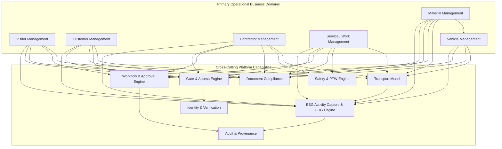
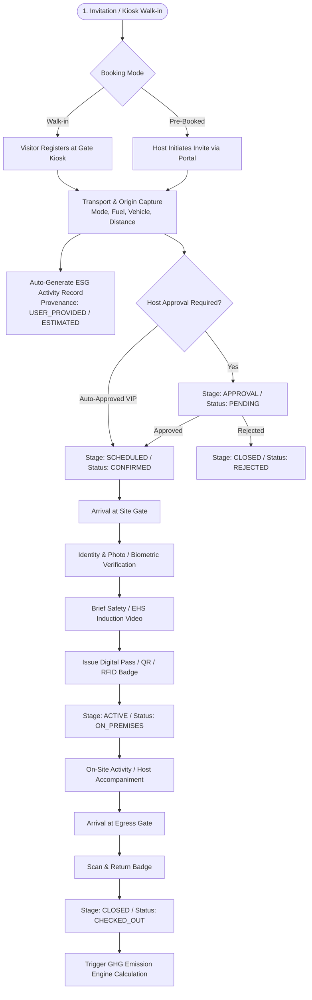
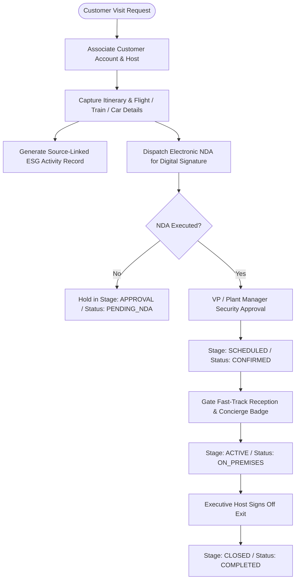
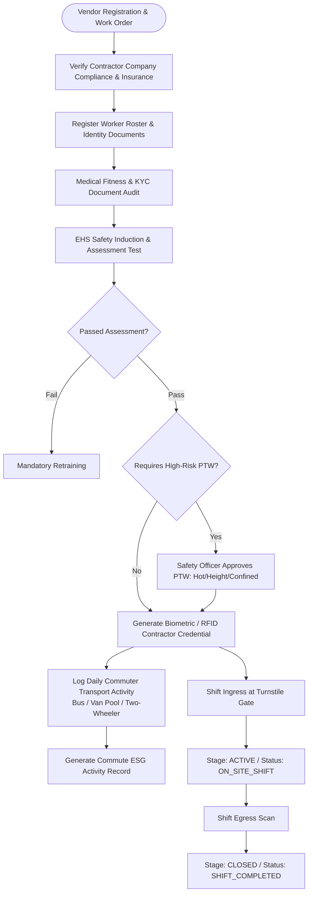
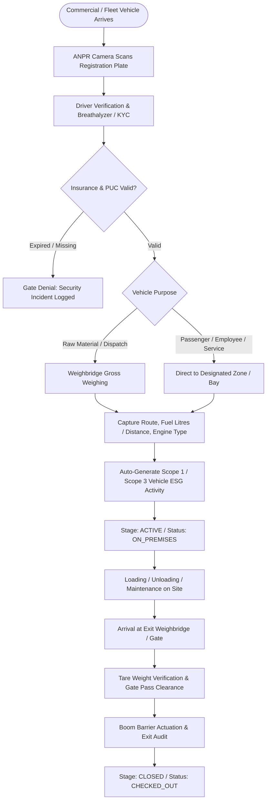
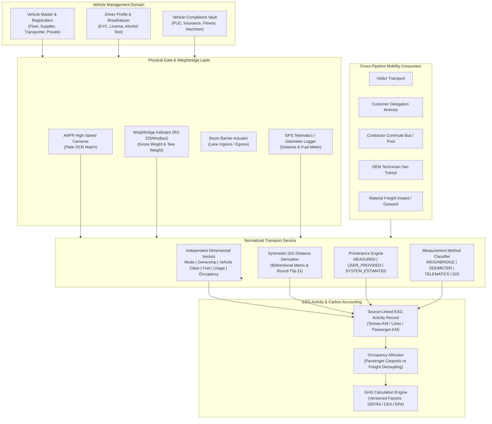

# VMS Enterprise: Domain Architecture Specification

## 1. Architectural Philosophy: The Domain Independence Mandate

A catastrophic antipattern in industrial facility management software is the "Universal Visitor" trap: forcing contractors, OEM technicians, bulk chemical tankers, customer audit delegations, and outbound scrap trucks into a single bloated `Visitor` table or generic workflow.

**VMS Enterprise explicitly rejects this antipattern.**

In VMS Enterprise:
1. **Visitor, Customer, Contractor, Service, Material, and Vehicle are independent, first-class business domains.**
2. Each domain owns its independent:
   - Data entities and relational schemas
   - Business validations and compliance lifecycles
   - Stage/status state machines
   - Authorization rules and role access
   - Operational user interfaces and specialized kiosks
   - Domain-specific events and metrics

---

## 2. Inventory of Top-Level Business Domains

| # | Business Domain | Primary Responsibility | Core Entities Owned |
|---|---|---|---|
| **1** | **Visitor Management** | Transient guests, candidates, business meetings, VIPs, auditors | `Visitor`, `VisitorAppointment`, `VisitorHost`, `VisitorBadge` |
| **2** | **Customer Management** | Client visits, plant tours, commercial audits, technical evaluations | `CustomerAccount`, `CustomerVisit`, `DelegationMember`, `NDACompliance` |
| **3** | **Contractor Management** | Vendor staff, long-term construction, maintenance crews, compliance | `ContractorCompany`, `Contract`, `WorkOrder`, `ContractorWorker`, `SafetyInduction` |
| **4** | **Service / Work Management** | Machinery repair, equipment commissioning, calibration, OEM technicians | `ServiceRequest`, `TechnicianAssignment`, `WorkOrderTask`, `SignOffReport` |
| **5** | **Material Management** | Logistics gate passes, inward consignment, outward dispatch, scrap, spares | `MaterialGatePass`, `MaterialItem`, `Consignment`, `ReturnableTracker` |
| **6** | **Vehicle Management** | Plant fleet, transporter lorries, private cars, tankers, weighbridge passes | `Vehicle`, `Driver`, `TransporterCompany`, `TareGrossWeightLog` |
| **7** | **Transport Management** | Normalized mobility capture across all human and goods movements | `TransportActivity`, `JourneyLeg`, `RouteMaster` |
| **8** | **Gate Management** | Physical ingress/egress points, turnstiles, ANPR, barriers, weighbridges | `Gate`, `Lane`, `BarrierController`, `HardwareTerminal` |
| **9** | **Access Management** | Zone authorization, biometric credentials, RFID badges, pass validation | `AccessPolicy`, `ZoneRule`, `CredentialMapping`, `ActivePass` |
| **10** | **Identity Verification** | Liveness check, government ID inspection, duplicate face deduplication | `IdentityProfile`, `VerificationAttempt`, `BiometricReference` |
| **11** | **Document & Legal Compliance** | NDAs, insurance certificates, licenses, pollution certificates, agreements | `Document`, `DocumentVersion`, `VerificationAudit` |
| **12** | **Safety & Permit Management** | EHS inductions, Permit to Work (PTW: Hot Work, Height, Confined Space) | `PermitToWork`, `HazardChecklist`, `InductionRecord` |
| **13** | **Emergency Management** | Plant alarms, muster station roll calls, headcounts, live zone occupancy | `EmergencyIncident`, `MusterStation`, `HeadcountSnapshot` |
| **14** | **ESG / GHG Activity Intelligence** | Embedded activity capture, carbon factor registry, emission calculation | `ESGActivityRecord`, `EmissionFactor`, `GHGCalculation` |
| **15** | **Analytics & BI** | Historical throughput, contractor overstay trends, Scope 3 summaries | `AggregatedMetric`, `OverstayRecord`, `AuditSummary` |
| **16** | **AI Intelligence** | Natural language operational querying, anomaly detection, predictive volume | `AIQueryLog`, `AnomalyAlert`, `AuditPrediction` |
| **17** | **Administration** | Multi-tenant setup, organization topology, sites, gates, zones, RBAC | `Tenant`, `Organization`, `Site`, `Role`, `User` |
| **18** | **Integration Platform** | SAP/ERP connectors, HRMS sync (Workday/Darwinbox), hardware edge SDKs | `IntegrationEndpoint`, `SyncJob`, `WebhookSubscription` |

---

## 3. High-Level Domain Boundary Diagram



---

## 4. Common Transaction Architecture & Stage vs. Status

To maintain consistent governance across diverse operational pipelines, every business transaction inherits a standardized architectural envelope while maintaining domain-specific fields.

### The Critical Distinction: Stage vs. Status

A frequent bug in enterprise architectures is collapsing operational **Stage** and operational **Status** into a single string. 
- **Stage** represents *where the transaction resides in its business progression*.
- **Status** represents *the health or outcome within that particular stage*.

| Operational Stage (`stage`) | Possible Statuses (`status`) | Description |
|---|---|---|
| `DRAFT` | `DRAFT`, `INCOMPLETE` | User is assembling data; not yet submitted. |
| `APPROVAL` | `PENDING`, `APPROVED`, `REJECTED`, `ESCALATED`, `EXPIRED` | Under workflow evaluation by hosts, safety managers, or security. |
| `SCHEDULED` | `CONFIRMED`, `RESCHEDULED`, `CANCELLED` | Approved and awaiting the scheduled arrival window. |
| `CHECK_IN` | `IN_PROGRESS`, `BLOCKED`, `COMPLETED`, `NO_SHOW` | Arrived at gate; undergoing physical verification and badge issue. |
| `ACTIVE` | `ON_PREMISES`, `IN_RESTRICTED_ZONE`, `OVERSTAY_WARNING` | Subject or asset is physically on-site. |
| `CHECK_OUT` | `IN_PROGRESS`, `COMPLETED`, `HELD_FOR_INSPECTION` | Surrendering badge, verifying returnable material, tare weighing. |
| `CLOSED` | `ARCHIVED`, `CANCELLED`, `REJECTED`, `EXPIRED` | Finalized record, immutable for compliance and auditing. |

### Common Transaction Envelope Model

```typescript
export interface CommonTransactionEnvelope {
  transactionId: string;         // e.g., "VIS-2026-000482", "MAT-2026-019284"
  tenantId: string;              // Tenant boundary
  organizationId: string;        // Operating entity
  siteId: string;                // Physical plant location
  sourceDomain: 'VISITOR' | 'CUSTOMER' | 'CONTRACTOR' | 'SERVICE' | 'MATERIAL' | 'VEHICLE';
  stage: TransactionStage;       // DRAFT, APPROVAL, SCHEDULED, CHECK_IN, ACTIVE, CHECK_OUT, CLOSED
  status: TransactionStatus;     // PENDING, APPROVED, REJECTED, ON_PREMISES, etc.
  createdAt: Date;
  createdBy: string;
  updatedAt: Date;
  updatedBy: string;
  version: number;               // Optimistic concurrency control
  metadata?: Record<string, unknown>; // Domain-extensible JSONB
}
```

---

## 5. Detailed Domain Pipeline Specifications & Workflows

### 5.1 Visitor Pipeline

**Domain Mission:** Orchestrate short-term individual or delegation visits with automated sponsor notification, fast-lane pre-registration, safety induction, and automatic ESG transport tracking.

- **Visitor Categories:**
  - `NEW_VISITOR` - First-time visitor requiring identity verification and full safety induction.
  - `REPEATED_VISITOR` - Recognized visitor with active KYC; expedited check-in.
  - `GROUP_VISITOR` - Delegations, university tours, plant open-days managed under a lead contact.
  - `VIP_VISITOR` - Board members, dignitaries; expedited escort protocol, VIP parking reservation.
  - `AUDITOR` - ISO, ESG, financial or statutory inspectors; requires compliance escort and specific zone access.
  - `CONSULTANT` - Professional advisory staff working on-site under project sponsorship.
  - `GOVERNMENT_OFFICIAL` - Regulatory inspectors (Pollution Board, Labor, Fire); urgent high-priority routing.
  - `INTERVIEW_CANDIDATE` - HR recruitment applicant; scoped solely to HR meeting rooms.
  - `OTHER` - Ad-hoc general visits.
- **Visit Purposes (Master-Driven):**
  - `MEETING`, `AUDIT`, `INSPECTION`, `TRAINING`, `INTERVIEW`, `CONSULTATION`, `SITE_VISIT`, `VENDOR_NEGOTIATION`, `OTHER`.
- **Booking Modes:**
  - `RESERVED` - Pre-registered invitation generated by host employee.
  - `WALK_IN` - Registered at security gate kiosk upon arrival.
  - `RECURRING` - Multi-day pass for long-term project consultants.
  - `GROUP` - Batch registration via CSV upload or group booking link.
  - `EMERGENCY` - Immediate access granted for crisis management / incident response.

#### Visitor Pipeline Flow Diagram



---

### 5.2 Customer Pipeline

**Domain Mission:** High-touch management of commercial clients, potential customers, customer quality auditors, and executive delegations. Emphasizes hospitality, confidentiality (automatic NDA capture), security clearance, and corporate sustainability reporting.

- **Customer Visit Types:**
  - `CUSTOMER_MEETING` - Commercial negotiations, contract reviews.
  - `CUSTOMER_AUDIT` - Rigorous vendor qualification or ISO/IATF quality audits.
  - `CUSTOMER_INSPECTION` - Factory acceptance testing (FAT) for specialized goods.
  - `TECHNICAL_VISIT` - Engineering co-design, prototyping workshop.
  - `PLANT_VISIT` - General showcase of manufacturing automation and capacity.
  - `DELEGATION` - Multi-stakeholder corporate or overseas delegation.
  - `MANAGEMENT_VISIT` - CXO-level bilateral meetings.
- **Domain Specializations:**
  - Executive welcoming workflow (digital signage sync).
  - Mandatory pre-signed Non-Disclosure Agreement (NDA) integration.
  - Conference room & hospitality provisioning coordination.
  - Dedicated host escort assignment.
  - ESG Scope 3 Category 6 (Business Travel / Client Visit) activity logging.

#### Customer Pipeline Flow Diagram



---

### 5.3 Contractor Management Pipeline

**Domain Mission:** Comprehensive governance of external contractors, specialized sub-contractors, and contingent workforces operating within manufacturing facilities. Enforces strict statutory, labor, safety, and training prerequisites prior to site authorization.

- **Contractor Domain Entities:**
  - `ContractorCompany` - Vendor master, labor license, insurance policy, ESI/PF registration.
  - `Contract` & `WorkOrder` - Commercial PO scope, designated execution dates, authorized headcounts.
  - `ContractorWorker` - Individual worker profile, KYC, medical fitness certificate, age proof.
  - `SafetyInduction` - Mandatory safety training, hazard awareness, test score, expiration date.
  - `PermitToWork` (PTW) - Critical link to high-risk work permits (Hot work, height, electrical).
  - `DailyAttendance` - Turnstile-level shift tracking, muster logging, overtime control.

#### Contractor Pipeline Flow Diagram



---

### 5.4 Service / Work Management Pipeline

**Domain Mission:** Direct control over external service engineers, equipment installers, calibrators, and emergency warranty repair teams. Bridges service tickets with physical machine location and safety clearances.

- **Service Pipeline Features:**
  - `ServiceRequest` - Triggered by maintenance breakdowns or scheduled preventative maintenance.
  - `TechnicianProfile` - Competency certificates, OEM authorization letter, calibration tool serials.
  - `ToolInwardDeclaration` - Recording test kits, laptops, calibration rigs entering the site to avoid export customs disputes upon exit.
  - `WorkLocationBinding` - Scoped access strictly to Machine Cell #4 or Boiler Room #2.
  - `ServiceSignOff` - Maintenance Manager sign-off confirming job completion before technician departure.

#### Service Pipeline Flow Diagram

```mermaid
flowchart TD
    S_Req([Breakdown / Service Ticket]) --> S_OEM[Assign Service Vendor & Technicians]
    S_OEM --> S_Transport[Capture Technician Logistics & Tool Transit]
    S_Transport --> S_ESG[Generate Technician Commute ESG Activity]
    S_Transport --> S_ToolPass[Register Inward Tool & Equipment Pass]
    S_ToolPass --> S_PlantApprover[Maintenance Head Approves Access]
    S_PlantApprover --> S_Arrive[Technician Arrival at Security Gate]
    S_Arrive --> S_ToolInspect[Security Inspects Tools vs. Manifest]
    S_ToolInspect --> S_Badge[Issue Service Pass & Lockout/Tagout (LOTO) Key]
    S_Badge --> S_Active[Work Execution at Machine Location]
    S_Active --> S_SignOff[Host Completes Digital Work Sign-Off]
    S_SignOff --> S_ExitCheck[Security Re-verifies Outward Tools]
    S_ExitCheck --> S_GateExit[Egress & Final Closure]
```

---

### 5.5 Material Management Pipeline

**Domain Mission:** Flawless tracking of goods moving into and out of the industrial boundary. Governs tax compliance, delivery challans, returnable tracking, security physical inspections, and supply chain transport emissions.

- **Material Classifications:**
  - `MATERIAL_INWARD` - Raw materials, consumables, office assets arriving on site.
  - `MATERIAL_OUTWARD` - Finished goods, inter-plant transfers, customer dispatches.
  - `RETURNABLE` - Reusable packaging, leased dies, tools sent for servicing, calibration samples. Requires return tracking, deadline SLA alerts, and security reminders.
  - `NON_RETURNABLE` - Consumed materials, permanent sales dispatches, scrap.
  - `SCRAP` - Metal cuttings, waste chemicals, hazardous industrial scrap. Requires environmental permits and weighbridge verification.
  - `SAMPLE` - Lab testing specimens, prototype evaluation parts.
  - `EQUIPMENT` & `TOOL` - Heavy machinery for installation or site work.
  - `EMERGENCY` - Critical replacement spare parts delivered during machine breakdowns.

#### Material Pipeline Flow Diagram

```mermaid
flowchart LR
    M_Req([Material Movement Request]) --> M_Type{Pass Type}
    M_Type -->|Inward| M_InChallan[Inward PO / Invoice / Delivery Challan]
    M_Type -->|Outward| M_OutPass[Outward Gate Pass & Tax Invoice]
    
    M_InChallan --> M_Veh[Link Logistics Transporter & Truck]
    M_OutPass --> M_Veh
    
    M_Veh --> M_TranspLog[Capture Route, Fuel, Payload, Transporter]
    M_TranspLog --> M_ESG[Generate Scope 3 Cat 4/9 Transport ESG Activity]
    
    M_TranspLog --> M_GateArrive[Truck Arrives at Logistics Gate]
    M_GateArrive --> M_WeighGross[Weighbridge: Gross Weight Captured]
    M_WeighGross --> M_Unload[Unload / Inspection by Stores Dept]
    M_Unload --> M_WeighTare[Weighbridge: Tare Weight Captured\nNet Material Calculated]
    
    M_WeighTare --> M_RetCheck{Returnable Material?}
    M_RetCheck -->|Yes| M_ReturnTracker[Open Returnable Tracker & Escrow SLA]
    M_RetCheck -->|No| M_ClosePass[Finalize Inward/Outward Pass]
    M_ReturnTracker --> M_ClosePass
    M_ClosePass --> M_TruckExit[Security Validates Challan & Clears Exit Barrier]
```



---

### 5.6 Vehicle Management Pipeline

**Domain Mission:** Governance of all rolling stock entering plant premises, including internal forklifts, company pool cars, commercial logistics lorries, and visitor private vehicles.

- **Vehicle Governance Attributes:**
  - Vehicle Registration, Class, Fuel Type, Engine Emission Standard (Euro 6 / BS-VI / Electric).
  - Mandatory Document Checks: Insurance Policy, Pollution Certificate (PUC), Fitness Certificate, Hazardous Chemical Transport License.
  - Driver Licensing & Alcohol / Breathalyzer test verification at gate.
  - Weight discrepancy alert (Weighbridge Gross - Tare vs. Declared PO weight).
  - Direct integration with Normalized Transport and ESG Activity engines.

#### Vehicle Pipeline Flow Diagram



---

### 5.7 Vehicle & Transport Integrated Architecture Diagram (Diagram 9)

The Vehicle and Transport domains provide a normalized mobility and freight foundation across all enterprise physical movements:



---

## 6. Domain Lifecycle Matrices

Each domain features customized lifecycle progressions. The platform avoids forcing heterogeneous domains into an artificial identical workflow.

| Stage | Visitor | Customer | Contractor | Service | Material | Vehicle |
|---|---|---|---|---|---|---|
| **DRAFT** | Invitation Draft / Walk-in | Visit Request Form | Vendor Profile / PO Allocation | Breakdown Ticket / OEM Request | Challan Draft / Pass Request | Trip Log Draft |
| **APPROVAL** | Host Sponsor Approval | VP / Director Approval + NDA | Safety Officer + EHS Audit + PTW | Maintenance Head Approval | Store Keeper + Commercial Clearance | Security Fleet Officer Verification |
| **SCHEDULED** | Calendar Invite Sent | Delegation Protocol Configured | Worker Roster Scheduled | Tech Arrival Window Booked | Inward Dock Slot Booked | ANPR Whitelist Queued |
| **CHECK_IN** | Kiosk Photo & EHS Video | Executive Concierge Welcome | Shift Turnstile Biometric Scan | Tool Inspection & LOTO Key Issue | Logistics Weighbridge Gross Weight | ANPR Match + Driver Breathalyzer |
| **ACTIVE** | Badge Active (Escorted) | On Premises in VIP Area | Shift Active on Shopfloor | Technician Servicing Machinery | Unloading at Warehouse Bay | Parked in Designated Commercial Bay |
| **CHECK_OUT** | Badge Surrendered | Executive Sign-off | Shift Turnstile Egress Scan | Work Sign-off & Tool Re-inspection | Tare Weight Logged & Gate Pass Signed | Exit Weighbridge + Security Clearance |
| **CLOSED** | Visit Archived | Visit Report & ESG Logged | Shift Logged to Attendance ERP | Ticket Closed & ESG Logged | ERP Movement Recorded & ESG Logged | Fleet Log Archived & ESG Logged |

