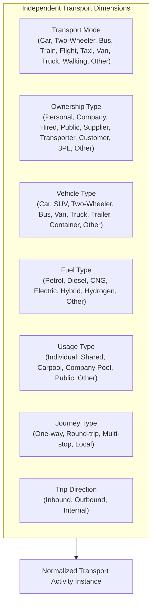
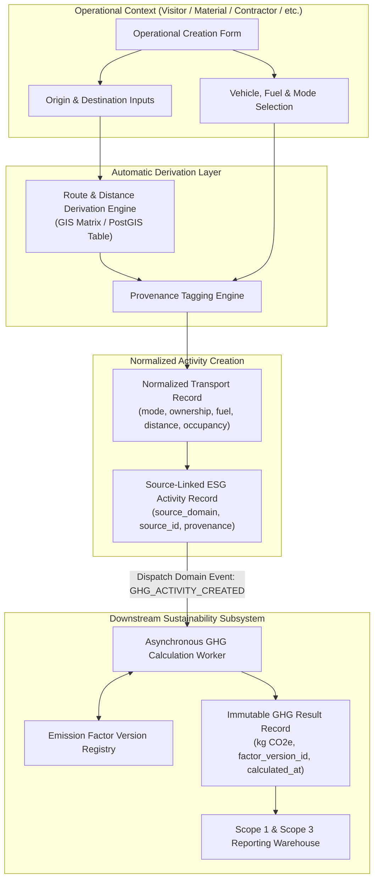

# VMS Enterprise: ESG Activity Intelligence Architecture

## 1. Architectural Mandate: Operational Cross-Cutting Capture

In conventional enterprise software, sustainability data collection is relegated to an isolated survey or manual spreadsheet retrospective at the end of a fiscal quarter. 

**VMS Enterprise mandates a radically different, production-grade approach:**
> **ESG / GHG activity capture is a CROSS-CUTTING operational capability embedded directly into every transactional business workflow.**

When an end-user creates a Visitor transaction, Customer visit, Contractor activity, Service visit, Material transport transaction, or Vehicle movement, the platform automatically determines whether ESG/GHG activity data is applicable and captures normalized activity data **at the point of origin**.

### The Anti-Re-entry Invariant:
**Users must NEVER be forced to re-enter logistics, transport, or fuel data into a separate ESG dashboard.** Operational execution automatically seeds sustainability accounting.

---

## 2. Activity Capture Component Architecture

The **Activity Capture Component** is a polymorphic, cross-domain reusable UI and service component embedded directly inside operational forms:

```
[ Visitor Form ]      [ Customer Form ]    [ Contractor Form ]
       │                      │                     │
       └──────────────────────┼─────────────────────┘
                              │
                    ┌─────────▼─────────┐
                    │  Activity Capture │
                    │     Component     │
                    └─────────┬─────────┘
                              │
       ┌──────────────────────┼─────────────────────┐
       │                      │                     │
[ Service Form ]      [ Material Form ]     [ Vehicle Form ]
```

### Dynamic Field Resolution Matrix:
The component dynamically renders only fields relevant to the current operational domain:

| Domain Form | Rendered Fields | Auto-Derivations | Default Scope |
|---|---|---|---|
| **Visitor Form** | Mode, Ownership, Vehicle Type, Fuel, Occupancy, Origin, Distance, Trip Direction | Distance derived from Origin -> Site geocoding | Scope 3 Cat 7 / Cat 6 |
| **Customer Form** | Mode, Flight/Train/Car, Class of Travel, Origin, Hotel Nights, Distance | Airport-to-Airport distance matrix calculation | Scope 3 Cat 6 |
| **Contractor Form** | Worker Commute Mode (Bus/Van/Bike), Transit Distance, Days on Site | Transit route optimization from vendor base | Scope 3 Cat 7 |
| **Service Form** | Service Van/Tool Transit Mode, Distance, Technician Count, Origin Depot | Route estimation from OEM service center | Scope 3 Cat 1 / Cat 6 |
| **Material Form** | Transporter Class, Fuel, Gross/Tare Payload (kg), Origin Hub, Route Distance | Weighbridge Gross - Tare net payload | Scope 3 Cat 4 / Cat 9 |
| **Vehicle Form** | Fuel Type, Odometer (km), Fuel Added (L), Engine Standard, Load % | Telematics / Fuel dispenser meter integration | Scope 1 / Scope 3 |

---

## 3. Normalized Transport Model (Independent Dimensional Vectors)

VMS Enterprise strictly prohibits monolithic, hard-coded transport strings like `"Own Car"` or `"Company Diesel Bus"`. Such anti-patterns make multi-dimensional carbon accounting impossible and require schema migrations whenever a new mobility variant emerges.

Instead, transport is decomposed into **independent dimensional vectors**:



### Transport Dimension Enums:

```typescript
export type TransportMode = 
  | 'CAR' | 'TWO_WHEELER' | 'BUS' | 'TRAIN' | 'FLIGHT' 
  | 'TAXI_CAB' | 'AUTO_RICKSHAW' | 'VAN' | 'TRUCK' | 'WALKING' | 'OTHER';

export type OwnershipType = 
  | 'PERSONAL' | 'COMPANY' | 'HIRED' | 'PUBLIC' 
  | 'SUPPLIER' | 'TRANSPORTER' | 'CUSTOMER' | 'THIRD_PARTY_LOGISTICS' | 'OTHER';

export type VehicleClass = 
  | 'HATCHBACK' | 'SEDAN' | 'SUV' | 'TWO_WHEELER' | 'MINI_BUS' 
  | 'COACH_BUS' | 'LIGHT_COMMERCIAL_VAN' | 'MEDIUM_DUTY_TRUCK' 
  | 'HEAVY_DUTY_TRUCK' | 'TRAILER' | 'CONTAINER_CARRIER' | 'OTHER';

export type FuelType = 
  | 'PETROL' | 'DIESEL' | 'CNG' | 'ELECTRIC' 
  | 'HYBRID_PETROL' | 'HYBRID_DIESEL' | 'HYDROGEN' | 'OTHER';

export type UsageType = 
  | 'INDIVIDUAL' | 'SHARED' | 'CARPOOL' | 'COMPANY_POOL' | 'PUBLIC_COMMUTE' | 'OTHER';

export type JourneyType = 
  | 'ONE_WAY' | 'ROUND_TRIP' | 'MULTI_STOP' | 'LOCAL_CAMPUS';

export type TripDirection = 
  | 'INBOUND' | 'OUTBOUND' | 'INTERNAL_TRANSFER';

export type MeasurementMethod = 
  | 'ODOMETER' 
  | 'TELEMATICS_GPS' 
  | 'GIS_ROUTING' 
  | 'WEIGHBRIDGE_SCALE' 
  | 'DECLARED_MANIFEST' 
  | 'ESTIMATED_TABLE';
```

---

## 4. Automatic Data Derivation & Data Provenance

Where users provide high-level inputs, the platform automatically derives granular data while **strictly preserving provenance**:

### The Derivation Workflow:
1. Visitor types: `Origin: Bengaluru, Karnataka` (Host Site: `Chennai Plant, Tamil Nadu`).
2. System GIS Engine detects route symmetrically (bidirectional match across Bengaluru <-> Chennai Plant): calculates one-way `Distance: 348 km`.
3. If user specifies `JourneyType: ROUND_TRIP`, system automatically doubles estimated distance to `696 km`.
4. UI presents:
   ```
   Estimated Distance: 348 km [System Estimated via GIS Routing]
   [ Confirm ]   [ Edit Manually ]
   ```
5. If confirmed: Record stores `distance: 348`, `distance_provenance: SYSTEM_ESTIMATED`, `measurement_method: GIS_ROUTING`.
6. If edited to 365 km: Record stores `distance: 365`, `distance_provenance: USER_PROVIDED`, `measurement_method: DECLARED_MANIFEST`.

### Provenance Tracking Invariant:
**The platform must NEVER silently pretend an estimated value was physically measured.**

```typescript
export type DataProvenance = 
  | 'MEASURED'           // Verified via weighbridge, odometer, or telematics
  | 'USER_PROVIDED'      // Explicitly typed by the human registrant
  | 'SYSTEM_ESTIMATED'   // Derived via GIS distance matrix or routing engine
  | 'SYSTEM_CALCULATED'  // Derived via formula (e.g., Gross - Tare weight, Campus 0km)
  | 'IMPORTED';          // Ingested via external batch ERP / EDI sync
```

---

## 5. End-to-End Activity Capture Architecture Diagram



---

## 6. Zero Orphan Guarantee: End-to-End Traceability

Every ESG activity record maintains an unbroken cryptographic lineage back to its source operational transaction:

```
GHG Executive Dashboard
   │ (Click Scope 3 Category 7)
   ▼
Emission Metric (e.g., 84.2 kg CO2e)
   │ (Trace Calculation)
   ▼
GHG Calculation Record (ghg_calc_id: CALC-2026-99182)
   │ (Used Factor: UK-DEFRA-2026-V1.2 @ 0.1712 kg/km)
   ▼
ESG Activity Record (esg_act_id: ESG-2026-008129)
   │ (source_domain: VISITOR, source_id: VIS-2026-000482)
   ▼
Transport Activity (trans_id: TRN-2026-000482)
   │ (Distance: 492 km, Fuel: Diesel, Mode: Car, Occupancy: 2)
   ▼
Visitor Transaction (VIS-2026-000482)
   │ (Subject: Dr. Aris Thorne, Auditor from Geneva)
   ▼
Visitor Host & Meeting Record (Host: VP Quality Assurance)
```

No orphan records are permitted unless explicitly categorized as `imported_historical_activity` with audit authorization.
