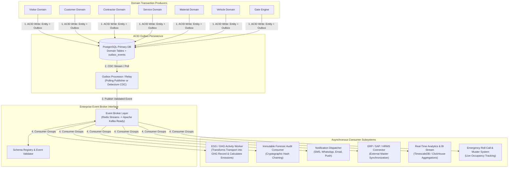

# VMS Enterprise: Event-Driven Architecture Specification

## 1. Architectural Philosophy: Decoupled Reactive Streams

VMS Enterprise employs an **Event-Driven Architecture (EDA)** across all business domains and platform services. 

### Core Principles:
1. **Asynchronous Decoupling:** Core transactional operations (e.g., approving a visitor, checking in a contractor at a turnstile) must execute without synchronous dependencies on analytics, ESG calculations, push notifications, or external ERP synchronization.
2. **Transactional Outbox Pattern:** High-reliability state mutations write the operational entity state and an outbox event within the **same ACID transaction** to eliminate dual-write hazards.
3. **Idempotent Consumers:** Every event consumer enforces idempotency using unique `event_id` deduplication caches.
4. **Enterprise Event Bus Compatibility:** The event layer provides an abstract interface that functions on **Redis Streams** for lightweight single-node or clustered deployments, and effortlessly scales to **Apache Kafka / Redpanda** for enterprise-wide event distribution without modifying domain business logic.

---

## 2. Event Architecture Diagram



---

## 3. Standardized Event Envelope Specification

All events dispatched across VMS Enterprise adhere to the CloudEvents 1.0 compliant envelope:

```typescript
export interface DomainEventEnvelope<T = unknown> {
  eventId: string;              // UUIDv4 (Unique for idempotency)
  eventType: string;            // e.g., "vms.visitor.created.v1"
  eventSource: string;          // e.g., "vms:service:visitor"
  eventTimestamp: string;       // ISO 8601 UTC
  tenantId: string;             // Tenant isolation
  organizationId: string;       // Operating organization
  siteId: string;               // Site location
  correlationId: string;        // Distributed trace correlation
  causationId?: string;         // Preceding event ID
  version: string;              // Schema version "1.0"
  data: T;                      // Domain-specific payload
  metadata: {
    actorId: string;            // User or System Actor
    actorRole: string;          // Role during action
    clientIp?: string;
    userAgent?: string;
  };
}
```

---

## 4. Comprehensive Event Catalogue

### 4.1 Visitor & Customer Lifecycle Events
| Event Type | Producer | Trigger Point | Downstream Consumers |
|---|---|---|---|
| `VISITOR_CREATED` | Visitor Domain | Host registers an invite or visitor completes pre-reg | Notification Hub, Audit Service |
| `VISITOR_UPDATED` | Visitor Domain | Contact details, purpose, or host changed | Audit Service |
| `APPOINTMENT_CREATED`| Visitor/Customer | Scheduled arrival window confirmed | Calendar Sync, Notification Hub |
| `VISITOR_APPROVED` | Workflow Engine | Host or Security approves visitor | Access Service, Notification Hub |
| `VISITOR_REJECTED` | Workflow Engine | Approver rejects visit request | Notification Hub, Audit Service |
| `CHECKIN_COMPLETED` | Gate Engine | Visitor scans QR and passes turnstile | Muster Engine, Analytics, Host Alert |
| `CHECKOUT_COMPLETED`| Gate Engine | Visitor exits and badge is surrendered | GHG Engine, Analytics, Audit |
| `OVERSTAY_DETECTED` | Monitoring Worker| Active on site past approved time window | Security Guard Alert, Incident Log |

### 4.2 Identity & Document Compliance Events
| Event Type | Producer | Trigger Point | Downstream Consumers |
|---|---|---|---|
| `IDENTITY_VERIFIED` | Identity Service | Government ID / OCR matching completed | Document Service, Gate Engine |
| `FACE_VERIFIED` | Hardware / Edge | Kiosk or turnstile liveness matching passes | Gate Actuation, Audit Service |
| `DOCUMENT_VERIFIED` | Document Service | NDA or insurance verified valid | Workflow Engine, Access Service |
| `DOCUMENT_EXPIRED` | Document Service | Daily cron flags expiring vendor license | Contractor Domain, Notification Hub |

### 4.3 Contractor & Service Lifecycle Events
| Event Type | Producer | Trigger Point | Downstream Consumers |
|---|---|---|---|
| `CONTRACTOR_REGISTERED`| Contractor Domain| New vendor profile onboarded | Compliance Audit, Document Service |
| `WORKER_VERIFIED` | Contractor Domain| Individual worker KYC & medical cleared | Access Credential Engine |
| `TRAINING_COMPLETED`| Safety Domain | EHS safety induction assessment passed | Gate Authorization, Access Service |
| `PERMIT_APPROVED` | Safety Domain | Hot work / Height PTW authorized | Gate Engine, Zone Access Controller |
| `SERVICE_COMPLETED`| Service Domain | Maintenance manager signs off repair | Material Gate Pass, Work Order ERP |

### 4.4 Material & Vehicle Logistics Events
| Event Type | Producer | Trigger Point | Downstream Consumers |
|---|---|---|---|
| `MATERIAL_REGISTERED`| Material Domain| Inward or outward gate pass created | Store Dept, Transporter Alert |
| `MATERIAL_APPROVED` | Workflow Engine | Commercial & tax clearance authorized | Logistics Gate Engine |
| `GATE_PASS_CREATED` | Material Domain| Barcode/QR pass generated for truck | Logistics Gate, ANPR Whitelist |
| `VEHICLE_REGISTERED`| Vehicle Domain | Transporter truck profile entered | Transport Normalizer, ESG Engine |
| `VEHICLE_VERIFIED` | Gate Engine | Weighbridge gross/tare weighed & PUC ok| Access Barrier, Material Domain |

### 4.5 ESG & GHG Activity Events
| Event Type | Producer | Trigger Point | Downstream Consumers |
|---|---|---|---|
| `TRANSPORT_ACTIVITY_CREATED` | Any Domain Form | Origin, destination, fuel, distance entered | ESG Activity Service |
| `GHG_ACTIVITY_CREATED` | ESG Activity Svc | Normalized activity record linked to source | GHG Calculation Engine |
| `GHG_CALCULATED` | GHG Engine | CO2e calculated with versioned factor | Sustainability Analytics, ESG BI |
| `EMISSION_FACTOR_UPDATED` | Factor Registry| New factor version published | Retroactive Recalculation Worker |

### 4.6 Safety, Incident & Emergency Events
| Event Type | Producer | Trigger Point | Downstream Consumers |
|---|---|---|---|
| `EMERGENCY_DECLARED`| Emergency Module| Fire alarm trip or manual siren trigger | Gate Turnstile Release, Security Alert |
| `MUSTER_STARTED` | Muster Engine | Roll-call initialized at assembly zones | Real-Time Headcount Monitor |
| `MUSTER_COMPLETED` | Muster Engine | 100% headcount accounted for | Emergency Management Incident Log |

---

## 5. Event Reliability & Ordering Guarantees

1. **Partitioning Key Strategy:** Events are partitioned by `tenant_id:site_id:entity_id` ensuring sequential ordering for any individual visitor pass, material pass, or contractor worker.
2. **At-Least-Once Delivery:** The event broker guarantees delivery; consumer handlers enforce idempotency by inserting `event_id` into a Redis distributed set or SQL deduplication table before executing side-effects.
3. **Dead Letter Queue (DLQ):** Unprocessable messages are directed to a tenant-specific DLQ after 3 failed retries with exponential backoff for manual replay and alerting.
