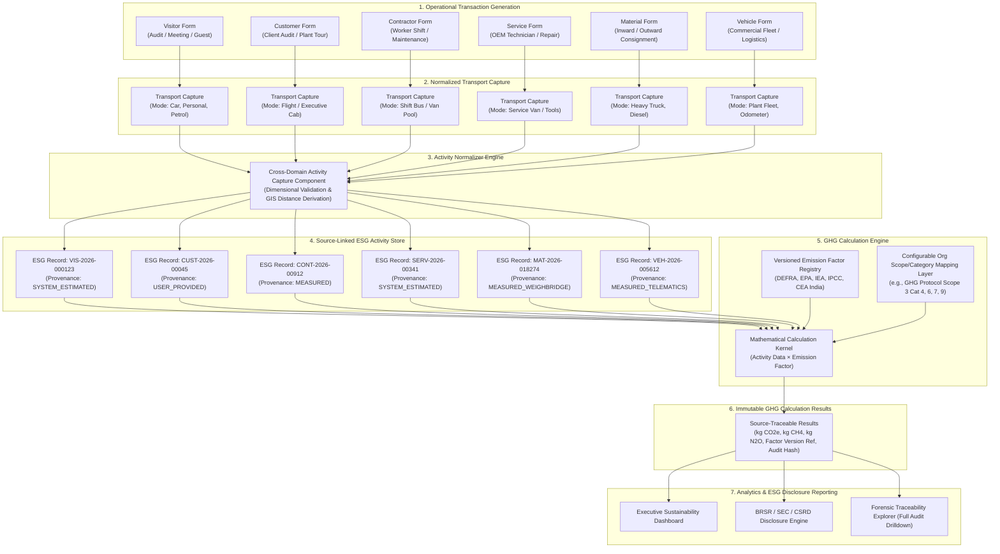

# VMS Enterprise: Greenhouse Gas (GHG) Engine Architecture

## 1. Architectural Mandate: Calculation Decoupling

In VMS Enterprise, **under no circumstance are GHG emission values calculated inside the user interface or frontend applications.**

### The Separation Invariant:
```
OPERATIONAL FRONTEND:
Captures raw operational activity (Distance km, Fuel litres, Payload tonnes, Occupancy count)
       │
       ▼
NORMALIZED ACTIVITY REPOSITORY:
Persists immutable, source-linked operational records with complete provenance
       │
       ▼
GHG CALCULATION ENGINE (BACKEND ASYNC):
Resolves active emission factors, applies organizational scope mappings, computes CO2e
       │
       ▼
SUSTAINABILITY ANALYTICS & ESG LEDGER:
Aggregates Scope 1, Scope 2, Scope 3 reporting streams
```

Calculating emissions in the UI is an enterprise antipattern that causes:
- Inability to update emission factors retrospectively or version them cleanly.
- Drift between web, mobile, kiosk, and API imports.
- Failure of regulatory assurance and external financial-grade audits.

---

## 2. Critical Cross-Pipeline ESG/GHG Architecture Diagram

As mandated by platform principles, the architecture must visually communicate that ESG/GHG intelligence is continuously generated from daily operational transactions across all six core pipelines:



---

## 3. Emission Factor Versioning & Immutability

Emission factors fluctuate annually as national electricity grids, fuel blends, and international carbon accounting methodologies (IPCC, DEFRA, US EPA, CEA) evolve.

### Core Governance Rules:
1. **Never Overwrite Historical Factors:** When DEFRA publishes its 2027 factor database, the 2026 factor records remain untouched. A new factor row with an incremented version is inserted.
2. **Reproducible Historical Calculations:** If an auditor reviews a fiscal 2025 Scope 3 filing in 2028, re-running or verifying the calculation produces the exact original result down to the last decimal gram of CO2e.
3. **Temporal Validity:** Each factor version declares `valid_from` and `valid_to` timestamps. Calculations strictly bind to the factor active on the transaction's occurrence date.

### Emission Factor Relational Model:

```typescript
export interface EmissionFactor {
  factorId: string;              // e.g., "EF-DEFRA-ROAD-DIESEL-CAR"
  version: string;               // e.g., "2026.1"
  source: string;                // e.g., "UK DEFRA / BEIS", "US EPA", "CEA India"
  factorValue: number;           // Numeric multiplier (e.g., 0.17082)
  unit: string;                  // e.g., "kgCO2e/km", "kgCO2e/litre", "kgCO2e/tonne-km"
  geography: string;             // ISO-3166 code or "GLOBAL", "IN", "US", "EU"
  year: number;                  // Reporting year, e.g., 2026
  methodology: string;           // "GHG_PROTOCOL", "ISO_14064", "DEFRA"
  validFrom: string;             // ISO 8601 UTC
  validTo: string | null;        // ISO 8601 UTC (null if current)
  gasScope: 'CO2e' | 'CO2' | 'CH4' | 'N2O';
  evidenceDocUrl?: string;       // Link to official publication or government gazette
  status: 'ACTIVE' | 'SUPERSEDED' | 'DRAFT' | 'REVOKED';
  tenantId?: string;             // Optional custom enterprise override factor
}
```

---

## 4. Configurable Organizational Scope / Category Mapping

VMS Enterprise never hard-codes `"Visitor = Scope 3 Category 7"`. Different organizations follow differing corporate carbon accounting boundaries (Operational Control vs. Financial Control):

- In one conglomerate, visitor travel is classified as **Scope 3 Category 7 (Employee Commuting and Visitor Commuting)**.
- In another corporate structure, client visits are accounted under **Scope 3 Category 6 (Business Travel)**.
- In a manufacturing vendor contract, material logistics is booked under **Scope 3 Category 4 (Upstream Transportation)** or **Scope 3 Category 9 (Downstream Transportation)** depending on whether freight was FOB Origin or Delivered Duty Paid.

### Configurable Mapping Layer:

```typescript
export interface ScopeMappingRule {
  ruleId: string;
  tenantId?: string;            // Optional: tenant-specific override, undefined = global baseline
  sourceDomain: SourceDomain;
  ownership?: OwnershipType;
  tripDirection?: TripDirection;
  activityType?: ESGActivityType;
  scope: GHGScope;               // 'SCOPE_1' | 'SCOPE_2' | 'SCOPE_3'
  category: string;             // e.g., "CAT_4_UPSTREAM_TRANSPORTATION"
  subcategory: string;          // e.g., "SUPPLY_CHAIN_INBOUND_FREIGHT"
  methodology: string;          // e.g., "GLEC_FRAMEWORK_V3", "GHG_PROTOCOL_SCOPE_3_STANDARD"
  priority: number;             // Priority evaluation (higher = evaluated first)
  isActive: boolean;
}
```

---

## 5. Calculation Formulae, Passenger vs. Freight Invariant & Canonical Hashing

### The Mathematical Standard:
1. **Passenger Mobility (Visitor, Customer, Contractor Commute):**
   $$\text{Emissions } (\text{kg CO}_2\text{e}) = \frac{\text{Activity Quantity (km)} \times \text{Factor Multiplier}}{\max(1, \text{Passenger Occupancy})}$$
2. **Commercial Freight Logistics (Material Consignments, Heavy Trucks):**
   $$\text{Emissions } (\text{kg CO}_2\text{e}) = \text{Activity Quantity (km or tonne-km)} \times \text{Factor Multiplier}$$
   *Critical Rule:* Cab occupancy (e.g., driver + co-driver) does **NEVER** divide commercial freight emissions.
3. **Active Zero-Emission Mobility (Walking, Cycling):**
   $$\text{Emissions } (\text{kg CO}_2\text{e}) = 0.0000 \times \text{Distance} = 0.0000 \text{ kg CO}_2\text{e}$$

### Tamper-Proof Canonical Hashing (RFC 8785):
To ensure regulatory compliance and forensic auditability under CSRD/SEC/BRSR frameworks, calculations generate a SHA-256 hash across the RFC 8785 canonical sorted representation of all inputs, factor bindings, and scopes:

```typescript
export interface GHGCalculationResult {
  calculationId: string;
  tenantId: string;
  esgActivityId: string;
  factorId: string;
  factorVersion: string;
  ghgScope: GHGScope;
  ghgCategory: string;
  subcategory: string;
  methodology: string;
  factorValueUsed: number;
  activityQuantity: number;
  emissionsKgCO2e: number;
  calculationHash: string; // SHA-256 digest over canonical JSON
  calculatedAt: Date;
  status: 'FINAL' | 'NEEDS_RECALCULATION' | 'HISTORICAL_ARCHIVED';
}
```
