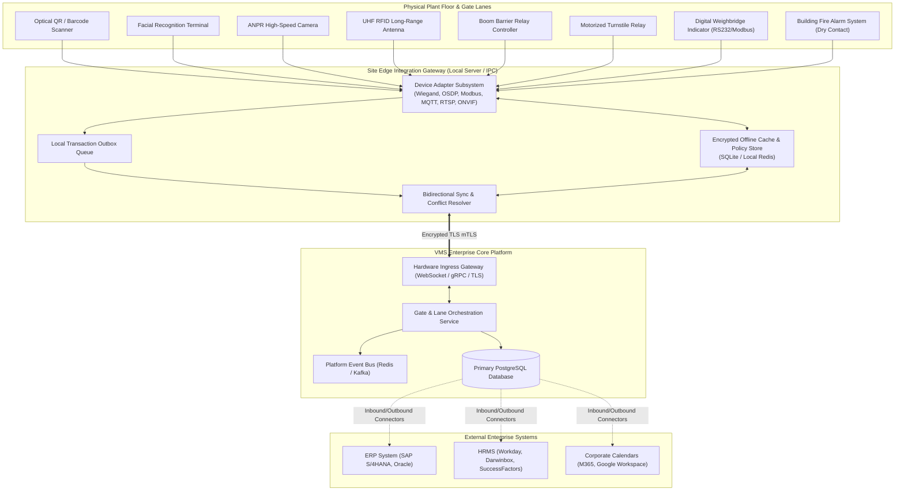

# VMS Enterprise: Integration & Hardware Edge Architecture

## 1. Architectural Philosophy: The Hardware Boundary Invariant

Industrial facilities feature dozens of disparate edge devices: biometric turnstiles, optical QR readers, ANPR cameras, weighbridges, long-range UHF RFID antennas, boom barriers, and fire alarm panels.

### The Hardware Isolation Invariant:
> **Under no circumstance do physical hardware devices connect directly or write SQL queries into the core VMS Enterprise database.**

Direct database coupling creates severe security vulnerabilities, crashes during network jitter, creates unmanageable connection pool exhaustion, and locks the organization into proprietary hardware protocols.

All hardware communications are mediated through the **Site Edge Integration Gateway** via standardized vendor-agnostic adapter interfaces.

---

## 2. Integration Architecture Diagram



---

## 3. Supported Hardware Device Adapters & Protocols

The Edge Gateway implements an extensible adapter contract (`IHardwareAdapter`):

```typescript
export interface IHardwareAdapter {
  deviceId: string;
  deviceType: HardwareDeviceType;
  protocol: 'OSDP_V2' | 'WIEGAND' | 'MQTT' | 'MODBUS_TCP' | 'REST_JSON' | 'ONVIF' | 'WEBSOCKET';
  connect(): Promise<void>;
  disconnect(): Promise<void>;
  onEvent(handler: (event: HardwareTelemetryEvent) => Promise<void>): void;
  executeCommand(command: HardwareControlCommand): Promise<CommandResult>;
}
```

### Supported Device Portfolio:
1. **Optical QR / Barcode Scanners:** Embedded kiosks and gate pedestals decoding 2D cryptographic passes.
2. **Biometric Face Terminals:** Hikvision, Dahua, Suprema, or generic ONVIF profile G cameras executing local liveness detection and vector matching.
3. **High-Speed ANPR Cameras:** Real-time automatic number plate recognition with OCR confidence scoring for inbound vehicle registration.
4. **Long-Range UHF RFID Antennas:** Passive/active windshield tags for registered fleet and container trucks.
5. **Boom Barriers & Turnstiles:** Digital I/O relay controllers (Wiegand/OSDP) actuating physical unlatching upon cryptographic clearance.
6. **Digital Weighbridges:** RS-232 / Modbus TCP interfaces reading gross and tare vehicle weights directly into material passes.
7. **Badge Printers:** Zebra / Brother thermal badge and lanyard label printers for visitor passes.
8. **Emergency Fire Alarm Panels:** Dry contact relay monitoring; instantly triggers emergency unlatch of all fail-safe turnstiles upon fire signal.

---

## 4. Offline Gate Operation & Synchronization Architecture

Industrial facilities frequently encounter network cuts, ISP fiber failures, or latency spikes. The gate must **never cease operating** during connectivity loss.

### Offline Operation Lifecycle:
1. **Continuous Pre-Caching:**
   - Every 15 minutes, the cloud platform synchronizes approved appointments, active contractor shift rosters, whitelist plates, and blacklists to the Edge Gateway's local encrypted cache.
   - Credentials include cryptographic cryptographic HMAC signatures valid for the scheduled time window.
2. **Offline Local Verification:**
   - When WAN is down, the Gate Terminal queries the Edge Gateway's local cache.
   - If a valid, unexpired pass is scanned, the Edge Gateway verifies the signature locally and actuates the barrier/turnstile without round-trip latency to the cloud.
3. **Queued Local Event Ledger:**
   - Every offline passage is appended to a local, tamper-evident SQLite append-only log with a local sequence number and cryptographic hash.
4. **Reconnection & Conflict Resolution:**
   - When WAN connection is restored, the `SyncEngine` streams queued events to the cloud via mTLS.
   - Conflict resolution rules:
     - *Passage precedence:* Physical entry logged locally is recognized as valid ground truth.
     - *Duplicate check:* If a pass was used at multiple offline gates concurrently (anti-passback anomaly), a high-priority security fraud incident is created.
     - *Audit logging:* All offline reconciliations are stamped with `synced_from_offline_cache: true`.

---

## 5. Enterprise Systems Integration Architecture

| External System | Integration Standard | Data Flow & Purpose |
|---|---|---|
| **SAP S/4HANA / ERP** | REST API / OData / IDoc | Sync purchase orders, inward delivery challans, outward sales dispatches, and material tare/gross weights. |
| **Workday / Darwinbox / HRMS** | Daily Batch Sync / SCIM | Sync active employee hosts, organizational hierarchies, department cost centers, and terminate departed staff. |
| **Microsoft 365 / Google Workspace** | Graph API / Google Calendar API | Automatically convert meeting invites into visitor pre-registrations with meeting room bookings. |
| **Access Control (Honeywell / LenelS2)** | REST SDK / BACnet / OSDP | Provision temporary digital credentials onto legacy physical access control infrastructure. |
