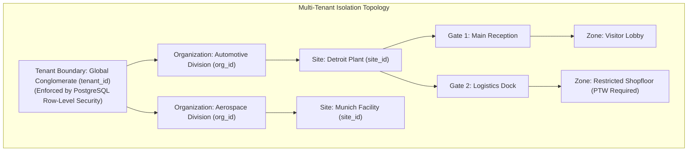

# VMS Enterprise: Security & Privacy Architecture

## 1. Security Philosophy: Defense-in-Depth & Zero Trust

VMS Enterprise operates at the intersection of corporate identity, physical industrial security, statutory labor law, and ESG reporting. It processes highly sensitive assets: national identity documents, CCTV/ANPR captures, biometric facial vectors, confidential client visits, proprietary contractor contracts, and executive travel itineraries.

### Non-Negotiable Invariants:
1. **Tenant Isolation at Data Layer:** Tenant boundaries are strictly enforced inside application middleware and at the PostgreSQL database layer via Row-Level Security (RLS). Frontend filtering is never relied upon for data confidentiality.
2. **Hybrid RBAC + ABAC Model:** Role-Based Access Control assigns baseline capabilities; Attribute-Based Access Control dynamically constrains access based on tenant, organization, site, gate location, time of day, and data classification.
3. **Privacy-by-Design & Least Privilege:** A user granted access to one business domain does not inherit cross-domain access. Specifically: **An ESG Manager inspecting Scope 3 commuter emissions has zero access to government identity scans, national ID numbers, or biometric files.**
4. **Biometric Template Isolation:** Biometric vectors (face embeddings, fingerprint templates) are cryptographically salted, separated from core profiles, and held under hardware vendor-neutral abstraction layers with automated purge lifecycles.

---

## 2. Multi-Tenant Architecture Diagram



---

## 3. Security Architecture & Permission Flow Diagram

```mermaid
flowchart TD
    subgraph Ingress_Security["API Gateway & Identity Ingress"]
        Req[Incoming Client Request] --> TLS[TLS 1.3 Termination & WAF]
        TLS --> TokenAuth[JWT / OAuth2 / API Key Authenticator]
    end

    subgraph Policy_Enforcement["Security Policy Enforcement Point (PEP)"]
        TokenAuth --> TenantContext[Inject Multi-Tenant Context\n(tenant_id, org_id, site_id)]
        TenantContext --> RBAC_Check[RBAC Check: Role Permissions]
        RBAC_Check --> ABAC_Check[ABAC Evaluator: Attributes & Data Privacy Mask]
    end

    subgraph Data_Isolation["Database Authorization & Storage (PDP)"]
        ABAC_Check --> RLS_Session["Set PostgreSQL Session Context:\nSET LOCAL app.current_tenant_id = '...'"]
        RLS_Session --> SQL_Exec[(PostgreSQL Tables\nRow Level Security Enforced)]
        ABAC_Check --> S3_Vault[S3 Object Vault\nPresigned URLs + KMS Encryption]
    end

    subgraph Audit_Ledger["Tamper-Evident Forensic Audit"]
        RLS_Session -.-> AuditLog[(Append-Only Audit Log\nActor, IP, Action, Timestamp, Delta)]
    end
```

---

## 4. Comprehensive Role & Permission Matrix

The platform establishes distinct, non-overlapping enterprise roles:

| Role Name | Scope / Target User | Allowed Operations | Strictly Denied / Masked Data |
|---|---|---|---|
| **Super Admin** | Platform SaaS Operator | Tenant provisioning, global system health, license quotas | Operational tenant PII, private enterprise documents |
| **Organization Admin** | Corporate VP / Director | Multi-site configuration, enterprise policy, global analytics | Unmasked biometric vectors |
| **Site Admin** | Plant Manager / Operations Head | Site configuration, gate topology, emergency broadcasts | System-wide configuration of other sites |
| **Security Manager** | Chief of Plant Security | Blacklist governance, security escalations, incident review | Financial pricing on material POs |
| **Security Guard** | Gate Cabin Guard | Real-time scan, verify visitor, log vehicle, actuate gate | Full PII history, contractor corporate contracts |
| **Receptionist** | Front Desk Staff | Pre-register, check in visitor/customer, print badge | Contractor EHS permits, material challans |
| **Host / Employee** | Corporate Host | Invite visitor/customer, approve appointment requests | Other employees' private appointments |
| **EHS Manager** | Safety & Health Officer | Permit-To-Work approval, contractor induction audit, muster | Corporate commercial contracts |
| **HR Manager** | Human Resources Staff | Candidate interview pass, contractor labor license audit | Material logistics passes |
| **Legal / Compliance** | Corporate Legal Team | NDA execution review, statutory document audits | Hardware terminal configuration |
| **ESG Manager** | Sustainability Director | Normalized transport logs, GHG factors, Scope 1/3 reports | **Government ID cards, personal KYC documents, passport photos** |
| **Auditor (External)** | ISO / Financial / Carbon Auditor| Read-only evidence log, calculation traces, factor versions | Live turnstile actuation, employee personal data |
| **IT Admin** | Infrastructure Team | Integrations, edge gateway health, SSO configuration | Operational visitor / contractor business records |
| **Management / CXO** | Executive Leadership | High-level KPI dashboards, site occupancy, ESG summary | Granular individual pass editing |

---

## 5. Granular Attribute-Based Access Control (ABAC) in Practice

### The ESG Privacy Guard:
When an `ESG Manager` queries a transport record linked to a visitor appointment:

```typescript
// ABAC Policy Evaluator Rule
if (user.role === 'ESG_MANAGER') {
  // ALLOWED:
  query.select([
    'transport.mode',
    'transport.fuel_type',
    'transport.vehicle_class',
    'transport.distance_km',
    'transport.occupancy',
    'esg_activity.provenance',
    'ghg_calculation.emissions_kg_co2e'
  ]);
  
  // STRIPPED / PROHIBITED (Zero Access):
  query.mask([
    'visitor.government_id_number',
    'visitor.government_id_scan_url',
    'visitor.personal_phone_number',
    'visitor.facial_biometric_template'
  ]);
}
```

---

## 6. Privacy-by-Design & Biometric Governance

To comply with global data privacy legislation (GDPR, India DPDP Act 2023, California CCPA):

1. **Explicit Consent & Purpose Binding:** Registrants provide cryptographic consent checkboxes specifying visit purpose and storage duration prior to photo capture.
2. **Biometric Template Separation:** Raw facial photos are stored in an encrypted, isolated object store bucket with time-bound presigned URLs. 512-dimensional facial embeddings are stored in a dedicated, isolated table with separate cryptographic keys.
3. **Vendor-Neutral Abstraction:** The system interfaces with biometric facial algorithms via standard vector embedding interfaces, preventing lock-in to any single hardware turnstile vendor.
4. **Automated Purge & Redaction Lifecycles:**
   - Visitor facial photos and government ID images are automatically purged or anonymized **30 days** post-visit unless flagged under active security investigation.
   - ESG transport and GHG calculation records are preserved for **7 years** to satisfy statutory carbon accounting audits, completely decoupled from deleted personal identities.
