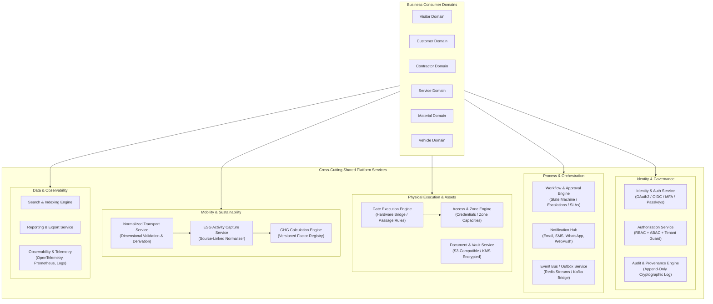
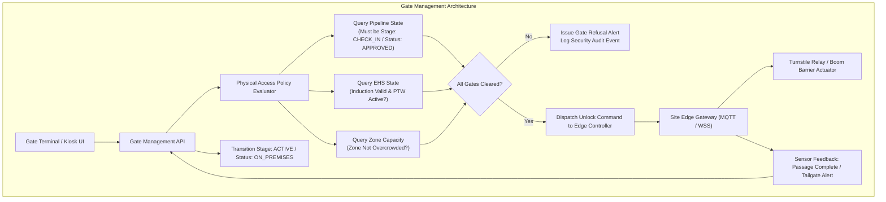

# VMS Enterprise: Shared Platform Services Architecture

## 1. Architectural Philosophy: The Shared Service Invariant

In VMS Enterprise, shared services provide foundational capabilities across all transactional business domains (**Visitor, Customer, Contractor, Service, Material, Vehicle**). 

### The Core Invariant:
**The shared layer must never contain domain-specific assumptions or hard-coded business logic.**

For example:
- The **Transport Service** handles normalized mobility dimensions (mode, ownership, fuel, vehicle class, occupancy, route) identically whether the subject is an executive client, an HVAC service technician, or a 40-tonne raw material lorry.
- The **Document Service** handles cryptographic storage, OCR verification, expiration tracking, and audits identically whether the document is a visitor government ID, a contractor labor license, an OEM technician calibration certificate, or a hazardous transport PUC.
- The **Gate Engine** validates physical passage eligibility identically across human turnstiles, vehicle boom barriers, and logistics weighbridges, strictly separated from business workflow rules.

---

## 2. Shared Services Architecture Diagram

---

## 3. Inventory & Specifications of Shared Platform Services

### 3.1 Identity, Authentication & Authorization Service
- **Identity Provider Integration:** SAML 2.0 / OIDC integrations with Azure AD, Okta, Google Workspace, and Ping Identity.
- **Authentication:** Multi-factor authentication (MFA via TOTP, SMS, FIDO2 WebAuthn), session tokens, ephemeral JWTs for API access.
- **Granular Authorization:** Hybrid RBAC (Role-Based Access Control) + ABAC (Attribute-Based Access Control) enforcing contextual rules:
  - Multi-tenant boundary checks: `tenant_id`, `organization_id`, `site_id`.
  - Temporal boundaries: Active shift or scheduled appointment window.
  - Least privilege: Privacy partitions preventing ESG managers from viewing biometric templates or government ID scans.

### 3.2 Configurable Workflow & Approval Engine
- **Engine Principles:** Decoupled DAG (Directed Acyclic Graph) state machine.
- **Capabilities:**
  - Sequential, parallel, and multi-tier approval hierarchies.
  - Dynamic escalations based on SLA timers (e.g., auto-escalate to Plant Manager if unapproved after 2 hours).
  - Out-of-office delegation with audit tracking.
  - Conditional branch evaluation based on transaction attributes (e.g., if contractor headcount > 20 or visitor requires restricted chemical zone access, require EHS Head approval).

### 3.3 Document & Legal Compliance Service
- **Centralized Schema:** Single repository for documents across all domains (`owner_type`, `owner_id`, `doc_type`, `version`, `expiry_date`, `verification_status`).
- **Capabilities:**
  - Automated OCR extraction and identity verification.
  - NDA workflow: Pre-signing with DocuSign / Adobe Sign webhook integration or internal canvas signature.
  - Document expiration monitors triggering pro-active renewal notifications before site arrival.
  - Zero plain-text document storage; S3 client-side envelope encryption with AES-256-GCM.

### 3.4 Normalized Transport Service
- **Single Source of Truth:** Reusable across Visitor, Customer, Contractor, Service, Material, and Vehicle.
- **Decoupled Dimensions:** Independent dimensional vectors avoiding brittle combinations (e.g., `Mode: Car` + `Ownership: Personal` + `Fuel: Petrol` + `Usage: Carpool`).
- **Automated Distance Derivation:** Integrated GIS route estimation between Origin and Destination with explicit provenance tracking (`MEASURED`, `USER_PROVIDED`, `SYSTEM_ESTIMATED`).

### 3.5 Gate Management & Physical Access Control Engine
- **Separation of Eligibility from Passage:**
  - *Business Pipeline:* Determines if an appointment, contractor work order, or material consignment is commercially and administratively valid.
  - *Gate Engine:* Evaluates real-time physical conditions (lane authorization, current zone occupancy, active emergency muster lockouts, hardware health) before issuing an actuation trigger to hardware.
- **Offline Tolerance:** Local edge gateway maintains an encrypted SQLite/Redis cache of scheduled transactions and valid cryptographic tokens for up to 72 hours of network disconnection.

### 3.6 Event Bus & Outbox Service
- **Transactional Outbox Pattern:** Ensures zero message loss during database commit and broker publication.
- **Transport Agnostic:** Pluggable adapter interface supporting Redis Streams in single-cluster deployments, seamlessly upgrading to Apache Kafka / Redpanda for multi-region scale.
- **Event Contracts:** Strongly typed Avro / JSON schemas with strict semantic versioning.

### 3.7 Audit & Provenance Service
- **Immutable Audit Trail:** Append-only cryptographic transaction ledger.
- **Forensic Attribution:** Captures `who`, `when`, `what`, `client_ip`, `user_agent`, `previous_state`, `new_state`, and `mutation_source`.
- **ESG Provenance:** Tracks data genesis (`MEASURED`, `USER_PROVIDED`, `SYSTEM_ESTIMATED`, `SYSTEM_CALCULATED`, `IMPORTED`).

### 3.8 Notification Hub
- **Multi-Channel Dispatch:** Email (SMTP/SendGrid), SMS (Twilio), WhatsApp Business API, Push Notifications (Firebase FCM), In-App WebSockets.
- **Template Management:** Localized, role-tailored notifications with dynamic variable interpolation and rate limiting.

### 3.9 Observability & System Health
- **Distributed Tracing:** OpenTelemetry instrumentation across all services and database queries.
- **Metrics:** Prometheus exporters tracking gate passage latency, workflow approval duration, ESG calculation throughput.
- **Structured Logging:** JSON logs with correlation IDs (`trace_id`, `span_id`, `tenant_id`).
