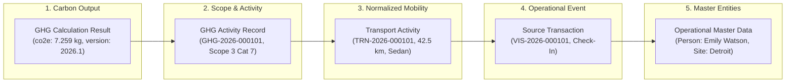

# VMS Enterprise: End-to-End Source-to-GHG Traceability Architecture

This architectural document provides the technical proof and operational mechanics governing end-to-end data provenance from calculated carbon emissions back to primary operational transactions.

---

## 1. The Canonical Provenance Chain

VMS Enterprise implements an audit-traceable provenance chain that connects every calculated greenhouse gas figure back to physical enterprise events:

$$\text{GHG Result} \longrightarrow \text{GHG Activity} \longrightarrow \text{Transport Activity} \longrightarrow \text{Source Transaction} \longrightarrow \text{Source Domain} \longrightarrow \text{Operational Master Data}$$

---

## 2. Five-Step Transactional Operational Capture Pipeline

Operational activity capture is executed by `OperationalCapturePipeline` (`packages/database/src/services/operational-capture-pipeline.ts`) following a 5-step process:

1. **Step 1: Source Domain Transaction Processing**:
   - The domain transaction is inserted/updated (e.g. `visitor_transactions`, `material_transactions`, `contractor_work_orders`).
2. **Step 2: Reusable Transport Activity Normalization**:
   - Transport details (origin, destination, distance, transport mode, vehicle class, fuel, occupancy, payload) are stored in `transport_activities` linked to the source transaction.
3. **Step 3: GHG Activity Generation**:
   - An activity record is inserted in `ghg_activities` with scope mapping (e.g. Scope 3 Cat 7 for visitors, Scope 3 Cat 4 for inbound freight) and initial status `PENDING`.
4. **Step 4: Domain Event Emission**:
   - An event is recorded in `domain_events` for outbox broadcasting.
   - **Transaction Commit**: Steps 1 to 4 are committed within an atomic ACID transaction.
5. **Step 5: Asynchronous GHG Calculation Execution**:
   - Emission factor version is resolved from `emission_factor_versions`.
   - An immutable record is created in `ghg_calculations`.
   - `ghg_activities` is updated to `CALCULATED` with `co2e` and gas breakdown.
   - **Operational Safety Invariant**: If Step 5 fails, times out, or factor lookup is pending, the operational transaction is **100% committed and unaffected**.

---

## 3. Concrete Provenance Proof Walkthrough Across All 6 Pipelines

### Pipeline 1: VISITOR
- **Primary Event**: Executive guest check-in at security reception.
- **Transport**: Personal petrol sedan, 42.5 km from airport, occupancy = 1.
- **GHG Classification**: Scope 3 Category 7 (Employee and Visitor Commuting), Subcategory: `VISITOR_TRANSIT`.
- **Calculated Emissions**: $(42.5 \times 0.1708) / 1 = 7.259\text{ kg CO}_2\text{e}$.
- **Canonical Proof**:
  `GHG Result (7.259 kg CO2e) -> GHG Activity (GHG-2026-001001) -> Transport Activity (TRN-2026-001001) -> Source Transaction (VISITOR:VIS-2026-000101) -> Source Domain (VISITOR) -> Operational Data (Site: DETROIT-ASSEMBLY, Person: Emily Watson)`

### Pipeline 2: MATERIAL (Multi-Line Freight)
- **Primary Event**: Inward heavy freight delivery of 25 tonnes steel coils and 10 returnable skids.
- **Transport**: Commercial diesel heavy truck (HDV), 380 km, weighed via calibrated weighbridge.
- **GHG Classification**: Scope 3 Category 4 (Upstream Transportation & Distribution).
- **Calculated Emissions**: $380\text{ km} \times 25.0\text{ tonnes} \times 0.8924 = 8,477.8\text{ kg CO}_2\text{e}$.
- **Line & Return Traceability**: Resolves PO `PO-2026-STEEL-01`, line items, and return records in `material_returns`.

### Pipeline 3: CUSTOMER (Delegation Carpool)
- **Primary Event**: OEM technical audit delegation visit.
- **Transport**: Hired petrol sedan, 28 km, occupancy = 2 passengers.
- **GHG Classification**: Scope 3 Category 6 (Business Travel).
- **Calculated Emissions**: $(28 \times 0.1708) / 2 = 2.3912\text{ kg CO}_2\text{e}$ per participant.
- **Hierarchy Traceability**: Resolves Customer Account `Acme Global Account` and lead participant `David Lead VP`.

### Pipeline 4: CONTRACTOR (Contingent Workforce Shift)
- **Primary Event**: Facility maintenance shift crew arrival.
- **Transport**: Hired diesel coach bus, 35 km, occupancy = 15 workers.
- **GHG Classification**: Scope 3 Category 7 (Contingent Workforce Commuting).
- **Calculated Emissions**: $(35 \times 0.0965) / 15 = 0.2252\text{ kg CO}_2\text{e}$ per worker.
- **Hierarchy Traceability**: Resolves Contractor Company `VEND-APEX-99` -> Contract `CONTR-2026-APEX` -> Work Order -> Worker Badges.

### Pipeline 5: SERVICE (OEM Specialized Maintenance)
- **Primary Event**: Critical CNC spindle calibration order.
- **Transport**: Technician personal car, 18 km.
- **GHG Classification**: Scope 3 Category 1 (Purchased Goods and Services).
- **Hierarchy Traceability**: Resolves Service Provider `SP-KUKA-01` and equipment tag `ROBOTIC-WELD-CELL-09`.

### Pipeline 6: VEHICLE (Internal Fleet)
- **Primary Event**: Company-owned utility truck transfer between plant gates.
- **Transport**: Company-owned vehicle, 12 km.
- **GHG Classification**: Scope 1 (Direct Mobile Combustion, Internal Fleet).
- **Direct Emissions**: Assigned to corporate Direct Scope 1 inventory.

---

## 4. Programmatic Traceability Engine & Audit Verification

The `TraceabilityEngine` class (`packages/database/src/services/traceability-engine.ts`) exposes bidirectional verification APIs:

1. **`traceFromGHGActivity(ghgActivityId)`**: Resolves full `ProvenanceChain` containing all layer entities and the canonical proof string.
2. **`traceFromGHGCalculation(calculationId)`**: Resolves provenance directly from an immutable calculation ledger entry.
3. **`traceFromSourceTransaction(sourceDomain, transactionId)`**: Reverses lookup from operational event to all associated carbon calculations.
4. **`verifyProvenanceIntegrity(ghgActivityId)`**: Executes structural validation verifying that:
   - Source transaction exists in domain table.
   - Transport activity matches source transaction ID.
   - Referenced emission factor version exists in immutable factor registry.
   - Mathematical formula matches input snapshots.
   - Site hierarchy is intact.
