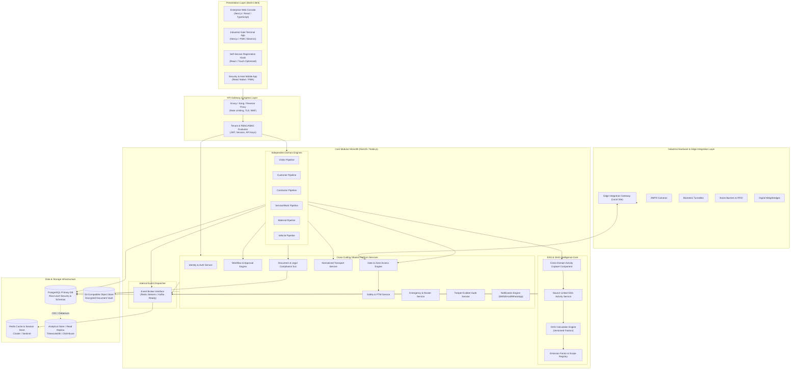

# VMS Enterprise: System Architecture Specification

## 1. Executive Summary & Platform Purpose

**VMS Enterprise** is a mission-critical, multi-site industrial and corporate platform engineered for large-scale manufacturing facilities, corporate campuses, logistics hubs, and future multi-tenant SaaS deployments. 

Contrary to conventional visitor loggers, VMS Enterprise is **not** a simple visitor management system. It is a unified operational orchestration platform governing six primary transactional business pipelines:
1. **Visitor Management** (Auditors, VIPs, candidates, business guests, regulatory inspectors)
2. **Customer Management** (Client audits, delegation tours, commercial reviews, executive visits)
3. **Contractor Management** (Long-term & short-term vendors, maintenance crews, worker compliance, safety permits)
4. **Service / Work Management** (OEM engineers, field technicians, hazardous work execution, specialized work orders)
5. **Material Management** (Inward/outward goods, returnable vs. non-returnable equipment, scrap, calibration samples, spares)
6. **Vehicle Management** (Commercial fleet, supply chain trucks, trailers, internal tankers, driver verifications)

These operational pipelines interact seamlessly with physical gate execution (turnstiles, boom barriers, weighbridges, ANPR, biometrics) and safety governance (EHS induction, PTW - Permit To Work, muster emergencies).

Crucially, VMS Enterprise embeds an enterprise **ESG / GHG Activity Intelligence Engine** directly into the heart of daily operations. Operational transactions automatically capture normalized transport, fuel, and resource activities at the point of origin, generating verified, traceable Scope 1 and Scope 3 activity streams without manual data re-entry.

---

## 2. Architectural Principles & Invariants

The platform adheres to non-negotiable architectural invariants:

1. **Strict Domain Isolation (No Universal Visitor Object):**
   Visitor, Customer, Contractor, Service, and Material are distinct business entities with independent lifecycles, schemas, validation rules, compliance mandates, and access policies. Contractor workers or material gate passes are **never** shoehorned into a Visitor table.
2. **Cross-Cutting Operational ESG Capture:**
   ESG/GHG data collection is not an isolated retroactive survey. It is embedded into operational transaction workflows. When a visitor, customer, technician, contractor, material transporter, or fleet vehicle books or arrives, transport and logistics activities are captured and linked directly to the parent transaction.
3. **Strict Decoupling of GHG Calculation from UI:**
   Frontend applications collect raw, normalized operational activity data (distance, fuel type, vehicle class, passenger occupancy, trip direction). They **never** calculate CO2e emissions. Emissions are derived asynchronously by the dedicated GHG Calculation Engine using versioned emission factor registries.
4. **Immutable Activity Provenance:**
   Every ESG/GHG activity record stores its explicit origin type (`MEASURED`, `USER_PROVIDED`, `SYSTEM_ESTIMATED`, `SYSTEM_CALCULATED`, `IMPORTED`). System estimates (e.g., GPS distance estimation) are explicitly distinguished from verified weighbridge or odometer measurements.
5. **Separation of Business Eligibility from Physical Gate Execution:**
   Approval of an appointment or work order grants *eligibility*, but does not equal *physical passage*. The Gate Engine enforces real-time physical constraints (active blacklists, expired safety inductions, zone capacity, dual-custody verification, gate operating hours) before actuating access hardware.
6. **Hardware Abstraction Layer (HAL):**
   Edge devices (ANPR cameras, biometric turnstiles, UHF RFID readers, weighbridges, boom barriers) communicate through local Edge Integration Gateways using standardized IoT/MQTT/WebSocket protocols. Hardware devices never execute direct SQL against the core database.
7. **Offline-Tolerant Gate Operation:**
   Gate terminals cache locally authorized pass tokens and queue ingress/egress transactions during WAN outages, synchronizing cryptographically validated logs upon network restoration.
8. **Multi-Tenant Hierarchy & Tenant Isolation:**
   Every transactional table enforces multi-tenancy at the data layer through compound tenant-organization-site keys and row-level security (RLS) policies.

---

## 3. High-Level System Architecture Diagram



---

## 4. Multi-Tenant Organizational Topology

VMS Enterprise models organizational hierarchies with deep granularity to support multi-site enterprise conglomerates:

```
[Tenant: Global Manufacturing Corp]
  └── [Organization: North America Operations]
        ├── [Site: Detroit Stamping & Assembly Plant]
        │     ├── [Gate: Gate 1 - North Main Gate (Turnstiles, Security Cabin)]
        │     │     ├── [Zone: Administrative Welcome Lobby]
        │     │     └── [Zone: Executive Offices]
        │     ├── [Gate: Gate 2 - Commercial Logistics Gate (ANPR, Heavy Weighbridge)]
        │     │     ├── [Zone: Raw Material Warehouse Bay A]
        │     │     └── [Zone: Hazardous Chemical Storage (High Security)]
        │     └── [Gate: Gate 3 - Contractor & Maintenance Gate]
        │           └── [Zone: Tool & Die Fabrication Workshop]
        └── [Site: Monterrey Component Facility]
              └── ...
```

### Architectural Guarantees:
- **Tenant Isolation:** A tenant is an autonomous administrative boundary. Data cannot leak across tenants under any circumstance.
- **Site-Specific Rules:** Each site defines its own working shifts, gate passes, vehicle weight tolerances, speed limits, mandatory personal protective equipment (PPE), induction validity, and local emission factor grids.
- **Multi-Level Rollup:** ESG managers and corporate CXOs can inspect Scope 3 logistics emissions filtered by Site, rolled up by Organization, or consolidated globally across the Tenant.

---

## 5. Technology Stack Selection & Rationales

| Layer | Technology | Engineering Rationale |
|---|---|---|
| **Frontend Framework** | **Next.js 15+ / React 19 / TypeScript** | Server Components for high-density administrative tables; Client components for reactive gate and self-service kiosks. High performance, SEO-neutral enterprise dashboards. |
| **Styling & Design System** | **Tailwind CSS + Headless UI / Radix UI** | Industrial tokens, dense tabular UI, zero-runtime CSS overhead, total theme control for corporate white-labeling. |
| **Backend Framework** | **NestJS / Node.js 22 LTS / TypeScript** | Strict enterprise modularity, dependency injection, clean domain boundaries, decorators for RBAC/ABAC guards, out-of-the-box microservice extraction capability. |
| **Primary Database** | **PostgreSQL 16+** | Native JSONB for dynamic metadata, strong ACID transactions, Row Level Security (RLS) for multi-tenancy, strict foreign key constraints, generated columns, and PostGIS compatibility for route calculation. |
| **Caching & Queueing** | **Redis 7+ (Streams & Pub/Sub)** | High-throughput distributed lock manager, token blacklisting, session state, fast local gate token verification cache, event publishing. |
| **Document Vault** | **S3-Compatible Object Store (MinIO / AWS S3)** | Immutable file storage with server-side envelope encryption (KMS), presigned upload/download URLs, and strict retention/quarantine lifecycle policies. |
| **Data Validation** | **Zod 3.x** | Runtime schema validation across boundaries; shared isomorphic types between frontend, backend, and edge gateways. |
| **Event Streaming** | **Redis Streams (Initial) -> Kafka / Redpanda (Scale)** | Reliable event-driven decoupling between transaction logging, ESG processing, gate synchronization, and analytics CDC. |

---

## 6. Monolith vs. Microservice Boundary Strategy

To avoid premature distributed systems complexity while enforcing production-grade architecture:
- **Phase 1 implements a Modular Monolith with Clean Architecture.**
- Every domain (`visitor`, `contractor`, `material`, `ghg`, `transport`, etc.) is encapsulated within an isolated module containing its own entities, DTOs, domain services, controllers, and repository interfaces.
- Inter-domain communication across modules occurs strictly through **Service Interfaces** or **Domain Event Dispatchers**. Direct database joins across disparate domain tables are prohibited unless through normalized cross-cutting linking tables (such as `esg_activity_records`).
- This design permits instantaneous extraction of `ghg-engine`, `gate-controller`, or `visitor-service` into independent microservices/containers when scale demands.
