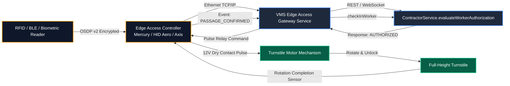

# Physical Access Control & Gate/Turnstile Integration

## 1. Overview & Purpose

The Contractor Domain interfaces directly with physical perimeter security infrastructure—including full-height industrial turnstiles, optical speed lanes, vehicle boom barriers, and biometric access controllers.

In heavy manufacturing plants where up to 2,000 contractor craftspeople arrive between 06:45 and 07:15 for shift change:
- Barrier rotation latency must be sub-second ($< 50\text{ ms}$ evaluation latency).
- Strict anti-passback rules must prevent badge sharing across turnstiles.
- Hardware pulse relays must verify physical passage completion.
- Edge controllers must handle momentary network partitions gracefully without trapping workers outside in adverse weather.

---

## 2. Hardware Architecture & Signal Topology



---

## 3. Strict Anti-Passback (APB) Enforcement

To prevent workers from handing their badges back through perimeter fencing to unverified colleagues, the system enforces strict anti-passback:

1. **State Machine Verification:**
   - A worker whose current attendance status is `CHECKED_IN` cannot execute a second `CHECK_IN` event at any perimeter gate.
   - Any attempt triggers an immediate hardware alarm at the security guard booth:
     ```json
     {
       "event": "ANTI_PASSBACK_VIOLATION",
       "badgeNumber": "CW-4001",
       "workerName": "Ramesh K. Yadav",
       "attemptedGate": "Gate 2 - Turnstile B",
       "currentStatus": "CHECKED_IN",
       "lastEntryTime": "2026-10-11T07:45:00Z"
     }
     ```
2. **Supervisor APB Reset:** Only an authorized Security Supervisor or EHS Officer can issue an audited anti-passback reset if a false alarm occurs.

---

## 4. Edge Controller Local Cache & Offline Resilience

If plant fiber connectivity is temporarily severed:
1. **Local Allowlist Cache:** Edge controllers synchronize an encrypted local SQLite/Redis cache of all authorized workers holding active assignments and valid compliance for the next 24 hours.
2. **Offline Decision:** If the server is unreachable within 150 ms, the edge controller evaluates the local cache and grants entry.
3. **Store & Forward Re-synchronization:** When network connectivity is restored, all offline entry events are streamed to `ContractorService.checkInWorker` with the original edge timestamps and provenance tagged as `IMPORTED`.
