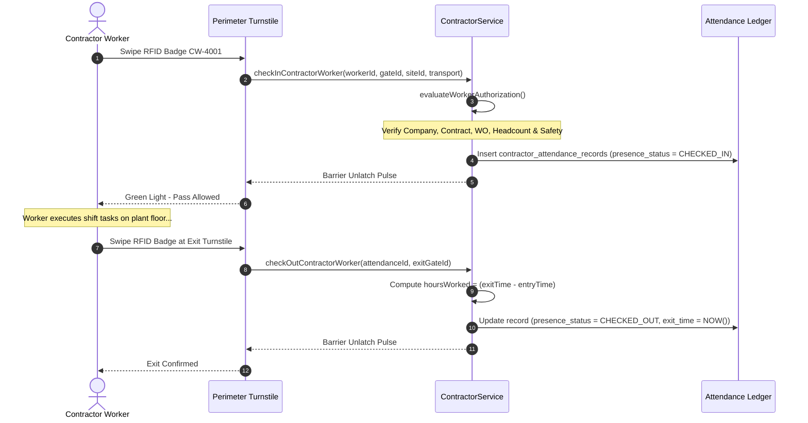

# Contractor Attendance Ledger & Gate Operations

## 1. Overview & Purpose

The Contractor Attendance Ledger (`contractor_attendance_records`) constitutes the immutable legal and operational record of all contractor presence across industrial facilities.

Unlike standard office badge logs, industrial contractor attendance serves critical multi-stakeholder functions:
1. **Life Safety & Emergency Headcount:** In the event of a plant fire or toxic gas release, security roll-calls rely on this ledger to determine exactly which contractor personnel are inside specific bays or sectors.
2. **Commercial Verification & Man-Hour Billing:** Timesheets submitted for Time & Materials (T&M) contracts are cross-verified against physical turnstile entry/exit timestamps.
3. **Statutory Shift Fatigue Limits:** Prevents dangerous labor exploitation and fatigue violations by flagging workers exceeding statutory shift limits (e.g. > 12 hours).
4. **Embedded Transport Capture:** Records commute data at entry for Scope 3 emissions reporting without causing physical bottlenecks.

---

## 2. Attendance Relational Model

The `contractor_attendance_records` table structure:

| Column Name | Data Type | Nullable | Description & Constraints |
|:---|:---|:---|:---|
| `attendance_id` | UUID | No | Primary Key |
| `tenant_id` | UUID | No | Multi-tenant isolation key |
| `contractor_worker_id` | UUID | No | Foreign Key to `contractor_workers` |
| `work_order_id` | UUID | No | Foreign Key to `contractor_work_orders` |
| `assignment_id` | UUID | Yes | Foreign Key to `contractor_worker_assignments` |
| `gate_id` | VARCHAR(64) | No | Turnstile or portal identifier (e.g. `GATE-02-TURNA`) |
| `site_id` | VARCHAR(64) | No | Facility plant site identifier |
| `shift_date` | DATE | No | Date of shift |
| `entry_time` | TIMESTAMPTZ | No | Timestamp of physical entry badge swipe |
| `exit_time` | TIMESTAMPTZ | Yes | Timestamp of physical exit badge swipe (null while on-site) |
| `hours_worked` | NUMERIC | Yes | Computed presence duration in decimal hours |
| `presence_status` | ENUM | No | State (`CHECKED_IN`, `CHECKED_OUT`, `OVERSTAY`, `NO_SHOW`, `ABNORMAL_EXIT`) |
| `transport_activity_id` | UUID | Yes | Foreign Key to normalized transport activity |
| `is_manual_correction` | BOOLEAN | No | Audit flag indicating manual time adjustment |
| `correction_reason` | TEXT | Yes | Mandatory explanation for manual correction |
| `corrected_by_user_id` | UUID | Yes | Operator ID who executed the correction |
| `original_entry_time` | TIMESTAMPTZ | Yes | Preserved pre-correction entry timestamp |
| `original_exit_time` | TIMESTAMPTZ | Yes | Preserved pre-correction exit timestamp |
| `created_at` | TIMESTAMPTZ | No | Creation timestamp |
| `updated_at` | TIMESTAMPTZ | No | Modification timestamp |

---

## 3. Turnstile Check-In & Check-Out Workflow



---

## 4. Audited Manual Attendance Corrections

In industrial environments, hardware malfunctions, tailgating incidents, or emergency plant evacuations occasionally leave attendance records open without an exit swipe.

VMS Enterprise prohibits direct unmonitored SQL updates. All corrections must pass through `ContractorService.correctAttendance`:
- Requires mandatory `correctionReason` and `correctedByUserId`.
- Preserves the original unmodified timestamps in `original_entry_time` and `original_exit_time`.
- Sets `is_manual_correction = TRUE`.
- Appends an entry into the enterprise audit ledger:
  ```json
  {
    "action": "ATTENDANCE_CORRECTION",
    "attendanceId": "att-501",
    "correctedBy": "SUPERVISOR_PATIL",
    "reason": "Turnstile power loss during 17:00 shift change; badge out confirmed via CCTV log",
    "originalExit": null,
    "correctedExit": "2026-10-11T17:05:00Z"
  }
  ```

---

## 5. Overstay & Shift Fatigue Monitoring

Workers whose presence remains `CHECKED_IN` beyond their scheduled shift duration (or exceeding 12 continuous hours) are automatically transitioned to `OVERSTAY`:
- An alert is pushed to the Plant Security Operations Center (SOC).
- Visual status badges turn red in the `CURRENTLY_ON_SITE` control room view.
- EOD reconciliation reports flag all unclosed shifts for security supervisor verification.
