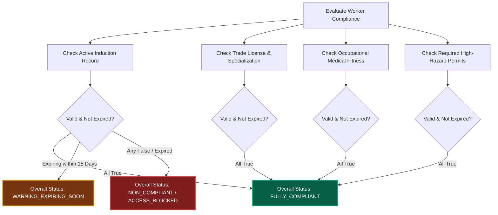

# Multi-Source Workforce Compliance & Safety Prerequisites

## 1. Overview & Purpose

In heavy industrial operations, technical compliance and environmental health & safety (EHS) prerequisites are statutory imperatives. Unqualified or unverified contractor craftspeople pose catastrophic risks to human life, machinery, and regulatory licenses.

VMS Enterprise features a unified, multi-source compliance evaluation engine that aggregates:
1. **Corporate EHS Safety Inductions:** Mandatory annual or project-specific plant safety training.
2. **Statutory Trade Qualifications & Licenses:** Heavy equipment crane certifications, boiler rigger licenses, high-voltage electrical authorizations.
3. **Occupational Medical Fitness:** Audiometry, spirometry, vision, and physical fitness certifications from registered occupational health centers.
4. **Task-Specific Safety Permits:** Height work, hot work, and confined space pre-clearances.

---

## 2. Compliance Relational Model

The `contractor_compliance_records` table holds auditable compliance certifications:

| Column Name | Data Type | Nullable | Description & Constraints |
|:---|:---|:---|:---|
| `record_id` | UUID | No | Primary Key |
| `tenant_id` | UUID | No | Multi-tenant isolation key |
| `contractor_worker_id` | UUID | No | Foreign Key to `contractor_workers` |
| `requirement_type` | ENUM | No | Type (`SAFETY_INDUCTION`, `EHS_TRAINING`, `TRADE_LICENSE`, `QUALIFICATION_CERTIFICATE`, `MEDICAL_FITNESS`, `GOVERNMENT_ID`, `INSURANCE_CERTIFICATE`, `PERMIT_PREREQUISITE`, `DRUG_ALCOHOL_SCREENING`, `BACKGROUND_VERIFICATION`) |
| `name` | VARCHAR(255) | No | Human-readable requirement title |
| `status` | ENUM | No | Verification state (`VALID`, `EXPIRING_SOON`, `EXPIRED`, `PENDING_REVIEW`, `REJECTED`, `WAIVED`) |
| `document_ref` | VARCHAR(128) | Yes | Vault document ID / upload reference |
| `valid_from` | DATE | No | Certification start date |
| `valid_to` | DATE | Yes | Certification expiration date (null if non-expiring) |
| `verified_by` | VARCHAR(128) | Yes | EHS Officer / Verifier username |
| `verification_notes` | TEXT | Yes | Audit notes or verification conditions |
| `created_at` | TIMESTAMPTZ | No | Creation timestamp |
| `updated_at` | TIMESTAMPTZ | No | Modification timestamp |

---

## 3. Specialized Trade Qualifications

Specialized craft certifications are further normalized in `contractor_qualifications`:

| Column Name | Data Type | Description |
|:---|:---|:---|
| `qualification_id` | UUID | Primary Key |
| `contractor_worker_id` | UUID | Foreign Key to worker |
| `qualification_type` | ENUM | `TRADE_LICENSE`, `SAFETY_TRAINING`, `SPECIALIZED_CERTIFICATE`, `MEDICAL_FITNESS` |
| `certificate_number` | VARCHAR(128) | Issuing authority license reference |
| `issuing_authority` | VARCHAR(255) | Certifying body (e.g. `National Safety Council`, `State Boiler Directorate`) |
| `issue_date` | DATE | Date certified |
| `expiry_date` | DATE | Date expiration occurs |
| `is_verified` | BOOLEAN | Verified by accredited safety inspector |

---

## 4. Multi-Source Compliance Evaluation Logic

When `ContractorService.evaluateWorkerCompliance(workerId)` is evaluated, the engine checks all prerequisite items:

If any mandatory prerequisite is `EXPIRED` or `REJECTED`, the worker's compliance status is marked `NON_COMPLIANT`, triggering an immediate lock at physical gate turnstiles.
