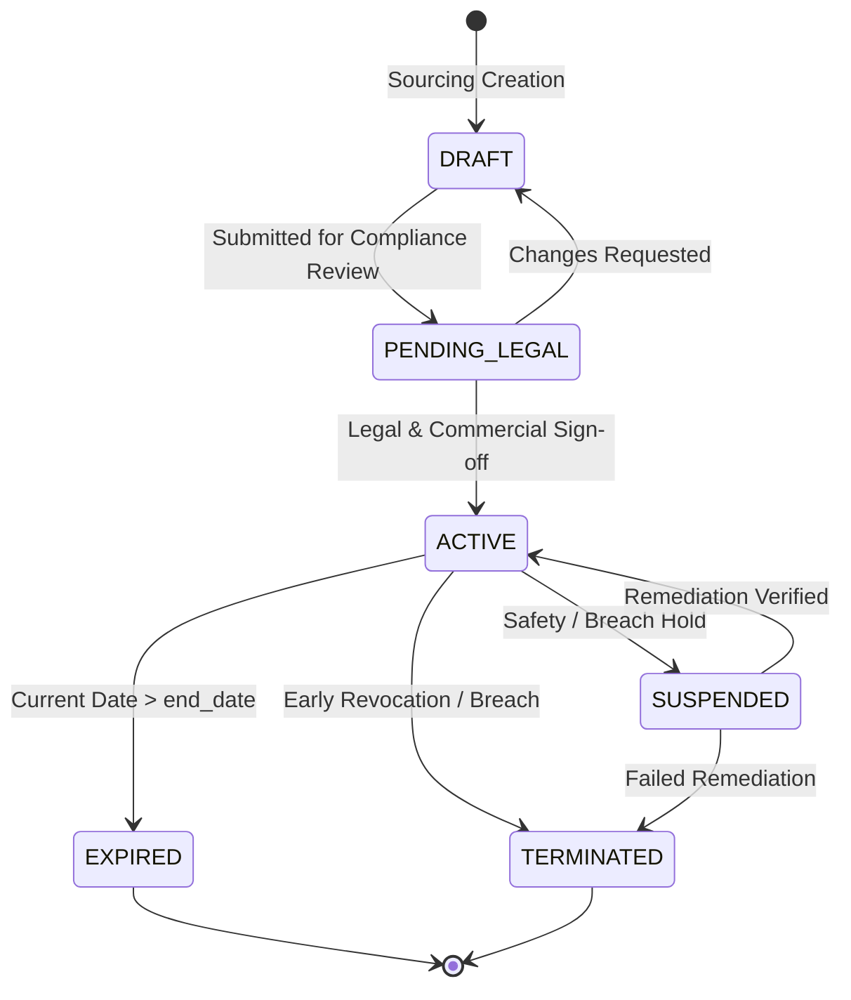

# Commercial Contract Management

## 1. Overview & Purpose

The Contract Management subsystem within the Contractor Domain bridges enterprise procurement agreements with physical site operations. Every industrial contractor on site must perform work under the legal canopy of an active commercial contract.

Key architectural tenets:
1. **Commercial Parentage:** Work orders cannot exist in a vacuum; every work order belongs to exactly one active commercial contract.
2. **Temporal Bounding:** A contract establishes strict validity boundaries (`start_date` and `end_date`). No child work order or workforce deployment can extend past the contract expiry date.
3. **Termination Cascades:** If a contract is suspended or terminated due to legal, commercial, or safety breaches, the system immediately propagates an access freeze across all associated child work orders and active gate authorizations.

---

## 2. Contract Relational Model

The `contractor_contracts` table is structured as follows:

| Column Name | Data Type | Nullable | Description & Invariants |
|:---|:---|:---|:---|
| `contract_id` | UUID | No | Primary Key |
| `tenant_id` | UUID | No | Multi-tenant isolation key |
| `company_id` | UUID | No | Foreign Key to `contractor_companies` |
| `contract_number` | VARCHAR(64) | No | Unique agreement reference (e.g., `CNT-2026-081`) |
| `title` | VARCHAR(255) | No | Descriptive agreement title |
| `contract_type` | ENUM | No | Type (`MASTER_SERVICES_AGREEMENT`, `SERVICE_LEVEL_AGREEMENT`, `PURCHASE_ORDER`, `STATEMENT_OF_WORK`, `FIXED_PRICE_PROJECT`, `TIME_AND_MATERIALS`, `MAINTENANCE`, `TURNKEY`) |
| `status` | ENUM | No | Operational status (`DRAFT`, `PENDING_LEGAL`, `ACTIVE`, `SUSPENDED`, `EXPIRED`, `TERMINATED`) |
| `start_date` | DATE | No | Contract effective date |
| `end_date` | DATE | No | Contract termination date |
| `scope_of_work` | TEXT | Yes | Narrative technical scope and boundaries |
| `commercial_owner_user_id`| UUID | Yes | Procurement / Sourcing manager responsible |
| `site_id` | VARCHAR(64) | Yes | Targeted plant location or campus |
| `financial_value` | NUMERIC | Yes | Notional commercial contract value |
| `sla_terms` | JSONB | Yes | Specific uptime, turnaround, or safety SLA commitments |
| `created_at` | TIMESTAMPTZ | No | Record creation timestamp |
| `updated_at` | TIMESTAMPTZ | No | Record last modified timestamp |

---

## 3. Contract Lifecycle & State Machine

---

## 4. Renewal & Termination Workflows

### 4.1 Contract Renewal Workflow
Contracts nearing expiration can be renewed via `ContractorService.renewContract`:
- Extends the `end_date` to the new agreement terminus.
- Verifies that new insurance and indemnity certificates have been filed.
- Preserves historical contract references and increments internal audit versioning.
- Automatically lifts expiry warning flags on child work orders.

### 4.2 Contract Termination Cascade
When a contract is terminated (`status = TERMINATED` or `SUSPENDED`):
- All child work orders under the contract are marked as `SUSPENDED` or `CANCELLED`.
- Any contractor worker attempting badge-in at a turnstile whose only active assignment maps to this contract receives an immediate **DENIED: CONTRACT_TERMINATED** rejection.
- Security and Plant Operations dashboards display an alert notification outlining the termination reason.
