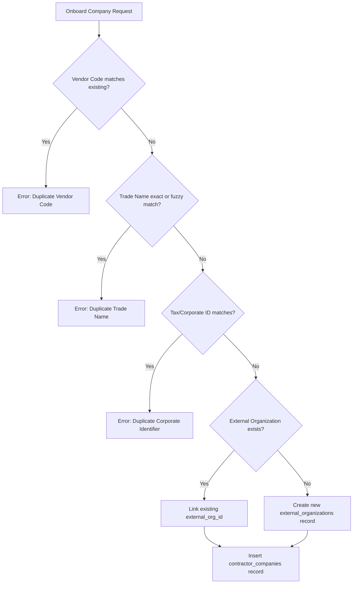

# Contractor Company Management

## 1. Overview & Purpose

Contractor Company Management in VMS Enterprise establishes the organizational root for all third-party industrial service providers, general construction contractors, specialized maintenance partners, and labor brokers operating across corporate facilities.

Contractor companies are fundamentally separated from host departments or transient corporate visitors:
- Every contractor company maps canonically to the enterprise `external_organizations` table.
- A contractor company cannot access a facility directly; it must hold at least one active commercial contract and authorized work order.
- Safety ratings and compliance performance at the company level directly govern whether physical entry permits will be granted for its workforce.

---

## 2. Relational Entity Structure

The canonical database table `contractor_companies` defines the following schema:

| Column Name | Data Type | Nullable | Constraints & Description |
|:---|:---|:---|:---|
| `company_id` | UUID | No | Primary Key |
| `tenant_id` | UUID | No | Multi-tenant isolation partition key |
| `external_org_id` | UUID | No | Foreign key linking to `external_organizations` |
| `vendor_code` | VARCHAR(64) | No | Unique supplier/vendor ERP identifier (e.g., `VEND-APEX-01`) |
| `trade_name` | VARCHAR(255) | No | Official trade name / registered commercial entity name |
| `contractor_classification` | ENUM | No | Classification tier (e.g. `GENERAL_CONTRACTOR`, `ELECTRICAL`, `MECHANICAL`, `CIVIL`, `LOGISTICS`, `TIER_1_GENERAL`) |
| `safety_rating` | ENUM | No | Safety score (`PLATINUM`, `GOLD`, `SILVER`, `BRONZE`, `GRADE_A`, `GRADE_B`, `GRADE_C`, `GRADE_D`, `RESTRICTED`, `BLACKLISTED`) |
| `status` | ENUM | No | Company state (`ACTIVE`, `PENDING_APPROVAL`, `SUSPENDED`, `INACTIVE`, `BLACKLISTED`) |
| `responsible_internal_manager_id` | UUID | Yes | Internal enterprise sponsor / procurement lead |
| `primary_contact_name` | VARCHAR(255) | Yes | Contractor's key account manager |
| `primary_contact_phone` | VARCHAR(64) | Yes | Primary phone number |
| `primary_contact_email` | VARCHAR(255) | Yes | Primary communication email |
| `site_contact_name` | VARCHAR(255) | Yes | On-site contractor project manager |
| `approved_site_ids` | JSONB | Yes | Array of facility site UUIDs where the company is authorized |
| `insurance_policy_number` | VARCHAR(128) | Yes | Commercial general liability / worker compensation policy |
| `insurance_expiry_date` | DATE | Yes | Expiration date of active insurance policy |
| `notes` | TEXT | Yes | Audit remarks, qualification history, or onboarding notes |
| `created_at` | TIMESTAMPTZ | No | Timestamp of creation |
| `updated_at` | TIMESTAMPTZ | No | Timestamp of last modification |

---

## 3. Duplicate Prevention & Onboarding Verification

When onboarding a new contractor company via `ContractorService.createContractorCompany`, the system performs automated duplicate prevention:
1. **Vendor Code Match:** Checks if an existing company in the same tenant holds an identical vendor code.
2. **Trade Name Normalized Match:** Compares normalized alphanumeric representations of company names (case-insensitive, whitespace-trimmed, punctuation stripped).
3. **Registration / Tax Number Match:** Cross-checks corporate registration numbers against canonical organization records.

If any match is detected, the operation fails with a descriptive `DUPLICATE_COMPANY_DETECTED` error preventing redundant corporate identities.

---

## 4. Safety Rating & Suspension Governance

A contractor's safety rating is evaluated dynamically based on EHS audit findings, site incident reports, and near-miss frequency rates:

- **PLATINUM / GRADE_A:** Unrestricted access across all operational zones; eligible for expedited high-hazard work order approvals.
- **GOLD / GRADE_B:** Standard industrial access; annual safety recertification required.
- **SILVER / GRADE_C:** Heightened safety surveillance; mandatory escort or supervisor presence in hazardous areas.
- **BRONZE / GRADE_D:** Probationary tier; work orders capped at non-hazardous, low-risk scopes.
- **RESTRICTED:** System automatically blocks turnstile entry for all associated workers until root cause remediation is accepted by Plant EHS.
- **BLACKLISTED:** Terminal revocation of all active contracts and physical access badges across all facilities.
