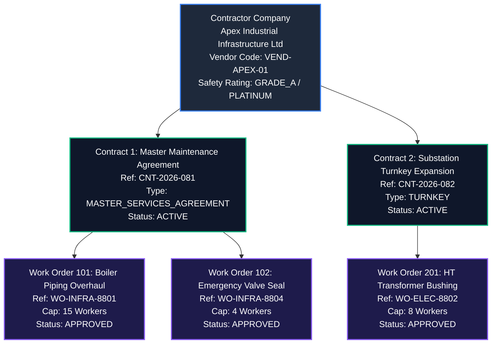
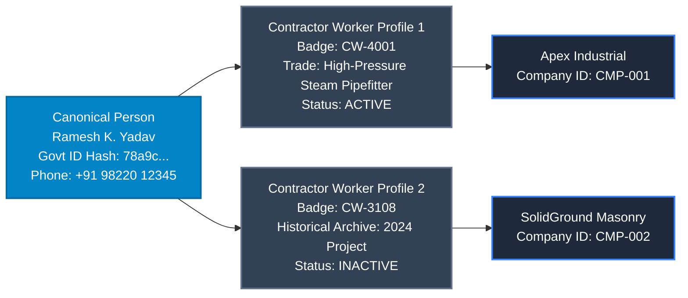
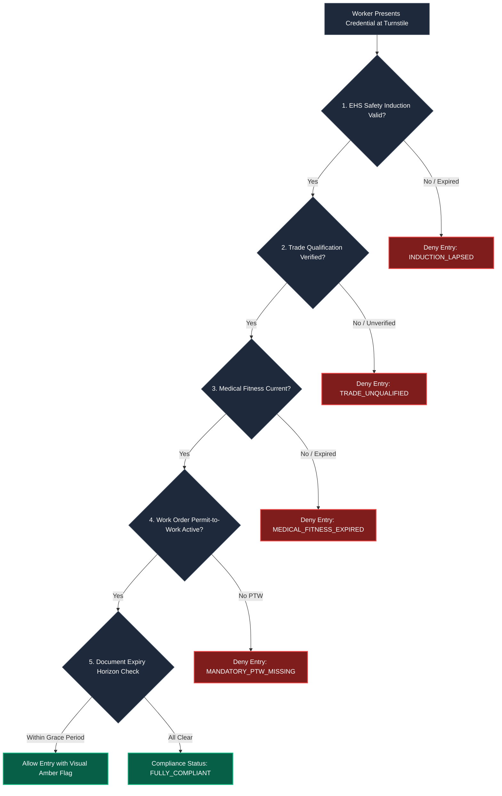
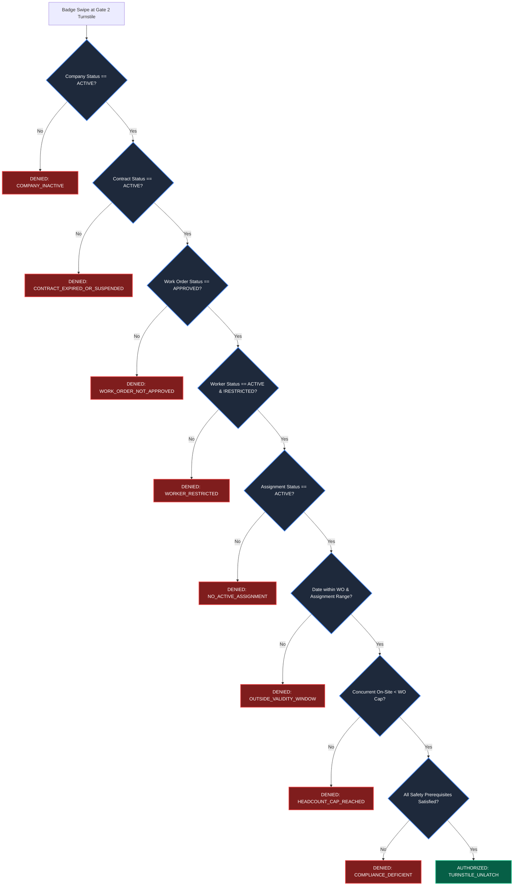
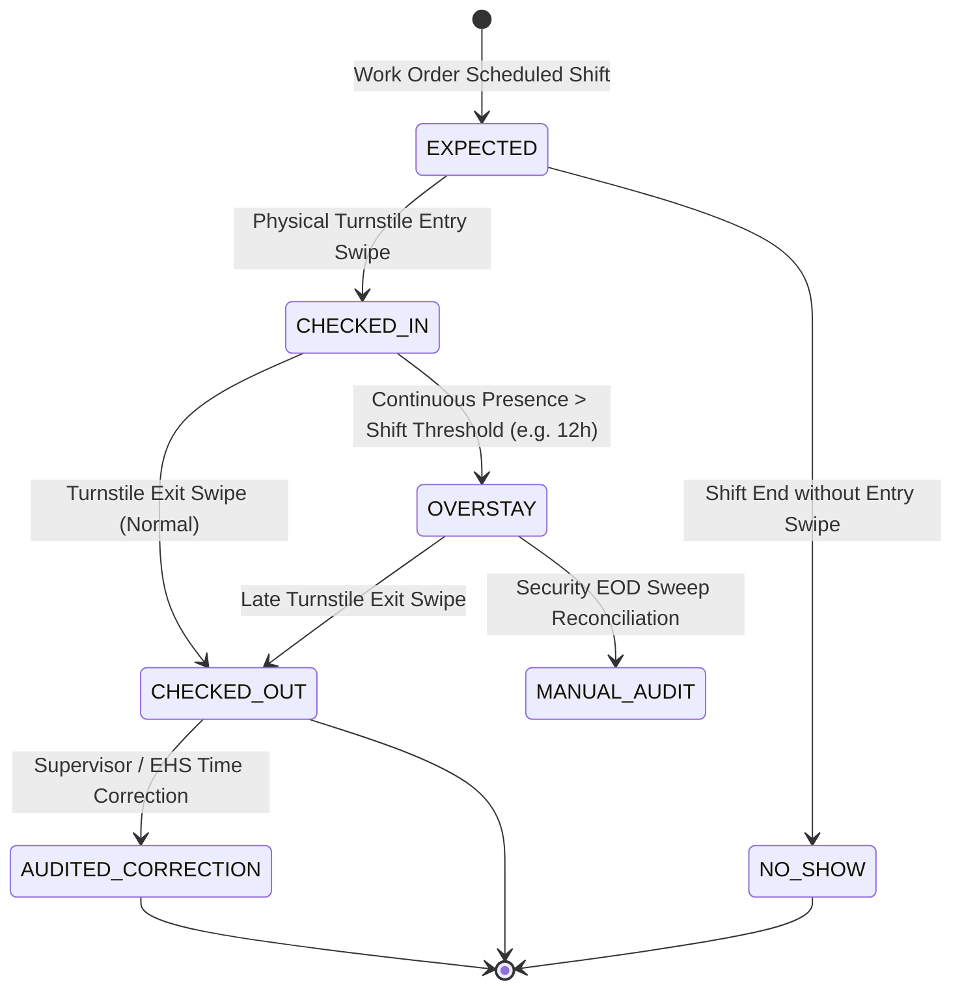
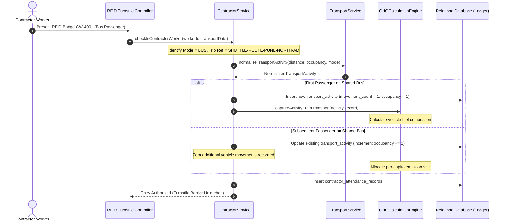
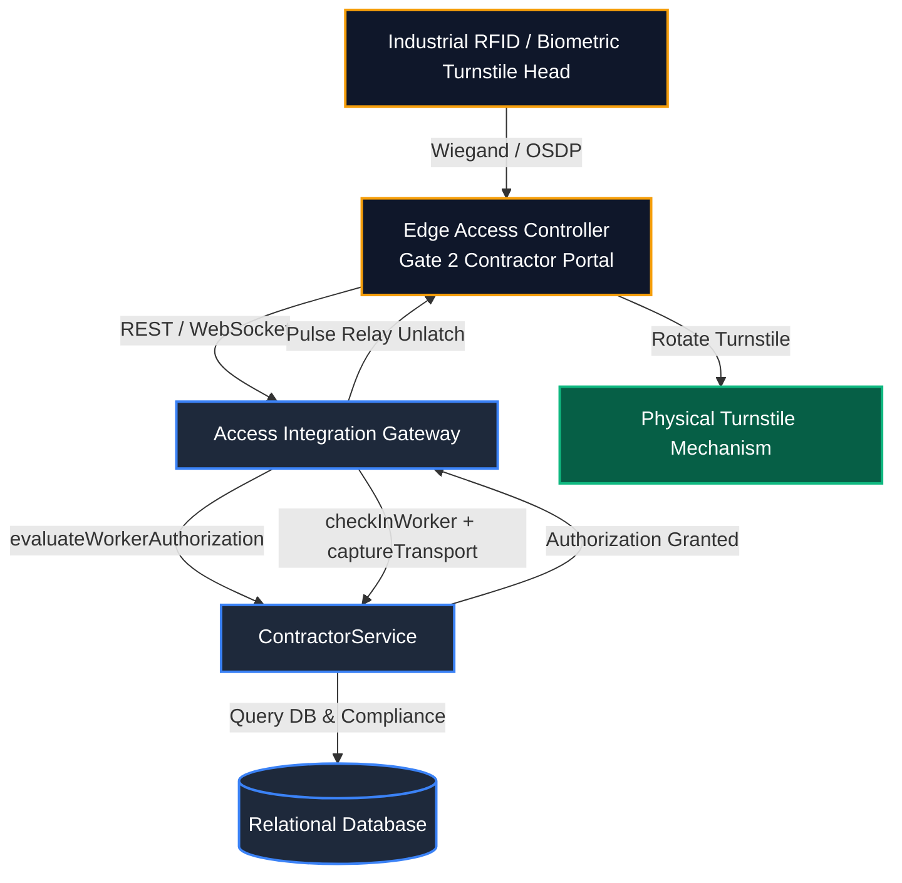
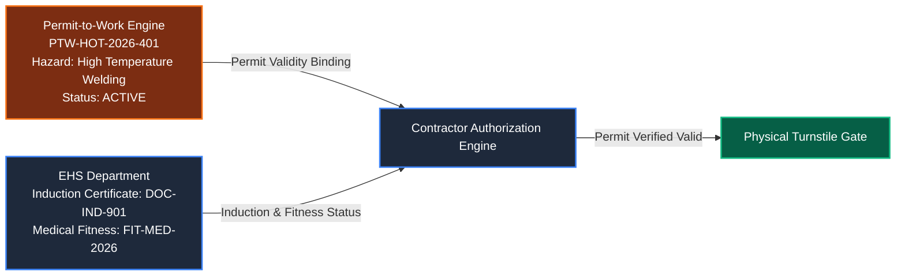

# Contractor Management Domain Architecture & Relational Model

## 1. Domain Architectural Model

The Contractor Management Domain (`@vms/contractor`) in VMS Enterprise is an enterprise-grade subsystem engineered specifically for governing industrial contractor companies, multi-tiered commercial contracts, discrete work orders, contingent craft labor forces, and workforce compliance across high-security manufacturing plants, industrial complexes, and corporate campuses.

In mission-critical industrial manufacturing (automotive assembly, heavy fabrication, aerospace, continuous process plants, and high-voltage utilities), contractor management fundamentally diverges from transient visitor management:
- **Domain Independence Invariant:** A contractor worker is **not** a visitor. They operate under contractual obligations, work orders, insurance indemnities, specialized trade certifications, and statutory safety prerequisites.
- **Hierarchical Governance:** Authority cascades from Contractor Company &rarr; Commercial Contract &rarr; Authorized Work Order &rarr; Worker Assignment &rarr; Physical Gate Access.
- **Returning Worker Deduplication:** Craftspeople return across multiple contractors or projects over decades; their canonical human identity (`Person`) and historical records are preserved without redundant profile generation.
- **Strict Authorization Decision Engine:** Physical turnstile badge-ins must evaluate multi-variable compliance predicates in real time (Company active, Contract active, Work Order approved, Headcount cap available, Worker active, Assignment valid, Safety induction current, Medical fitness verified, PTW active).
- **Zero-Blocker Embedded ESG/GHG Capture:** Workforce commute activity data (GHG Protocol Scope 3 Category 7: Employee & Contractor Commuting) is embedded seamlessly at turnstiles without causing physical queuing or turnstile lockups if downstream carbon calculation engines experience latency.
- **Group Transport Deduplication:** Shared contractor shuttles record a single physical vehicle movement with incremented occupancy to prevent multi-passenger emission multiplication.

---

## 2. Diagram 1: Company &rarr; Contract &rarr; Work Order Hierarchy



---

## 3. Diagram 2: Company &rarr; Worker Relationship & Canonical Person Linking



---

## 4. Diagram 3: Work Order &rarr; Worker Assignment Relationship & Headcount Cap

```mermaid
graph TD
    classDef wo fill:#1e1b4b,stroke:#8b5cf6,stroke-width:2px,color:#fff;
    classDef assign fill:#0f766e,stroke:#14b8a6,stroke-width:2px,color:#fff;
    classDef worker fill:#334155,stroke:#64748b,stroke-width:2px,color:#fff;
    classDef cap fill:#b91c1c,stroke:#ef4444,stroke-width:2px,color:#fff;

    WO[Work Order: WO-INFRA-8801<br/>Authorized Cap: 3 Workers]:::wo

    WO --> AS1[Assignment 1<br/>Worker: Ramesh Yadav (CW-4001)<br/>Status: ACTIVE]:::assign
    WO --> AS2[Assignment 2<br/>Worker: Suresh Nair (CW-4005)<br/>Status: ACTIVE]:::assign
    WO --> AS3[Assignment 3<br/>Worker: Amit Verma (CW-4006)<br/>Status: ACTIVE]:::assign

    AS1 --> W1[Worker: CW-4001]:::worker
    AS2 --> W2[Worker: CW-4005]:::worker
    AS3 --> W3[Worker: CW-4006]:::worker

    WO -.-> REJ[4th Assignment Rejected<br/>HEADCOUNT_CAP_EXCEEDED]:::cap
```

---

## 5. Diagram 4: Multi-Source Compliance Evaluation Pipeline



---

## 6. Diagram 5: Work Authorization Decision Engine



---

## 7. Diagram 6: Attendance Lifecycle



---

## 8. Diagram 7: Transport / Commute Activity Capture & Group Deduplication



---

## 9. Diagram 8: Contractor-to-GHG Traceability Chain (Scope 3 Category 7)

```mermaid
graph LR
    classDef company fill:#1e293b,stroke:#3b82f6,stroke-width:2px,color:#fff;
    classDef entity fill:#0f172a,stroke:#64748b,stroke-width:1px,color:#fff;
    classDef transport fill:#065f46,stroke:#10b981,stroke-width:2px,color:#fff;
    classDef esg fill:#1e1b4b,stroke:#8b5cf6,stroke-width:2px,color:#fff;
    classDef ghg fill:#831843,stroke:#ec4899,stroke-width:2px,color:#fff;

    CMP[Contractor Company<br/>Apex Industrial]:::company --> CT[Contract<br/>CNT-2026-081]:::entity
    CT --> WO[Work Order<br/>WO-INFRA-8801]:::entity
    WO --> W[Worker<br/>Ramesh Yadav]:::entity
    W --> ATT[Attendance Event<br/>att-501 @ Gate 2]:::entity
    ATT --> TRA[Transport Activity<br/>Mode: BUS, Dist: 28.5 km]:::transport
    TRA --> ESG[ESG Activity Record<br/>Scope 3 Cat 7<br/>Provenance: SYSTEM_ESTIMATED]:::esg
    ESG --> GHG[GHG Calculation<br/>Emissions: 2.14 kg CO₂e<br/>Factor: DEFRA-2024-BUS]:::ghg
```



---

## 10. Diagram 9: Access / Gate & Turnstile Integration



---

## 11. Diagram 10: Safety & Permit Integration


