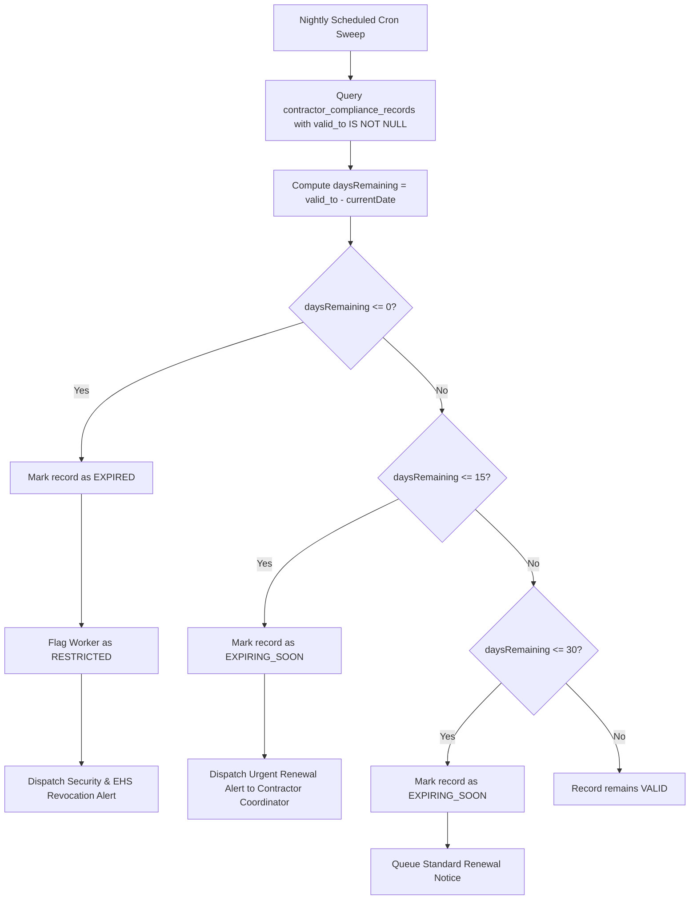

# Document Expiration & Lifecycle Horizon Management

## 1. Overview & Purpose

Document expiration in industrial environments cannot be treated reactively. If a contractor worker's high-voltage electrical license or medical fitness expires while they are deployed on site, continued physical presence constitutes a statutory compliance violation and an immediate occupational liability.

The Document Expiry Subsystem provides:
1. **Automated Horizon Scanning:** Proactive scheduled sweeps identifying documents nearing expiration across configurable warning windows.
2. **Multi-Tier Escalation Alerts:** Notifications dispatched at 30-day, 15-day, 7-day, and same-day intervals.
3. **Hard Gate Cutoffs:** Zero-grace-period policy enforcement for critical life-safety certifications (Medical Fitness, Safety Inductions, Confined Space Permits).
4. **Visual Industrial Control Alerts:** Real-time visual status badges across control room and contractor portal dashboards.

---

## 2. Expiration Horizon Tiers

| Horizon Window | Status Badge | Operational Action & Notification Scope | Gate Impact |
|:---|:---|:---|:---|
| **> 30 Days** | `VALID` (Green) | Normal deployment; no alerts active. | Unrestricted entry. |
| **16 - 30 Days** | `EXPIRING_SOON` (Yellow) | Automated notification dispatched to Contractor Key Account Manager requesting renewal submission. | Unrestricted entry. |
| **1 - 15 Days** | `EXPIRING_SOON` (Orange) | Urgent notification to Contractor and Host Plant Supervisor; warning banner displayed on security turnstile screen during badge swipe. | Entry allowed with warning flag. |
| **0 Days / Past Due** | `EXPIRED` (Red) | Access credentials revoked; automated notification dispatched to Security Dispatch and EHS. | **HARD REJECTION AT GATE TURNSTILE.** |

---

## 3. Horizon Scanning Logic

The `ContractorService.checkExpiringDocuments(tenantId, daysHorizon)` routine queries active compliance records:

---

## 4. Grace Period Policies vs Zero-Tolerance Invariants

Different compliance requirement types operate under distinct policy enforcement models:

1. **Zero-Tolerance Invariant (No Grace Period):**
   - **Medical Fitness (`MEDICAL_FITNESS`):** Hard stop immediately upon expiration. Workers cannot enter high-risk plant zones without certified physiological fitness.
   - **EHS Safety Induction (`SAFETY_INDUCTION`):** Annual refresher mandatory. Once lapsed, worker must attend induction before re-entry.
   - **Permit-to-Work (`PERMIT_PREREQUISITE`):** Hot work or height work permits expire at shift end or designated hour with immediate turnstile lockout.
2. **Conditional Grace Period (Configurable 48h - 7 Days):**
   - **Government ID Verification (`GOVERNMENT_ID`):** Allowed up to 5 days grace period if renewal slip has been uploaded and approved by plant security.
