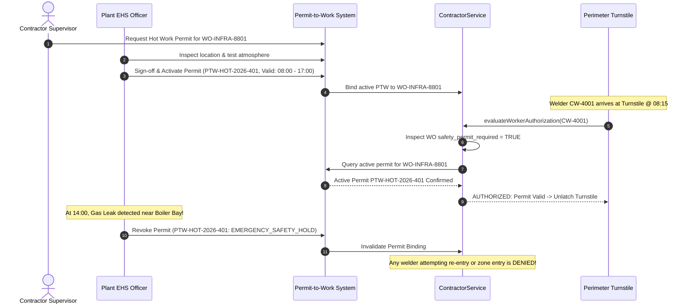

# Safety & Permit-to-Work (PTW) Integration

## 1. Overview & Purpose

In manufacturing plants, chemical processing facilities, and power utilities, contractor personnel execute high-hazard activities that pose extreme operational risks.

The Safety & Permit-to-Work Integration bridges the Contractor Domain with the plant Environmental Health & Safety (EHS) system:
- High-hazard Work Orders cannot be accessed without an active, verified **Permit-to-Work (PTW)**.
- Specific hazardous task classifications mandate specialized personal protective equipment (PPE), atmospheric gas testing, and lockout-tagout (LOTO) verification.
- Emergency safety stop orders and permit revocations immediately revoke turnstile access.

---

## 2. High-Hazard Work Categories

| Hazard Classification | Technical Description | Mandatory Prerequisites | Turnstile Gate Impact |
|:---|:---|:---|:---|
| **HOT_WORK** | Welding, cutting, brazing, flame cutting, or grinding producing sparks. | Spark containment, calibrated fire extinguisher, continuous fire watch. | Gate verifies active PTW before allowing welder entry. |
| **CONFINED_SPACE** | Entry into tanks, boilers, silos, trenches, or degreasing pits. | Calibrated multi-gas testing (O₂, LEL, CO, H₂S), tripod harness, standby rescuer. | Gate verifies specialized Confined Space Certification. |
| **WORKING_AT_HEIGHT** | Any task performed at an elevation of 2.0 meters or higher. | Full-body fall arrest harness, double lanyard, scaffolding green tag inspection. | Gate verifies Height Safety Training module on file. |
| **HIGH_VOLTAGE** | Work within high-voltage sub-stations, switchyards, or transformer bays. | Verified Lockout-Tagout (LOTO) isolation, dielectric PPE, earthing verification. | Gate verifies State Electrical Supervisor License. |
| **HAZMAT_CHEMICAL** | Handling corrosive acids, toxic reagents, or volatile solvents. | Chemical splash suit, breathing apparatus, eye-wash station clearance. | Gate checks chemical handling induction clearance. |

---

## 3. Permit Lifecycle & Gate Binding Flow

---

## 4. Emergency Evacuation Headcount Integration

During plant emergencies (e.g. fire alarm, ammonia release):
1. **Real-Time Muster Zone Roll-Call:** The Contractor Attendance Ledger provides the live census of all contractor personnel inside the plant (`presence_status = 'CHECKED_IN'`).
2. **Zone Density Mapping:** EHS incident commanders query attendance records by `work_location` to see how many craftspeople are operating in affected zones.
3. **Muster Station Badge-In:** As workers reach safe muster points and swipe RFID beacons, the system marks their safety status as `EVACUATED_SAFE`, identifying missing individuals instantly.
