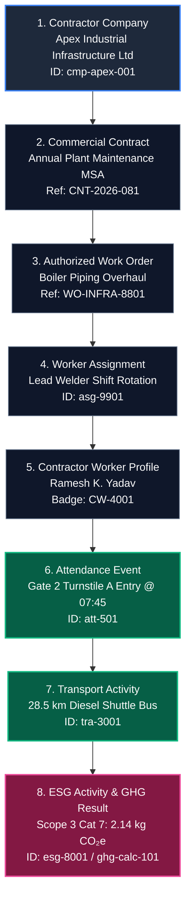

# End-to-End Source Provenance & Traceability

## 1. Overview & Regulatory Rationale

Global environmental compliance frameworks (such as the EU Corporate Sustainability Reporting Directive [CSRD], SEC Climate Disclosure Rules, ISO 14064, and India's Business Responsibility and Sustainability Reporting [BRSR]) require complete auditability of all reported emissions.

Auditors must be able to:
1. Trace any reported Scope 3 carbon figure back to the exact physical operational event that generated it.
2. Verify the raw data provenance level (measured vs estimated vs user-reported).
3. Inspect the commercial, contractual, and human context of the activity.

---

## 2. The 8-Tier Bidirectional Provenance Chain

VMS Enterprise maintains an unbroken, bidirectional 8-tier provenance chain for contractor workforce activities:



---

## 3. Data Provenance Grading Tiers

Every data point entering the provenance pipeline is tagged with a strict Zod-validated `DataProvenance` tier:

| Provenance Tier | Description | Typical Source in Contractor Domain |
|:---|:---|:---|
| **`MEASURED`** | Highest confidence; direct physical instrumentation. | Onboard GPS IoT telematics from contractor shuttle buses or weighbridge telemetry. |
| **`SYSTEM_CALCULATED`** | High confidence; algorithmically computed from verified coordinates. | GIS route calculation between labor camp geofence and plant gate coordinates. |
| **`USER_PROVIDED`** | Moderate confidence; submitted by user during registration. | Worker declares commuting via two-wheeler from distance of 14 km. |
| **`SYSTEM_ESTIMATED`** | Standard baseline; regional defaults. | Standard facility regional commuter distance lookup when exact address is unlisted. |
| **`IMPORTED`** | Secondary data; batch ingestion from third-party systems. | Legacy shift logs migrated from external contractor management ERPs. |

---

## 4. Auditor Drill-Down Capability

When a corporate sustainability auditor clicks on any greenhouse gas figure in the executive ESG reporting view:
- The system executes `traceFromGHGCalculation(ghgCalculationId)`.
- It reconstructs the entire upstream lineage:
  ```json
  {
    "ghgCalculationId": "ghg-calc-101",
    "emissionsKgCO2e": 2.14,
    "scope": "SCOPE_3_CATEGORY_7",
    "emissionFactorUsed": "DEFRA_2024_BUS_DIESEL",
    "sourceActivity": {
      "transportActivityId": "tra-3001",
      "mode": "BUS",
      "distanceKm": 28.5,
      "occupancy": 24,
      "provenance": "SYSTEM_ESTIMATED"
    },
    "attendanceRecord": {
      "attendanceId": "att-501",
      "entryTime": "2026-10-11T07:45:00Z",
      "gate": "Gate 2 - Turnstile A"
    },
    "worker": {
      "badgeNumber": "CW-4001",
      "workerName": "Ramesh K. Yadav"
    },
    "workOrder": {
      "workOrderNumber": "WO-INFRA-8801",
      "title": "Boiler Piping Overhaul"
    },
    "contract": {
      "contractNumber": "CNT-2026-081"
    },
    "contractorCompany": {
      "tradeName": "Apex Industrial Infrastructure Ltd",
      "vendorCode": "VEND-APEX-01"
    }
  }
  ```
This exhaustive traceability completely eliminates corporate greenwashing risks and satisfies the most demanding external ESG assurance audits.
