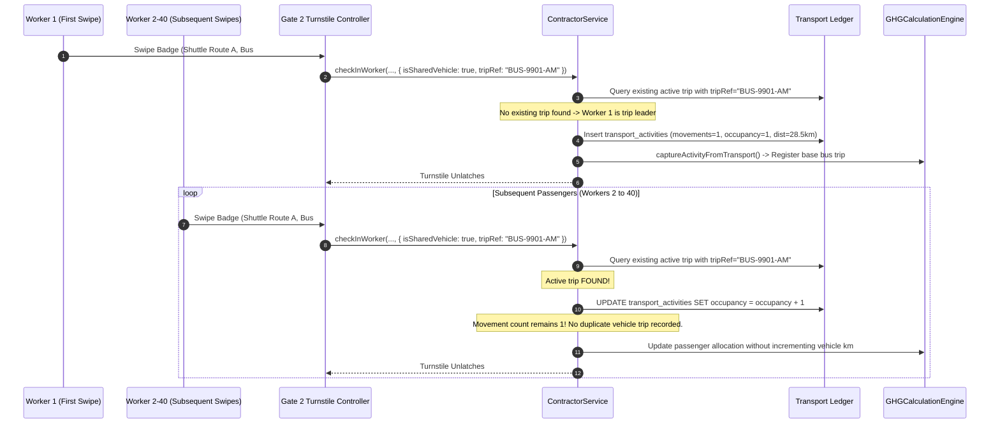

# Contractor Transport & Mobility Activity Capture

## 1. Overview & Purpose

Workforce mobility capture within the Contractor Domain accounts for the daily commuting footprint of hundreds or thousands of contingent craftspersons. Under international greenhouse gas accounting standards, these commuter journeys fall directly under **GHG Protocol Scope 3 Category 7: Employee & Contractor Commuting**.

Key engineering requirements:
1. **Low-Friction Gate Experience:** Commute data collection must never slow down turnstile throughput. Data is derived automatically from pre-configured worker commute profiles, bus route manifests, or quick turnstile prompts.
2. **Normalized Multi-Modal Transport:** Integrated with the platform `TransportService` to normalize distance, fuel types, and occupancy across disparate transport modes.
3. **Group Transport Movement Deduplication:** Industrial contractors predominantly transport craft forces in chartered 30-50 passenger buses. Failing to deduplicate these shared trips would result in catastrophic over-reporting of transport emissions.

---

## 2. Transport Modes & Parameter Normalization

Contractor workforce transport modes and default calculation parameters:

| Transport Mode | Vehicle Category | Default Fuel Type | Default Occupancy | GHG Scope Allocation |
|:---|:---|:---|:---|:---|
| `BUS` | Heavy Commercial Transit Bus | Diesel (B7 Blend) | 35 Passengers | Scope 3 Category 7 |
| `MINIBUS` | Medium Commercial Van | Diesel | 14 Passengers | Scope 3 Category 7 |
| `VAN` | Light Utility Vehicle | Diesel / CNG | 8 Passengers | Scope 3 Category 7 |
| `CARPOOL` | Passenger Car | Gasoline / EV | 3-4 Passengers | Scope 3 Category 7 |
| `TWO_WHEELER` | Motorcycle / Scooter | Gasoline / Electric | 1 Passenger | Scope 3 Category 7 |
| `BICYCLE` | Non-Motorized | Human Powered | 1 Passenger | Zero Direct Emissions |
| `WALKING` | Local Dormitory Pedestrian | None | 1 Person | Zero Direct Emissions |

---

## 3. Group Transport Movement Deduplication Architecture

### The Problem of Naive Commute Capture
If 40 contractor workers arrive at Gate 2 on a shared 28.5 km shuttle bus:
- **Naive Implementation:** Generates 40 individual transport records of 28.5 km each = $40 \times 28.5 = 1,140\text{ km}$ of bus travel, over-counting physical diesel combustion by **4,000%**.
- **VMS Enterprise Invariant:** Exactly **one physical vehicle journey** of 28.5 km is recorded in the transport ledger. Each boarding passenger is registered to that journey, incrementing the occupancy count from 1 to 40.

### Deduplication Sequence Flow

---

## 4. Distance Provenance & GIS Routing

Distances are derived using rigorous data provenance hierarchies:
- **`MEASURED`:** Exact GPS telemetry from onboard IoT telematics devices.
- **`SYSTEM_CALCULATED`:** GIS routing service computing highway distance between contractor labor camp coordinates and the plant gate geofence.
- **`SYSTEM_ESTIMATED`:** Standardized regional zonal commuting distance (e.g. Pune Metropolitan Industrial Belt = 28.5 km).
- **`USER_PROVIDED`:** Manual distance declared by contractor coordinator during shift scheduling.
