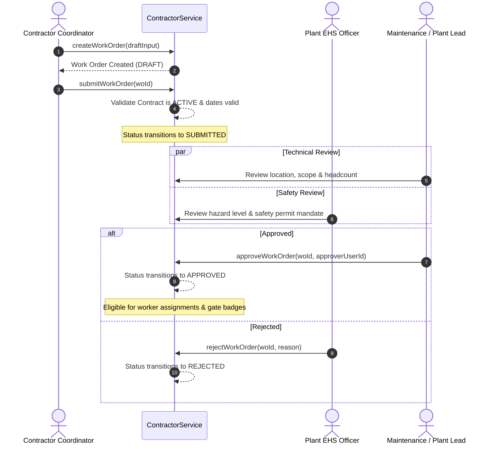

# Work Order Management & Headcount Governance

## 1. Overview & Purpose

Work Orders within VMS Enterprise represent the discrete, bounded operational authorization under which physical technical tasks are carried out inside industrial sites. 

While a commercial contract governs the overall business engagement over months or years, a Work Order defines:
- The precise physical shop floor, bay, roof, or sub-station where work is permitted (`work_location`).
- The technical craft or trade category required (`work_category`).
- The maximum simultaneous labor headcount authorized on site (`authorized_worker_count`).
- Specific EHS safety prerequisites, such as high-temperature or confined space Permits-to-Work (`safety_permit_required`).
- The designated internal plant manager or supervisor accountable for supervising the activity (`supervising_employee_id`).

---

## 2. Work Order Relational Model

The `contractor_work_orders` table maintains full operational fidelity:

| Column Name | Data Type | Nullable | Description & Invariants |
|:---|:---|:---|:---|
| `work_order_id` | UUID | No | Primary Key |
| `tenant_id` | UUID | No | Multi-tenant isolation key |
| `contract_id` | UUID | No | Parent Contract Foreign Key |
| `company_id` | UUID | No | Contractor Company Foreign Key |
| `work_order_number` | VARCHAR(64) | No | Unique work order code (e.g. `WO-INFRA-8801`) |
| `title` | VARCHAR(255) | No | Narrative operational title |
| `work_category` | ENUM | No | Category (`GENERAL`, `ELECTRICAL`, `MECHANICAL`, `CIVIL`, `HVAC`, `PLUMBING`, `PAINTING`, `FIRE_SAFETY`, `IT_NETWORKING`, `HAZARDOUS_MATERIAL`, `SPECIALIZED_TECHNICAL`) |
| `status` | ENUM | No | Lifecycle status (`DRAFT`, `SUBMITTED`, `APPROVED`, `REJECTED`, `IN_PROGRESS`, `COMPLETED`, `CANCELLED`) |
| `start_date` | DATE | No | Authorized work start date (must be &ge; contract start date) |
| `end_date` | DATE | No | Authorized work end date (must be &le; contract end date) |
| `work_location` | VARCHAR(255) | No | Exact physical facility area (e.g. `Heavy Machining Bay 2`) |
| `authorized_worker_count`| INTEGER | No | Maximum concurrent worker headcount cap |
| `safety_permit_required`| BOOLEAN | No | Flag indicating mandatory PTW link |
| `supervising_employee_id`| UUID | Yes | Internal plant supervisor in charge |
| `hazard_level` | VARCHAR(32) | Yes | Risk classification (`LOW`, `MEDIUM`, `HIGH`, `CRITICAL`) |
| `rejection_reason` | TEXT | Yes | Reason recorded if work order approval is denied |
| `created_at` | TIMESTAMPTZ | No | Creation timestamp |
| `updated_at` | TIMESTAMPTZ | No | Modification timestamp |

---

## 3. Approval Workflow & Lifecycle

Work orders must navigate a multi-role approval gate prior to becoming active for workforce deployment:



---

## 4. Headcount Cap Invariant Enforcement

To prevent contractor overcrowding, safety violations, and unauthorized labor inflation, the system enforces a strict headcount cap:

1. **Assignment Ceiling:** The total number of concurrently active worker assignments mapped to a work order cannot exceed `authorized_worker_count` unless an explicit supervisor override is recorded.
2. **Turnstile Concurrency Check:** At the turnstile, the Work Authorization Decision Engine counts the number of workers assigned to that Work Order who are currently `CHECKED_IN` on site. If `currentCheckedIn >= authorizedWorkerCount`, additional workers are turned away with:
   ```json
   {
     "isAuthorized": false,
     "rejectionReason": "HEADCOUNT_CAP_REACHED: Maximum authorized headcount (15) for WO-INFRA-8801 is already on premises"
   }
   ```
