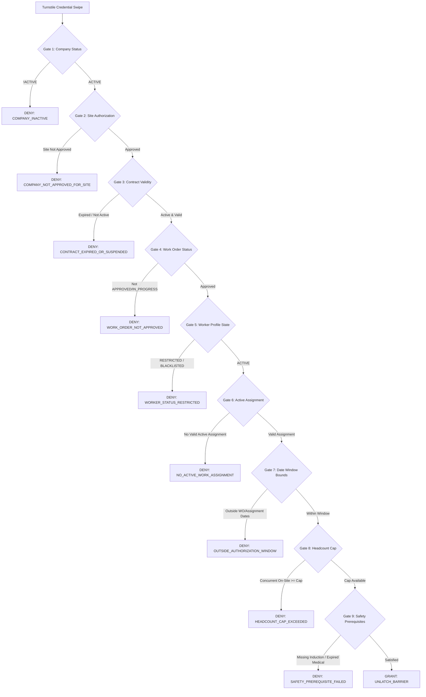

# Worker Authorization Decision Engine

## 1. Overview & Purpose

The Worker Authorization Decision Engine (`ContractorService.evaluateWorkerAuthorization`) is the critical access control gateway between database policy and physical barrier automation.

When an industrial contractor presents an RFID badge, mobile credential, or biometric identifier at a plant perimeter turnstile, the engine evaluates a complex multi-predicate decision matrix in under 50 milliseconds to grant or deny barrier rotation.

---

## 2. Multi-Predicate Evaluation Matrix

The engine evaluates nine sequential validation gates. If any gate fails, authorization is immediately denied with a specific, auditable failure code:



---

## 3. Decision Contract Schema

The TypeScript interface `WorkerAuthorizationDecision` defines the output payload:

```typescript
export interface WorkerAuthorizationDecision {
  isAuthorized: boolean;
  contractorWorkerId: string;
  badgeNumber: string;
  workerName: string;
  companyName: string;
  workOrderNumber?: string;
  workLocation?: string;
  rejectionReason?: string;
  warnings?: string[];
  evaluatedAt: Date;
  details?: {
    companyStatus: ContractorCompanyStatus;
    contractStatus: ContractStatus;
    workOrderStatus: WorkOrderStatus;
    workerStatus: ContractorWorkerStatus;
    assignmentStatus: ContractorAssignmentStatus;
    medicalFitnessValid: boolean;
    safetyInductionValid: boolean;
    headcountCap: number;
    currentOccupancy: number;
  };
}
```

---

## 4. Rejection Codes & Operational Triage

| Rejection Code | Root Cause | Operator Triage Action |
|:---|:---|:---|
| `COMPANY_INACTIVE` | Contractor organization is suspended or pending onboarding review. | Contact Procurement / Vendor Management. |
| `COMPANY_NOT_APPROVED_FOR_SITE` | Company is not authorized for this specific plant facility. | Verify contract site scope. |
| `CONTRACT_EXPIRED_OR_SUSPENDED` | Commercial agreement has concluded or is under legal hold. | Sourcing lead must file contract extension. |
| `WORK_ORDER_NOT_APPROVED` | Work Order is still in `DRAFT` or `SUBMITTED` state. | Plant Engineer must approve work order. |
| `WORKER_STATUS_RESTRICTED` | Individual worker has safety incident or disciplinary restriction. | EHS Officer review required. |
| `NO_ACTIVE_WORK_ASSIGNMENT` | Worker has not been formally scheduled to a work order. | Contractor supervisor must assign worker. |
| `OUTSIDE_AUTHORIZATION_WINDOW` | Today's date is before `start_date` or after `end_date`. | Check shift scheduling calendar. |
| `HEADCOUNT_CAP_EXCEEDED` | Maximum authorized headcount for the work order is currently on site. | Await shift turnover or request supervisor cap elevation. |
| `SAFETY_PREREQUISITE_FAILED` | Expired EHS safety induction or occupational medical fitness. | Direct worker to Plant Safety Training Center. |
| `MANDATORY_PTW_MISSING` | Work order specifies high-hazard PTW but active permit not found. | Issue Permit-to-Work via EHS portal. |
