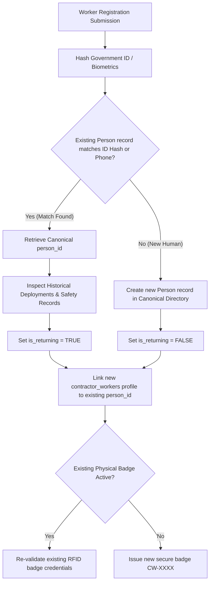

# Contractor Worker Management & Returning Worker Deduplication

## 1. Overview & Purpose

The Contractor Worker Management subsystem governs individual contingent workers, trade specialists, technicians, and craftspeople executing work orders within enterprise facilities.

Crucially, in large industrial manufacturing complexes, contractor labor is characterized by high turnover and repeated deployments:
- A pipefitter may work for Contractor A during an annual shutdown in 2024, return for Contractor B on an expansion project in 2025, and return independently in 2026.
- Creating detached worker records each time leads to fragmented compliance history, lost safety incident records, duplicate badge issuance, and security vulnerabilities.
- VMS Enterprise solves this via **Returning Worker Deduplication**, anchoring every contractor profile to a single immutable **Canonical Person** identity.

---

## 2. Worker Relational Entity Model

The `contractor_workers` table stores contingent workforce profiles:

| Column Name | Data Type | Nullable | Description & Invariants |
|:---|:---|:---|:---|
| `contractor_worker_id` | UUID | No | Primary Key |
| `tenant_id` | UUID | No | Multi-tenant isolation key |
| `company_id` | UUID | No | Employing Contractor Company Foreign Key |
| `person_id` | UUID | No | Canonical Person identity foreign key |
| `badge_number` | VARCHAR(64) | No | Physical/RFID badge identifier (e.g. `CW-4001`) |
| `full_name` | VARCHAR(255) | No | Worker legal full name |
| `worker_category` | ENUM | No | Category (`SKILLED`, `SEMI_SKILLED`, `UNSKILLED`, `SUPERVISOR`, `ENGINEER`, `SPECIALIST`, `SKILLED_TRADESPERSON`) |
| `status` | ENUM | No | Lifecycle status (`ACTIVE`, `PENDING_VERIFICATION`, `RESTRICTED`, `INACTIVE`, `BLACKLISTED`) |
| `trade_skill` | VARCHAR(255) | Yes | Craft specialization (e.g. `High-Pressure Steam Pipefitter`) |
| `designation` | VARCHAR(128) | Yes | Contractor-assigned job title |
| `phone` | VARCHAR(64) | Yes | Contact telephone number |
| `email` | VARCHAR(255) | Yes | Email address if available |
| `medical_fitness_valid` | BOOLEAN | No | Current medical fitness clearance flag |
| `medical_fitness_expiry`| DATE | Yes | Expiration date of medical fitness clearance |
| `is_returning` | BOOLEAN | No | Flag indicating returning worker with historical deployments |
| `total_shifts_completed`| INTEGER | No | Aggregated shift count across all plant deployments |
| `created_at` | TIMESTAMPTZ | No | Profile creation timestamp |
| `updated_at` | TIMESTAMPTZ | No | Profile modification timestamp |

---

## 3. Returning Worker Deduplication Engine

When `ContractorService.registerContractorWorker` is called, the system executes an automated disambiguation and deduplication routine:

### Benefits of Canonical Person Linking:
1. **Safety Incident Preservation:** Any safety breach, near-miss, or blacklisting attributed to a craftsperson follows their canonical identity regardless of which contractor employer sponsors them.
2. **Training Record Reusability:** If a worker completed an 8-hour Plant General Safety Induction within the past 12 months, the induction carries over without forcing wasteful retraining.
3. **Medical Fitness Tracking:** Centralized tracking prevents workers with expired medical fitness or safety disqualifications from evading restrictions by switching contractor agencies.
