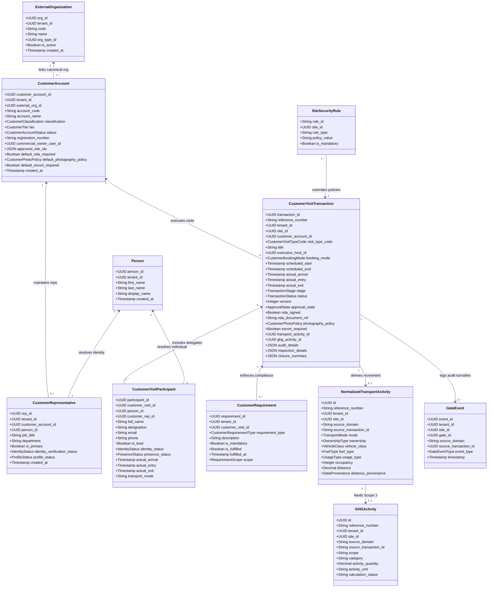

# Customer Domain Architecture & Relational Model

## 1. Domain Architectural Model

The Customer Management Domain (`@vms/customer`) is built upon clean relational foundations with strict domain boundaries, multi-tenant isolation, and explicit decoupling from the generic visitor subsystem.

---

## 2. Diagram 1: Entity Architecture

The following class diagram illustrates the relational structure of the Customer Domain and its explicit connections to shared platform services.

---

## 3. Database Schema Mapping & Constraints

### 3.1 Primary Customer Domain Tables
1. **`customer_accounts`**: Stores institutional customer profile, OEM tier, commercial owner, approved sites, and default security rules. Unique on `(tenant_id, account_code)`.
2. **`customer_representatives`**: Associates external customer contacts to canonical `persons` records, maintaining verified email, phone, job title, and designation.
3. **`customer_visit_types`**: Seed master table of supported customer engagements (`CUSTOMER_MEETING`, `PLANT_VISIT`, `MANAGEMENT_VISIT`, `CUSTOMER_AUDIT`, `CUSTOMER_INSPECTION`, `DELEGATION_VISIT`, `PRODUCT_REVIEW`, `PROCESS_REVIEW`).
4. **`customer_visit_transactions`**: The central transactional ledger for customer visits, holding state, timestamps, host sponsor, security settings, and references to transport, GHG, and audit records.
5. **`customer_visit_participants`**: Individual delegation attendees, tracking presence status (`EXPECTED`, `ARRIVED`, `CHECKED_IN`, `DEPARTED`, `NO_SHOW`), turnstile entries, and identity verification.
6. **`customer_requirements`**: Evaluated compliance requirements (NDA, safety inductions, PPE, quality escorts, photography prohibitions) bound to the visit.

### 3.2 Immutability and Audit Invariants
- Financial and carbon calculations in `ghg_calculations` and `gate_events` are strictly immutable (`isImmutable: true`).
- Any state transition, participant arrival, or schedule adjustment generates an audit log entry in `audit_logs` and an event in `domain_events`.
