# Customer Domain Independence & Shared Platform Services

## 1. The Anti-Pattern: Generic "Visitor Type" Polymorphism

In naive facility management systems, customers, contractors, vendors, and freight drivers are frequently compressed into a single `visitors` table using a discriminatory enum like `visitor_type = 'CUSTOMER'`. 

This design pattern invariably fails in enterprise manufacturing environments due to severe structural impedance mismatches:
1. **Conflicting Security Models:** A generic visitor requires host desk greeting; a customer audit delegation requires plant manager sponsorship, bilateral NDAs, PPAP signoffs, and safety inductions.
2. **Entity Cardinality Breakdowns:** A standard visitor is a 1-to-1 person; an OEM customer delegation is a corporate hierarchy with master accounts, representative rosters, and multi-delegate shared journeys.
3. **ESG Attribution Divergence:** Generic visitor travel maps to generic Scope 3 Cat 6; customer travel requires corporate customer account attribution, ISO 14064 verification, and customer sustainability reporting.
4. **Data Pollution & Breach Risks:** Blending customer accounts into visitor registries leaks OEM customer identities to third-party contractors and security desk guards.

In VMS Enterprise:
$$\text{\textbf{Strict Constraint: }} \texttt{visitor\_type = 'CUSTOMER'} \text{ is strictly prohibited.}$$

---

## 2. Diagram 2: Shared Platform Services Interaction

The Customer Domain operates as an autonomous business domain that integrates with normalized shared platform services via standard interfaces.

```mermaid
graph TD
    subgraph "Customer Domain (@vms/customer)"
        CA[Customer Accounts]
        CR[Customer Representatives]
        CVT[Customer Visit Transactions]
        CVP[Customer Visit Participants]
        CREQ[Precedence & Requirements Engine]
    end

    subgraph "Shared Platform Services"
        IDN[Identity & Person Service<br/>Canonical deduplication & contact records]
        TRS[Transport Service<br/>Normalized multi-modal movement vectors]
        GHG[GHG Calculation Engine<br/>Scope 3 Cat 6 emission factor pipeline]
        WFE[Workflow & Approval Engine<br/>Multi-stage host & executive approvals]
        GAT[Gate Operations & Devices<br/>Turnstiles, ANPR, physical access decisions]
        SEC[Permissions & RLS<br/>Least-privilege RBAC & PII masking]
        AUD[Immutable Audit & Event Ledger<br/>Tamper-evident system logs & outbox]
    end

    CA -->|Links external org| IDN
    CR -->|Resolves canonical individual| IDN
    CVP -->|Deduplicates person phone/email| IDN

    CVT -->|Executes workflow instance| WFE
    CVT -->|Evaluates site security rules| CREQ

    CVT -->|Records normalized movement| TRS
    TRS -->|Creates activity facts| GHG
    CVT -->|Links Scope 3 activity| GHG

    CVT -->|Authorizes physical check-in| GAT
    CVP -->|Validates badge & turnstile| GAT
    GAT -->|Emits immutable event| AUD

    CA -->|Restricted role access| SEC
    CR -->|Masks contact PII| SEC
    CVT -->|Enforces tenant & site scope| SEC

    CVT -->|Records state mutations| AUD
    CA -->|Logs master updates| AUD
```

---

## 3. Interaction Contracts with Platform Services

### 3.1 Identity & Person Service
- When customer representatives or delegation attendees are added, the customer service checks `person_contacts` for existing phone and email addresses.
- If a match is found within the tenant, the canonical `person_id` is reused, avoiding redundant identity profiles while maintaining customer-specific job titles and designations in `customer_representatives`.

### 3.2 Transport Service (`@vms/transport`)
- Customer visit transport details (origin, destination, mode, vehicle class, fuel type, usage type, occupancy) are transformed into a `NormalizedTransportActivity`.
- For round-trip journeys, the transport service symmetrically calculates return distances and sets bidirectional route metadata.

### 3.3 GHG Engine (`@vms/ghg`)
- Captures an immutable `ghg_activities` fact record linked directly to the `transport_activity_id` and `transaction_id`.
- Carries provenance flags (`SYSTEM_CALCULATED`, `USER_DECLARED`, `MEASURED_WEIGHBRIDGE`).
- Triggers emission factor lookup and calculation asynchronously without blocking plant operations.

### 3.4 Gate Operations & Physical Hardware
- Check-in and check-out events validate visit approval states and mandatory requirement fulfillments.
- Verified gate turnstile entries insert immutable `gate_events` rows with timestamps and operator identifiers.
