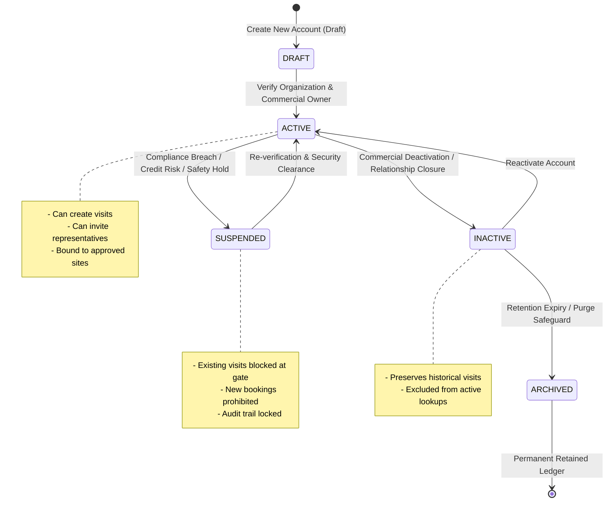

# Customer Account Master Data Lifecycle

## 1. Overview & Account Governance

Customer Accounts in VMS Enterprise represent legally recognized commercial organizations that interact with tenant production facilities. Managing customer accounts requires rigorous master data governance to prevent duplicate accounts, enforce geographic access boundaries, and preserve historical audit trails.

---

## 2. Diagram 3: Master Data Lifecycle State Machine



---

## 3. Account Lifecycle Stages & Validations

### 3.1 DRAFT Stage
- Newly registered accounts undergoing validation.
- Requires basic legal entity details: Legal Name, Trade Name, Organization Type, Commercial Owner User ID.
- Cannot be assigned to scheduled production audits or site visits until transitioned to `ACTIVE`.

### 3.2 ACTIVE Stage
- Fully vetted customer master account.
- Governed by approved site boundaries (`approvedSiteIds`). If an account is authorized only for Plant 1 (Chennai), attempting to schedule a visit to Plant 2 (Pune) is blocked.
- Defines account-level security defaults (default photography restriction, default escort requirement, default bilateral NDA mandate).

### 3.3 SUSPENDED Stage
- Applied immediately during intellectual property disputes, commercial contract breaches, or severe safety non-compliance.
- **Enforcement:** All currently scheduled visits for this account are automatically placed on security hold; gate check-in turnstiles reject any badge associated with the suspended account.

### 3.4 INACTIVE & ARCHIVED Stages
- Used when a customer relationship ends or transitions to a former supplier.
- Preserves all historical visit transactions, transport movements, and GHG calculations without data loss.

---

## 4. Probable Duplicate Detection Engine

To prevent multiple sales or quality coordinators from creating duplicate customer accounts for the same legal entity, the domain executes a multi-dimensional duplicate detection check during account registration:

$$\text{Duplicate Detected} \iff (\text{accountCode Matches Existing}) \lor (\text{cleanLegalName Matches Existing}) \lor (\text{registrationNumber Matches Existing})$$

```typescript
const probableDuplicate = existingAccounts.find((acc: any) => {
  const matchCode = input.accountCode && acc.account_code === input.accountCode;
  const matchName = acc.account_name?.trim().toLowerCase() === cleanOrgName.toLowerCase();
  const matchReg = input.registrationNumber && acc.registration_number && acc.registration_number === input.registrationNumber;
  return matchCode || matchName || matchReg;
});

if (probableDuplicate) {
  throw new Error(`Customer account '${input.accountCode || cleanOrgName}' already exists (Probable duplicate detected matching '${probableDuplicate.account_name}')`);
}
```

If a probable duplicate is detected, the engine raises an error referencing the existing account code, prompting the operator to attach the visit to the established master record.
