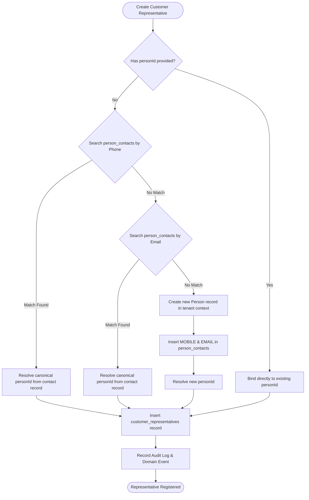

# Customer Representatives Directory & Identity Deduplication

## 1. Overview

A **Customer Representative** (`customer_representatives`) represents an individual employee, technical specialist, quality auditor, or executive designated by a customer account to engage with tenant manufacturing facilities.

To ensure strict relational integrity and eliminate duplicate identity profiles across the enterprise, representatives are linked to the tenant's canonical **Person** model (`persons`), while maintaining customer-specific context (job title, department, primary contact flag, and verification status).

---

## 2. Canonical Person Deduplication Engine

When creating a customer representative, the platform prevents creating orphaned person identities by executing telephone and email disambiguation:



1. **Phone Match:** Looks for existing contacts matching the normalized phone number.
2. **Email Match:** If no phone match exists, searches case-insensitively for the email address.
3. **Canonical Linkage:** If a match is found, the existing `person_id` is reused, avoiding redundant identity storage. If no match exists, a new `persons` record is provisioned and linked to `person_contacts`.

---

## 3. Least-Privilege PII Masking Architecture

In accordance with global privacy regulations (GDPR, DPDP, ISO 27701) and zero-trust security principles, customer personal data is governed by least-privilege role-based masking.

### 3.1 PII Access Matrix

| Role | Contact Phone Access | Email Address Access | Identity Document Reference |
| :--- | :--- | :--- | :--- |
| **SUPER_ADMIN** | Full Unmasked | Full Unmasked | Full Unmasked |
| **SECURITY_ADMIN** | Full Unmasked | Full Unmasked | Full Unmasked |
| **RECEPTIONIST** | Full Unmasked | Full Unmasked | Masked |
| **SECURITY_GUARD** | Masked (`+65-***-9120`) | Masked (`k***@kintaro.com`) | Last 4 Digits Only |
| **ESG_MANAGER** | Masked (`+65-***-9120`) | Masked (`k***@kintaro.com`) | Redacted |
| **AUDITOR** | Masked | Masked | Redacted |

### 3.2 Dynamic Masking Algorithm
When `listCustomerRepresentatives` is invoked with a restricted role context (e.g., `ESG_MANAGER` or `SECURITY_GUARD`), the service automatically transforms sensitive fields before returning records to the UI:

```typescript
if (requestingRole === 'ESG_MANAGER' || requestingRole === 'SECURITY_GUARD') {
  return list.map(rep => ({
    ...rep,
    phone: rep.phone ? rep.phone.replace(/(\+\d{1,3}-\d{2,3}-)\d{3,4}(-\d+)/, '$1***$2') : '***-***',
    email: rep.email ? rep.email.replace(/(^.{1,2})(.*)(@.*$)/, '$1***$3') : undefined,
  }));
}
```
This guarantees that operational ESG reporting and gate operations have full access to delegation statistics without exposing sensitive executive contact channels.
