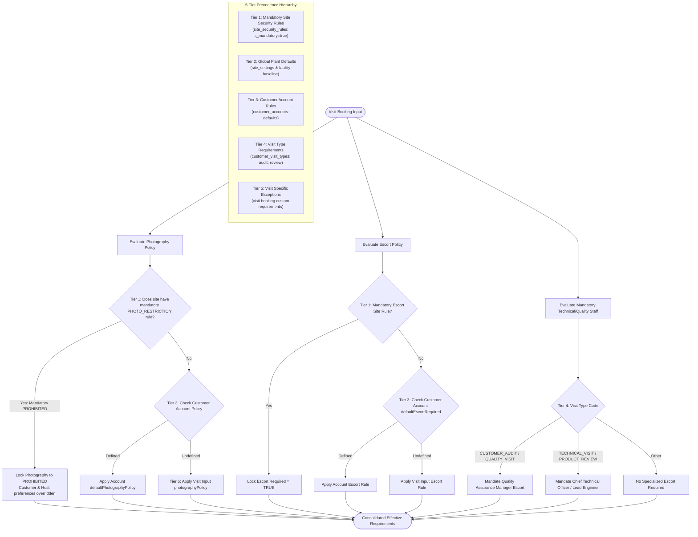

# Requirement Precedence Engine

## 1. Overview

Industrial manufacturing facilities enforce stringent environmental, health, safety (EHS), and intellectual property (IP) policies. When scheduling customer visits, corporate hosts, sales directors, and customer representatives frequently declare conflicting preferences (e.g., an executive wanting to take photos of plant automation lines vs. a plant's zero-camera IP policy).

To resolve policy conflicts deterministically, VMS Enterprise embeds an authoritative **Requirement Precedence Engine**.

---

## 2. Diagram 4: Precedence Hierarchy Flow

The Precedence Engine evaluates visit policies strictly top-down according to a 5-tier precedence hierarchy. Higher tiers unconditionally override lower tiers.

---

## 3. Precedence Hierarchy Definitions

### Tier 1: Mandatory Site Security Rules (`site_security_rules`)
- **Authority:** Supreme facility security mandate.
- **Scope:** Bound to a specific manufacturing facility (`site_id`).
- **Inviolability:** If `is_mandatory = true`, no corporate sponsor, plant host, or customer executive can waive or downgrade this requirement.
- **Example:** High-security battery prototyping facility where photography is strictly `PROHIBITED`. Even if the customer account preference is `PERMITTED`, the engine resolves the policy to `PROHIBITED`.

### Tier 2: Global Plant Defaults (`site_settings`)
- Baseline campus requirements applied to all personnel entering the physical perimeter (e.g., standard safety induction, closed-toe steel-toe footwear, high-visibility vest).

### Tier 3: Customer Account Rules (`customer_accounts`)
- Institutional terms negotiated in master customer contracts (e.g., default requirement for bilateral executive NDA execution prior to site access).

### Tier 4: Visit Type Requirements (`customer_visit_types`)
- Requirements triggered by the nature of the visit:
  - `CUSTOMER_AUDIT` & `QUALITY_VISIT`: Automatically mandates the presence of the Plant Quality Assurance Manager (`QUALITY_REP`).
  - `TECHNICAL_VISIT` & `PRODUCT_REVIEW`: Automatically mandates a Senior Mechanical or Electrical Engineer Co-Host (`TECHNICAL_REP`).

### Tier 5: Visit Specific Exceptions (`customRequirements`)
- Transactional stipulations added for a single visit (e.g., specialized cleanroom shoe covers, specific technical agenda documents).

---

## 4. Conflict Resolution Matrix Example

| Scenario | Tier 1 (Site Rule) | Tier 3 (Account Default) | Tier 5 (Visit Request) | Engine Resolution | Justification |
| :--- | :--- | :--- | :--- | :--- | :--- |
| **Executive Plant Tour** | `PHOTO_RESTRICTION: PROHIBITED` (Mandatory) | `defaultPhotographyPolicy: PERMITTED` | `photographyPolicy: PERMITTED` | **`PROHIBITED`** | Tier 1 site security rule overrides all lower preferences. |
| **Supplier Audit** | No site photo rule | `defaultPhotographyPolicy: RESTRICTED` | Not specified | **`RESTRICTED`** | Tier 3 account default governs in absence of Tier 1 site mandate. |
| **Commercial Meeting** | No site photo rule | `defaultPhotographyPolicy: RESTRICTED` | `photographyPolicy: PERMITTED` | **`PERMITTED`** | Non-mandatory site settings allow Tier 5 visit-specific agreements. |
| **Quality Audit** | `ESCORT: MANDATORY` | `defaultEscortRequired: false` | `escortRequired: false` | **`ESCORT REQUIRED`** | Mandatory site safety escort cannot be waived. |
