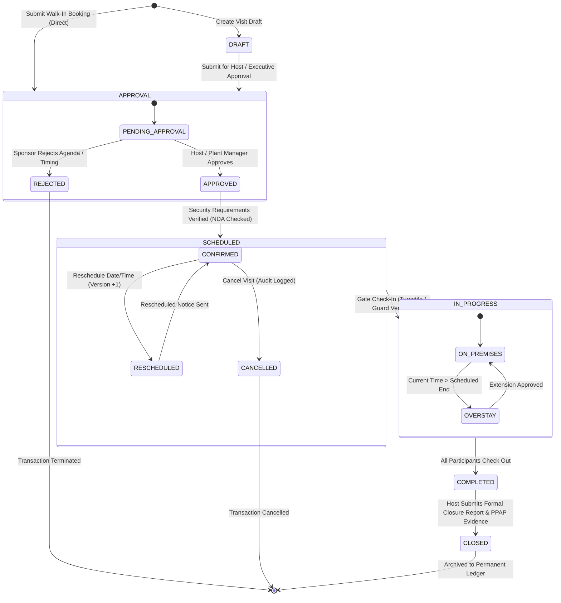

# Customer Visit Lifecycle State Machine

## 1. Overview & Separation of Stage vs. Status

In VMS Enterprise, transactional lifecycles are modeled using a strict two-dimensional state system:
- **`Stage` (`TransactionStage`):** Represents the linear macro-phase of the business process (`DRAFT` $\rightarrow$ `APPROVAL` $\rightarrow$ `SCHEDULED` $\rightarrow$ `IN_PROGRESS` $\rightarrow$ `COMPLETED` $\rightarrow$ `CLOSED`).
- **`Status` (`TransactionStatus`):** Represents the granular operational condition within a stage (`DRAFT`, `PENDING`, `APPROVED`, `CONFIRMED`, `ON_PREMISES`, `OVERSTAY`, `DEPARTED`, `CANCELLED`, `REJECTED`).

Conflating stage and status causes state ambiguity in multi-step enterprise workflows.

---

## 2. Diagram 5: Visit Lifecycle State Machine

---

## 3. Detailed Lifecycle Transitions & Business Invariants

### 3.1 Creation & Submission
- Standard visits are created in `stage = 'APPROVAL'`, `status = 'PENDING'`, `approval_state = 'PENDING'` (or `DRAFT` if saved as incomplete).
- Walk-in customer visits enter `APPROVAL` immediately with mandatory security desk escort until host authorization is recorded.

### 3.2 Host & Executive Approval Gate
- Required before any gate entry can be authorized.
- An authorized host user approves the visit via `approveCustomerVisit(tenantId, transactionId, approverUserId, notes)`.
- Approval transitions `approval_state = 'APPROVED'` and `status = 'CONFIRMED'`.

### 3.3 Gate Check-In Invariants (`checkInCustomerVisit`)
Gate check-in transitions `stage = 'IN_PROGRESS'` and `status = 'ON_PREMISES'`. Entry is strictly blocked if:
1. `approval_state !== 'APPROVED'`: Visit has not received formal authorization.
2. `visit.nda_signed === false` and `account.default_nda_required === true`: Mandatory bilateral NDA has not been executed or verified.
3. Account is `SUSPENDED` or `INACTIVE`.

### 3.4 Versioned Rescheduling (`rescheduleCustomerVisit`)
When a customer visit date is altered:
- The transaction version is incremented: `version = version + 1`.
- The new start and end timestamps are recorded.
- An immutable audit trail entry logs the rescheduling user, timestamp offset, and justification.

### 3.5 Formal Closure & Findings (`closeCustomerVisit`)
Following checkout (`COMPLETED`), customer audits and technical inspections require formal closure:
- Host records meeting outcome, inspection findings, follow-up actions, and links evidence documents (e.g., PPAP inspection checklists, VDA audit scorecards).
- Transitions the visit to `stage = 'CLOSED'`.
