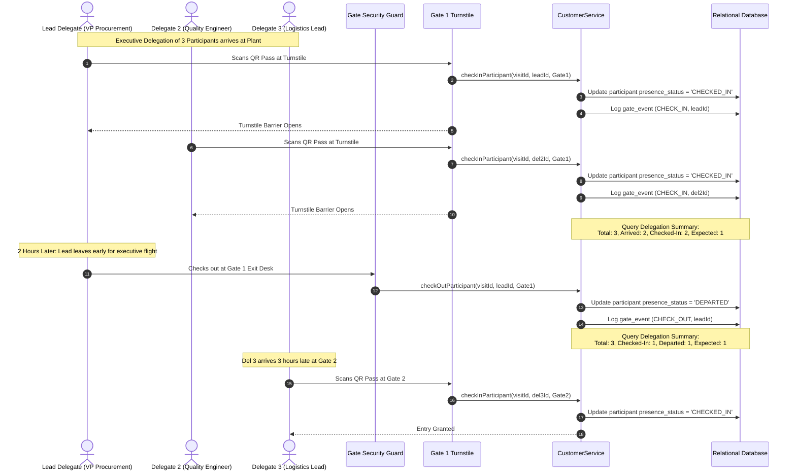

# Delegation Management & Partial Check-in/Check-out

## 1. Overview

Corporate customer visits are rarely solo events. They frequently involve multi-disciplinary delegations comprising procurement executives, quality engineers, supply chain directors, and legal counsels.

Managing delegations in industrial facilities requires:
1. **Unified Scheduling:** All delegates are scheduled under a single master customer visit transaction (`customer_visit_transactions`), eliminating redundant booking entries.
2. **Individual Accountability:** Each delegate has a distinct entry in `customer_visit_participants` linked to a canonical person record for turnstile badging and emergency roll-call muster lists.
3. **Staggered Arrivals & Departures:** Delegates frequently arrive on different flights or leave at different times. The platform supports independent gate check-in and checkout per participant.

---

## 2. Diagram 7: Delegation Flow



---

## 3. Individual Participant State Management

Each participant tracks an independent presence state machine:

| Presence Status | Description | Permitted Next States |
| :--- | :--- | :--- |
| **`EXPECTED`** | Scheduled delegate; has not yet arrived at site security gates. | `ARRIVED`, `CHECKED_IN`, `NO_SHOW` |
| **`ARRIVED`** | Physically present at reception; completing identity verification. | `CHECKED_IN`, `NO_SHOW` |
| **`CHECKED_IN`** | Active badge issued; physically present inside plant perimeter. | `DEPARTED` |
| **`DEPARTED`** | Has exited the site through security turnstiles. | *Terminal state for visit* |
| **`NO_SHOW`** | Did not arrive during the scheduled visit window. | *Terminal state for visit* |

---

## 4. Live Delegation Operational Summary (`CustomerDelegationView`)

Plant security, executive hosts, and emergency muster commanders can query real-time delegation status at any moment:

```typescript
const delegationView = await service.getCustomerDelegationSummary(tenantId, transactionId);
```

The resulting `CustomerDelegationView` contains:
- **`totalParticipants`:** Total number of registered delegates.
- **`leadParticipant`:** Reference and contact of lead executive sponsor.
- **`arrivedParticipants`:** Delegates at reception or checked in.
- **`checkedInParticipants`:** Delegates currently inside production areas.
- **`departedParticipants`:** Delegates who have completed checkout.
- **`expectedParticipants`:** Outstanding delegates who have not yet arrived.
- **`participants`:** Array of complete participant records with entry/exit timestamps.
