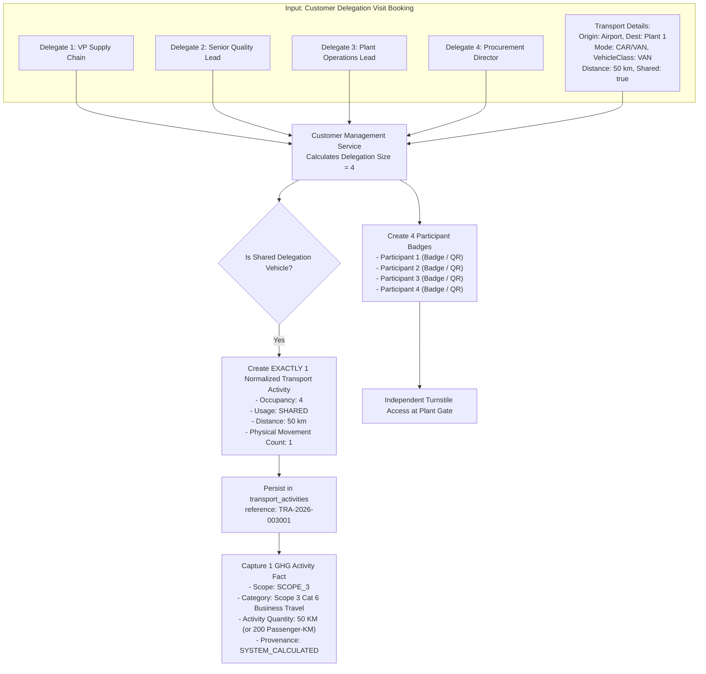

# Group Journey Deduplication & Shared Transport Normalization

## 1. The Carbon Multiplier Fallacy in Enterprise Transport

In legacy visitor and ESG tracking systems, transport activities are naively captured on a per-visitor basis. When an 8-person executive customer delegation arrives at a manufacturing plant in a single chartered Meridian Sprinter van travelling 50 km from the airport, a per-person recording architecture produces:
$$8 \text{ participants} \times 50\text{ km} = 400\text{ vehicle-km}$$

This creates a **$8\times$ artificial inflation** of the tenant's Scope 3 Category 6 greenhouse gas ledger, corrupting sustainability reporting and failing third-party GHG Protocol audits.

---

## 2. Diagram 8: Group Journey Normalization Flow

VMS Enterprise resolves this issue by strictly separating **physical vehicle movements** from **individual passenger badges**:



---

## 3. Mathematical Normalization Model

When `isSharedDelegationVehicle = true`:
1. **Physical Vehicle Leg:** Exactly 1 record is created in `transport_activities`.
2. **Occupancy Vector:** Automatically set to the total delegation headcount ($\sum \text{delegates}$) unless explicitly overridden.
3. **Vehicle Carbon Accounting (Vehicle-KM Method):**
   $$\text{Emissions}_{\text{kg CO}_2\text{e}} = \text{Distance (50 km)} \times \text{EF}_{\text{Vehicle Class, Fuel}}$$
4. **Passenger Allocation (Passenger-KM Method):**
   $$\text{Emissions}_{\text{kg CO}_2\text{e}} = (\text{Distance} \times \text{Occupancy}) \times \text{EF}_{\text{Passenger-KM}}$$
   $$\text{Emissions} = (50\text{ km} \times 4) \times \text{EF}_{\text{pkm}} = 200\text{ pkm} \times \text{EF}_{\text{pkm}}$$

Both methodologies yield compliant, audit-verifiable emissions figures without duplicative vehicle movements.

---

## 4. Code Implementation Guarantee

Inside `services/customer/src/customer.service.ts`:

```typescript
// Embedded Normalized Transport Activity Creation
// GROUP JOURNEY DUPLICATION PREVENTION:
// If delegation participants travel in 1 vehicle, 1 physical vehicle movement is stored with occupancy=count.
if (input.transport) {
  const t = input.transport;
  const totalDelegates = participantsToSave.length;
  const vehicleOccupancy = t.occupancy ?? (t.isSharedDelegationVehicle ? totalDelegates : 1);

  const normalized = this.transportService.createNormalizedTransport({
    tenantId,
    sourceDomain: 'CUSTOMER',
    sourceTransactionId: transactionId,
    mode: t.mode,
    ownership: t.ownership,
    vehicleClass: t.vehicleClass,
    fuelType: t.fuelType,
    usageType: t.usageType,
    occupancy: vehicleOccupancy,
    originLocation: t.originLocation,
    destinationLocation: t.destinationLocation,
    distanceKm: t.distanceKm,
    distanceProvenance: t.distanceProvenance,
    measurementMethod: t.measurementMethod,
    journeyType: t.journeyType || 'ONE_WAY',
    dataSource: t.dataSource || 'CUSTOMER_VISIT_FORM_EMBEDDED',
  });
  
  // Exactly ONE transport_activities record inserted
  this.db.insert('transport_activities', ...);
  // Exactly ONE ghg_activities record inserted
  this.db.insert('ghg_activities', ...);
}
```
This architectural invariant protects the enterprise against double counting across all multi-participant customer visits.
