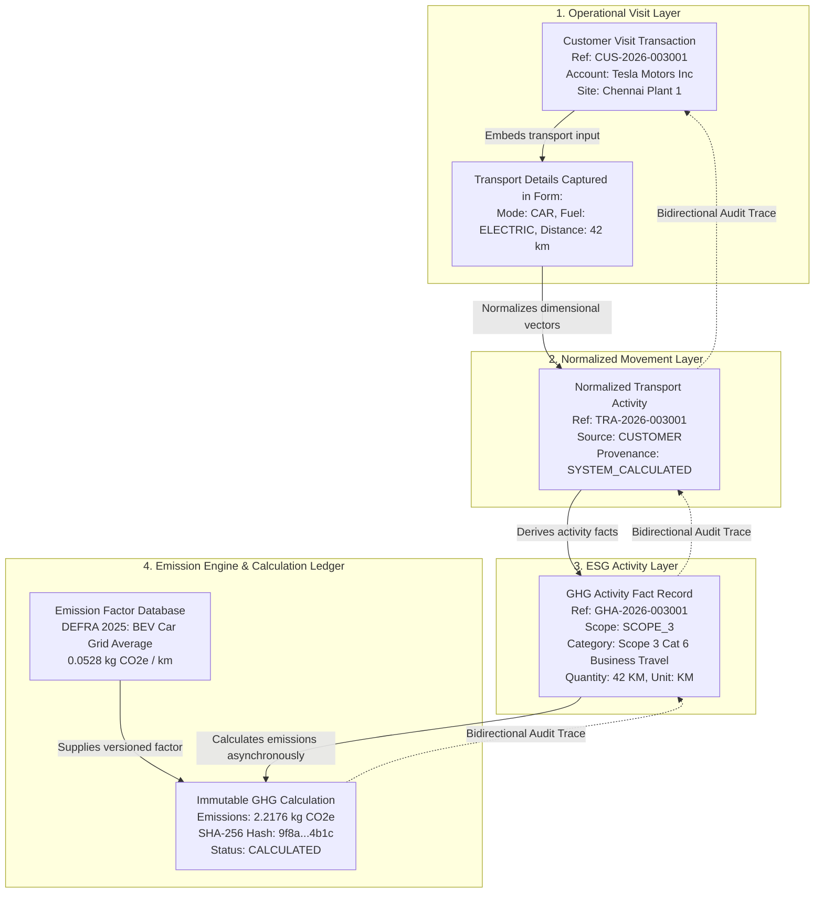

# Embedded ESG & Scope 3 Category 6 GHG Activity Provenance

## 1. Executive Context: Scope 3 Category 6 in Industrial Operations

Under the **GHG Protocol Corporate Value Chain (Scope 3) Accounting and Reporting Standard**, Category 6 covers **Business Travel** emissions from transportation of employees and authorized business partners for business-related activities in vehicles not owned or operated by the reporting entity.

In large manufacturing corporations, hosting hundreds of customer plant tours, OEM audits, and technical reviews every year generates substantial upstream travel emissions. VMS Enterprise embeds ESG activity capture directly into operational visitor flows without requiring manual data entry or external surveys.

---

## 2. Diagram 9: Scope 3 Cat 6 Provenance & Traceability Chain

The following diagram details the complete bidirectional provenance chain connecting a raw customer visit booking to the immutable carbon calculation ledger:

---

## 3. The Zero-Blocker Operational Invariant

A fundamental architectural requirement of VMS Enterprise is the **Zero-Blocker Invariant**:

$$\text{\textbf{Zero-Blocker Invariant: }} \text{Operational factory workflows must NEVER fail due to ESG calculation status.}$$

- If an emission factor service is unreachable, if network latency delays calculation, or if an invalid emission factor formula throws an error, **the customer visit transaction remains 100% valid**.
- The `ghg_activities` record is marked `calculation_status = 'PENDING'`, and a background reconciliation task re-processes the calculation queue without human intervention.
- Security turnstiles and plant gate guards are never obstructed by carbon accounting pipelines.

---

## 4. Complete Provenance & Verification Metadata

Every customer GHG activity carries explicit metadata verifying data origin and accuracy levels:

| Provenance Level | Description | Typical Use Case | Verification Level |
| :--- | :--- | :--- | :--- |
| **`SYSTEM_CALCULATED`** | Route derived using automated geographic coordinates between plant address and airport / hotel. | Default for airport pickups and inter-city travel. | High |
| **`MEASURED_WEIGHBRIDGE`** | Physical axle weighbridge or digital odometer logged at the gate entrance. | Heavy transport / OEM machinery delivery escorts. | Audit-Grade Highest |
| **`USER_DECLARED`** | Distance manually entered by executive host or customer representative. | Bespoke itinerary or multi-leg road trips. | Medium |
| **`ESTIMATED_REGIONAL_AVERAGE`**| Standard metropolitan commuting average used when origin is unspecified. | Local walk-in visitors. | Standard Baseline |

### 4.1 Cryptographic Immutability
Every calculation record stored in `ghg_calculations` includes a cryptographic hash:
$$\text{Calculation Hash} = \text{SHA256}(\text{activity\_quantity} \parallel \text{factor\_value} \parallel \text{version\_tag} \parallel \text{geography})$$
This guarantees that carbon footprints presented in annual sustainability reports (GRI 305, CSRD, SEC Climate Disclosures) are tamper-evident and audit-grade.
