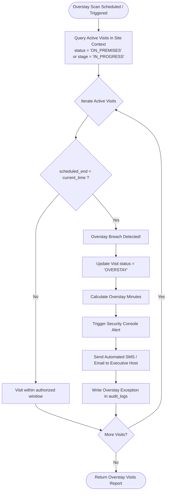

# Customer Exceptions & Overstay Monitoring

## 1. Overview & Security Risk Profile

In 24/7 manufacturing plants, customer delegates remaining unescorted on premises past their authorized schedule pose significant safety, compliance, and IP theft risks. 
- Production lines may transition to hazardous high-voltage or chemical testing shifts.
- Proprietary prototypes may be staged on factory floors after normal business hours.
- Emergency evacuation accounting (muster points) requires 100% accurate real-time headcounts.

The **Overstay Monitoring Engine** in `@vms/customer` proactively detects, flags, and escalates customer visits exceeding scheduled windows.

---

## 2. Overstay Detection Engine (`getOverstayCustomerVisits`)

The overstay engine continuously scans active customer visits within a facility:



---

## 3. Implementation Logic

Inside `CustomerService.getOverstayCustomerVisits`:

```typescript
public async getOverstayCustomerVisits(tenantId: string, siteId?: string): Promise<CustomerVisitTransaction[]> {
  const allVisits = this.db.findMany('customer_visit_transactions', { tenant_id: tenantId }, tenantId);
  const now = new Date();

  const overstayVisits = allVisits.filter((v: any) => {
    if (siteId && v.site_id !== siteId) return false;
    const isActive = v.status === 'ON_PREMISES' || v.stage === 'IN_PROGRESS';
    const isPastEnd = new Date(v.scheduled_end).getTime() < now.getTime();
    return isActive && isPastEnd;
  });

  for (const visit of overstayVisits) {
    if (visit.status !== 'OVERSTAY') {
      this.db.update('customer_visit_transactions', visit.transaction_id, {
        status: 'OVERSTAY',
        updated_at: now,
      }, tenantId);
      
      this.recordAuditLog(tenantId, visit.transaction_id, 'CUSTOMER_VISIT', 'OVERSTAY_BREACH', 'SYSTEM', {
        scheduledEnd: visit.scheduled_end,
        detectedAt: now,
      });
    }
  }

  return overstayVisits.map(v => this.mapCustomerVisitRecord(v));
}
```

---

## 4. Operational Resolution & Extensions

When an overstay breach is flagged:
1. **Security Console Alert:** Displayed in prominent high-contrast warning badges on the Gate Security dashboard.
2. **Host Extension:** The host can submit a formal visit extension request, providing operational justification and updating `scheduled_end`.
3. **Escorted Evacuation / Gate Checkout:** If no extension is requested, gate security dispatches a safety officer to escort the delegation to the exit turnstile and perform checkout.
