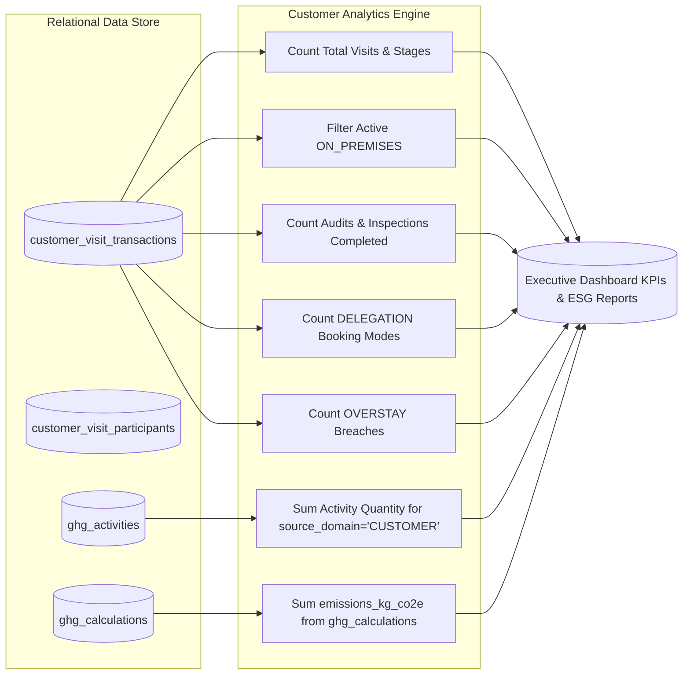

# Customer Operational Analytics & ESG Reporting

## 1. Overview & Data Philosophy

In enterprise manufacturing, executive plant directors and sustainability leaders require live operational visibility and verifiable carbon reporting. Rather than relying on simulated estimates or hardcoded mocks, VMS Enterprise derives all Key Performance Indicators (KPIs) **strictly from persisted database records in real time**.

---

## 2. Analytics Aggregation Engine (`getCustomerAnalyticsSummary`)

The `CustomerService.getCustomerAnalyticsSummary` method provides a consolidated executive analytics snapshot:

```typescript
export interface CustomerAnalyticsSummary {
  totalCustomerVisits: number;
  activeOnSite: number;
  scheduledUpcoming: number;
  completedVisits: number;
  auditsCompleted: number;
  inspectionsCompleted: number;
  totalDelegations: number;
  overstayCount: number;
  totalScope3Cat6EmissionsKg: number;
  totalPassengerKm: number;
}
```



---

## 3. Mathematical & Algorithmic Formulations

### 3.1 Active On Site
$$\text{Active On Site} = \sum [v \in \text{Visits} \mid v.\text{status} = \text{'ON\_PREMISES'} \lor v.\text{stage} = \text{'IN\_PROGRESS'}]$$

### 3.2 Completed Quality Audits
$$\text{Audits Completed} = \sum [v \in \text{Visits} \mid v.\text{visit\_type\_code} = \text{'CUSTOMER\_AUDIT'} \land (v.\text{stage} \in \{\text{'COMPLETED'}, \text{'CLOSED'}\})]$$

### 3.3 Scope 3 Category 6 Total Emissions ($\text{kg CO}_2\text{e}$)
$$\text{Total Emissions}_{\text{Scope 3 Cat 6}} = \sum_{c \in \text{Calculations}} c.\text{emissions\_kg\_co2e} \quad \text{where } c.\text{ghg\_activity\_id} \in \text{Customer Activities}$$

### 3.4 Total Passenger Travel ($\text{km}$)
$$\text{Total Travel Distance} = \sum_{a \in \text{Activities}} a.\text{activity\_quantity} \quad \text{where } a.\text{source\_domain} = \text{'CUSTOMER'}$$

---

## 4. Business Intelligence & ESG Regulatory Compliance

The derived operational metrics feed corporate disclosure channels:
1. **CSRD / ESRS E1 Climate Change:** Scope 3 Category 6 Business Travel disclosures with audit-verifiable calculation hashes.
2. **GRI 305-3:** Upstream travel accounting covering all external customer visits.
3. **ISO 14064-1:** Greenhouse gas verification ready with complete activity provenance and emission factor versioning.
4. **Plant Security Operations Review:** Weekly overstay frequency and plant safety audit logs.
