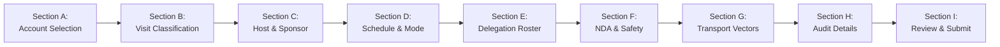

# Customer UI Navigation Reference & 21 Enterprise Subviews

## 1. Overview & UI Design Philosophy

The **Customer Management UI** (`CustomerManagementView.tsx`) provides plant managers, corporate receptionists, ESG compliance officers, and security gate staff with an industrial-grade interface built on:
- **4px Baseline Industrial Grid:** Compact, high-density layouts optimized for high-volume enterprise operations without bloated consumer styling.
- **Server-Side Rendering (SSR) Compatibility:** Full compatibility with headless Node test environments and SSR hydration without DOM mismatches.
- **Progressive Disclosure:** Complex multi-step customer booking workflows divided into logical, validated sections.
- **Role-Aware Security:** Automatic contact PII masking and least-privilege view restriction.

---

## 2. Master Navigation Matrix & Subviews

The view orchestrates **21 specialized subviews** organized into 4 functional groups:

| Group | Subview Key | Route Pattern | Target Persona | Primary Function |
| :--- | :--- | :--- | :--- | :--- |
| **Executive** | `OVERVIEW` | `/customers` | Plant Director, VP | Real-time KPIs, active visits, Scope 3 footprint |
| | `ANALYTICS` | `/customers/analytics` | ESG Manager, Operations | Historical charts, audit trends, carbon totals |
| **Directory** | `ACCOUNTS` | `/customers/accounts` | Commercial Manager | Master customer directory, OEM tiers, approved sites |
| | `ACCOUNT_DETAILS` | `/customers/accounts/:id` | Commercial Manager | Account overview, active agreements, visit history |
| | `NEW_ACCOUNT` | `/customers/accounts/new` | Commercial Manager | Create new customer account with duplicate checks |
| | `REPRESENTATIVES` | `/customers/representatives`| Receptionist, Admin | Canonical customer contact directory |
| | `NEW_REPRESENTATIVE`| `/customers/reps/new` | Receptionist, Admin | Add representative with person deduplication |
| **Visits** | `VISITS_ALL` | `/customers/visits` | Receptionist, Host | Master registry of all customer visits |
| | `VISIT_DETAILS` | `/customers/visits/:id` | Host, Guard | Comprehensive visit status, badge & gate actions |
| | `NEW_VISIT` | `/customers/new` | Host, Sales Coordinator | Progressive booking wizard (Sections A to I) |
| | `AUDITS` | `/customers/audits` | QA Manager, Lead Auditor | Specialized IATF / VDA audit console |
| | `INSPECTIONS` | `/customers/inspections` | Quality Lead, Inspector | PPAP / First-article inspection tracking |
| | `DELEGATIONS` | `/customers/delegations` | Receptionist, Host | Multi-participant delegation status board |
| | `DELEGATION_DETAILS`| `/customers/delegations/:id`| Security Desk | Real-time participant check-in/checkout board |
| **Operations** | `GATE_CONSOLE` | `/customers/gate` | Security Guard | Turnstile QR scanner, badge issuance |
| | `OVERSTAY` | `/customers/overstay` | Security Admin | SLA breach dashboard for active overstays |
| | `NDA_CONSOLE` | `/customers/nda` | Legal Counsel, Plant Mgr | Bilateral NDA vault and verification console |
| | `ESG_LEDGER` | `/customers/esg` | ESG Compliance Officer | Scope 3 Cat 6 activity traceability ledger |
| | `HISTORY` | `/customers/history` | Compliance Auditor | Historical timeline and audit logs |
| | `CALENDAR` | `/customers/calendar` | Receptionist, Host | Multi-site schedule calendar |
| | `SETTINGS` | `/customers/settings` | Super Admin | Precedence rules and visit type config |

---

## 3. The New Customer Visit Wizard: Sections A through I

The visit creation workflow (`NEW_VISIT`) utilizes a progressive disclosure wizard:

- **Section A: Customer Account Selection:** Selects or searches active customer accounts with tier tags.
- **Section B: Visit Classification & Type:** Selects visit type (`CUSTOMER_AUDIT`, `PLANT_VISIT`, etc.) and declares title and agenda.
- **Section C: Host & Relationship Ownership:** Designates executive host and secondary commercial sponsor.
- **Section D: Schedule & Booking Mode:** Sets start/end timestamps and booking mode (`RESERVED`, `WALK_IN`, `DELEGATION`, `RECURRING`).
- **Section E: Delegation & Participant Roster:** Adds multiple delegates with email, phone, designation, and lead flag.
- **Section F: Compliance, Bilateral NDA & Safety:** Declares bilateral NDA status, photography policy, and escort requirements.
- **Section G: Transport & Logistics Vectors:** Inputs vehicle mode, ownership, fuel type, passenger count, distance, and shared vehicle flag.
- **Section H: Audit & Inspection Technical Details:** Conditional section displayed only for audits or inspections; captures audit type, scope, and lead auditor.
- **Section I: Administrative Review & Confirmation:** Consolidated validation summary, precedence resolution preview, and submission action.
