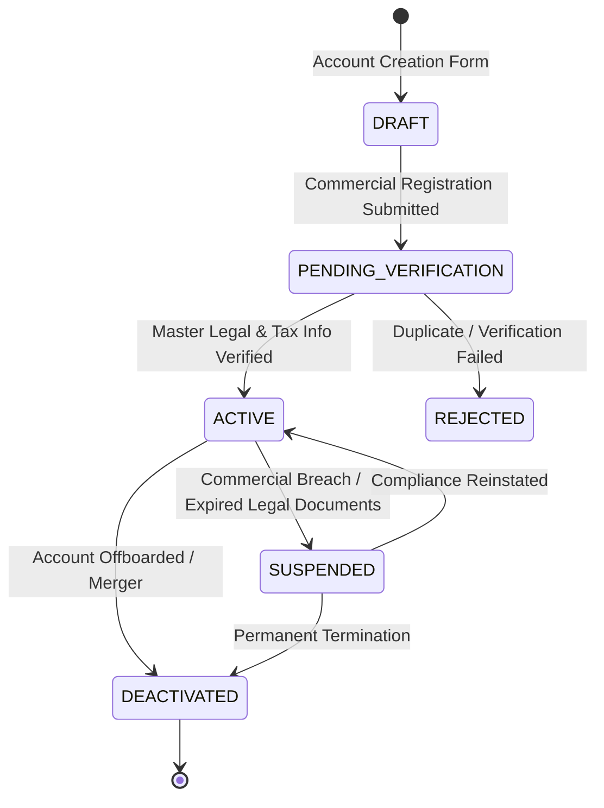

# Customer Account Management & Lifecycle

## 1. Overview & Account Master Data

The `customer_accounts` table serves as the single source of truth for all business relationships between the tenant enterprise and its external commercial clients. Each account is bound to a canonical `external_organizations` master record while maintaining tenant-specific commercial terms, security ratings, and default visit requirements.

### 1.1 Account Classifications & Tiers
- **Classifications:** `OEM_CUSTOMER`, `STRATEGIC_CUSTOMER`, `COMMERCIAL_PARTNER`, `EXISTING_CUSTOMER`, `PROSPECTIVE_CUSTOMER`, `DISTRIBUTOR`, `SERVICE_CLIENT`, `QUALITY_CUSTOMER`.
- **Tiers:** `TIER_1_STRATEGIC`, `GLOBAL_ENTERPRISE`, `KEY_ACCOUNT`, `STANDARD`, `PROBATIONARY`.

### 1.2 Multi-Plant Site Boundary Enforcement
Customer accounts maintain an approved sites whitelist (`approved_site_ids: JSON array of UUIDs`). If an account is authorized only for Chennai Plant (`SITE_1`), any attempt to schedule or check in customer representatives at Coimbatore Foundry (`SITE_2`) is blocked by site boundary validation.

---

## 2. Diagram 3: Customer Account Lifecycle State Machine



---

## 3. Probable Duplicate Detection Engine

To prevent multiple sales or quality teams from fragmenting customer master data, `CustomerService.createCustomerAccount` runs duplicate detection across:
1. `account_code`: Exact match throws immediate unique violation.
2. Normalized Organization Name (`account_name`): Trims punctuation and whitespace.
3. Tax/Corporate Registration Number (`registration_number`): E.g., EIN, GSTIN, VAT, or Commercial Register ID.

If a probable duplicate is detected, the operation rejects with:
```
Customer account 'TSLA-01' already exists (Probable duplicate detected matching 'Tesla Inc.')
```

---

## 4. Controlled Export Operations

Customer account exports are subject to strict role-based access control. Only `SUPER_ADMIN`, `SITE_ADMIN`, and `MANAGEMENT` roles can trigger export requests. All exports automatically:
- Apply data minimization and PII masking.
- Record forensic audit logs with timestamp, user ID, filter query, and record count.
- Enforce strict tenant boundary checks across all records.
