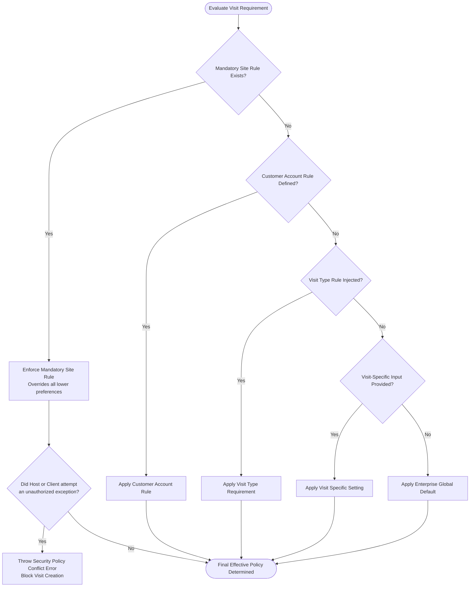

# Customer Approval Workflows & Precedence Hierarchy

## 1. Overview & Multi-Tier Approval Model

Customer visits in high-security facilities cannot be initiated unilaterally. They require structured approvals from commercial relationship owners, plant security managers, and quality assurance leads.

### 1.1 Standard Customer Approval Matrix
- **Standard Customer Meeting:** Single-stage approval by the designated executive host (`HOST`).
- **Customer Audit / Quality Inspection:** Dual-stage approval: Executive Host $\to$ Plant Quality Assurance Manager (`MANAGEMENT`).
- **Hazardous Zone / Executive Delegation:** Triple-stage approval: Host $\to$ EHS Safety Manager (`EHS_MANAGER`) $\to$ Plant Security Chief (`SECURITY_MANAGER`).

---

## 2. Diagram 4: Precedence Hierarchy Decision Flowchart

When evaluating effective visit policies (such as photography permission, technical escort mandates, safety induction, and PPE), the platform adheres to an authoritative 5-tier precedence hierarchy:

$$\text{Mandatory Site Rules} > \text{Global Defaults} > \text{Customer Account Rules} > \text{Visit Type Requirements} > \text{Visit Exceptions}$$

---

## 3. Real Workflow & Approval Instance Integration

In VMS Enterprise Part 7, workflow instances are not synthetic mocks. Upon visit creation:
1. A genuine `workflow_instances` record is inserted with `definition_id: 'WF_CUSTOMER_VISIT_V1'` and bound immutably to the visit transaction.
2. An `approval_instances` record is persisted in status `PENDING`.
3. When `approveVisit` is executed, the workflow transitions to `COMPLETED` (`stg-cust-end`) and the approval record updates to `APPROVED`.
4. When `rejectVisit` is executed, both instances update to `REJECTED`.
5. When `requestChanges` is executed, both instances record `CHANGES_REQUESTED` and return the visit to `DRAFT`.
