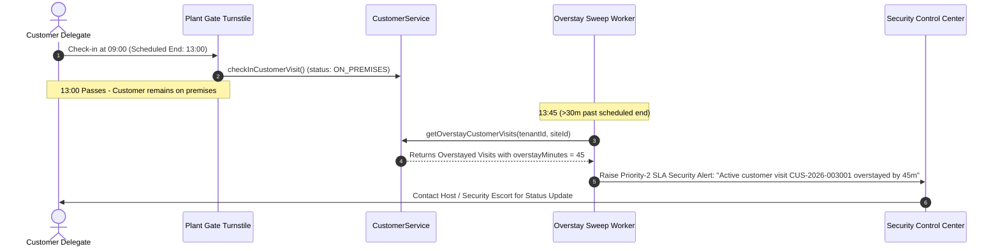

# Customer Gate Check-In, Check-Out & Overstay SLA

## 1. Physical Gate Security Operations

When customer representatives arrive at a plant access gate (e.g., Gate 1 Executive Turnstile or Vehicle Portal):
- **Verification Gate:** Check-in requires confirmed appointment status, valid bilateral NDA, and unexpired appointment window.
- **Cross-Site Access Violation Protection:** If an operator attempts to scan or check in a customer appointment at an unauthorized plant site (e.g., Coimbatore operator scanning a Chennai visit pass), the system throws an immediate `Cross-site access violation` error.
- **Appointment Expiration Enforcement:** Appointments with scheduled end times exceeding a 4-hour grace period are automatically blocked with `Appointment window has expired`.

---

## 2. Diagram 9: Overstay SLA Detection & Escalation Sequence



---

## 3. QR E-Pass Issuance & Security Tokenization

Customer E-Passes are issued with HMAC SHA-256 signatures:
```typescript
const payload = `${tenantId}:${customerVisitId}:${refNumber}:${participantId}`;
const token = createHmac('sha256', secretKey).update(payload).digest('hex');
const qrPayload = `vms://customer-pass/${refNumber}?token=${token.slice(0, 16)}`;
```
- Sensitive personal identity details (phone, email, government ID) are **never** encoded in the plain text of QR codes.
- Security scanners validate the HMAC token against the active visit record before clearing turnstile barriers.
