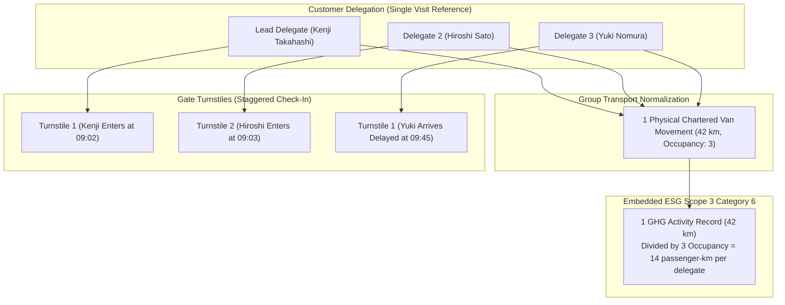

# Customer Delegation Management & Staggered Presence

## 1. Overview & Delegation Model

Customer delegations are multi-person official visits from executive clients or technical consortiums (e.g., 5 Kintaro engineers arriving together for an executive line walk). 

### 1.1 Structural Characteristics
- **Single Parent Transaction:** One `customer_visit_transactions` record holds overall appointment metadata, commercial owner, and ESG Scope 3 travel data.
- **Participant Roster:** `customer_visit_participants` records maintain individual delegate presence statuses (`EXPECTED`, `ARRIVED`, `CHECKED_IN`, `DEPARTED`).
- **Lead Delegate:** Exactly 1 participant is designated `is_lead: true`, who acts as the primary contact for notifications and security handshakes.

---

## 2. Diagram 7: Delegation Management & Group Transport Deduplication



---

## 3. Staggered Check-In & Departure Tracking

Delegations do not always arrive or depart simultaneously:
- Individual participants can check in through security turnstiles independently via `checkInParticipant`.
- The parent visit transaction automatically enters `ON_PREMISES` when the **first** participant checks in.
- The parent visit transaction remains `ON_PREMISES` until the **final** participant checks out.
- When the last participant exits via `checkOutParticipant`, the visit stage automatically advances to `CHECK_OUT` (`CHECKED_OUT`).

---

## 4. Real-Time Delegation Presence View

Security command centers and plant receptionists access the `CustomerDelegationView` board:
```typescript
interface CustomerDelegationView {
  totalParticipants: number;
  expectedParticipants: number;
  arrivedParticipants: number;
  checkedInParticipants: number;
  departedParticipants: number;
  outstandingVerificationCount: number;
  vehiclesCount: number;
  participants: CustomerVisitParticipant[];
}
```
This enables instant emergency headcounts in the event of plant fire alarms or evacuation drills.
