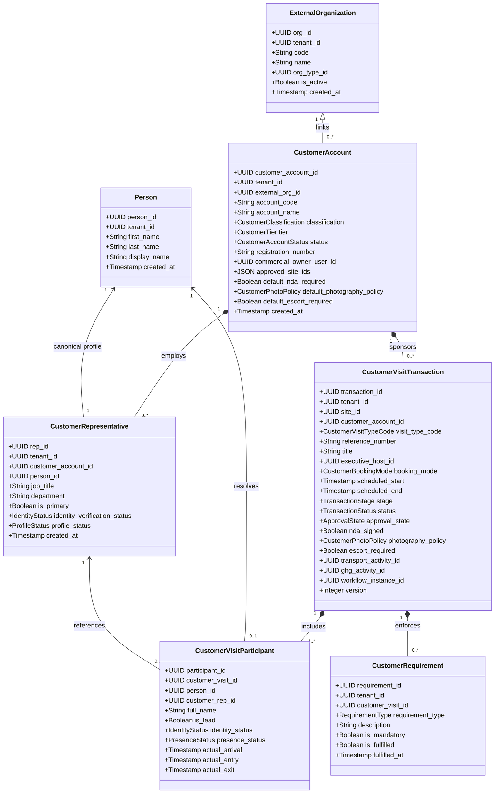

# Customer Domain Architecture & Relational Model

## 1. Domain Architectural Model

The Customer Management Domain (`@vms/customer`) in VMS Enterprise is an enterprise-grade subsystem engineered specifically for governing business interactions with OEM customers, strategic clients, commercial partners, quality auditors, and executive delegations across high-security manufacturing plants, industrial complexes, and corporate campuses.

In mission-critical industrial manufacturing (such as automotive OEMs, aerospace, defense, and heavy machinery), customer engagements are fundamentally different from generic transient visits. They involve:
- Formal institutional relationships governed by master accounts, legal trade names, commercial ownership, and vendor ratings.
- High-stakes technical audits (e.g., IATF 16949, VDA 6.3 process audits, ISO 9001 quality audits).
- Structured product and tooling inspections prior to production part approval (PPAP) and dispatch.
- Multi-participant executive delegations arriving via shared chartered transport.
- Strict intellectual property protections including bilateral Non-Disclosure Agreements (NDAs), photography prohibitions, and technical escort mandates.
- Embedded ESG Scope 3 Category 6 (Business Travel) activity data capture to track customer travel carbon footprints without disrupting factory operations.

---

## 2. Diagram 1: Entity Architecture

The following class diagram illustrates the relational structure of the Customer Domain and its explicit connections to shared platform services.

---

## 3. Diagram 2: Domain Boundary & Strict Independence

Customer transactions are completely decoupled from transient visitor transactions.
- **Strict Rule:** `visitor_type = 'CUSTOMER'` is strictly forbidden in VMS Enterprise.
- Customers have independent database schemas (`customer_accounts`, `customer_representatives`, `customer_visit_transactions`, `customer_visit_participants`, `customer_requirements`), dedicated approval workflows, dedicated lifecycle state machines, and specialized auditing features.
- Cross-domain interactions occur strictly through normalized shared platform infrastructure (Identity, Transport, GHG Engine, Gate Devices, Workflow Engine, and Audit Ledger).

```mermaid
graph TD
    subgraph Shared_Enterprise_Infrastructure["Shared Enterprise Infrastructure"]
        ID["Identity & Access (Persons, Users, RBAC)"]
        TP["Transport Service (Normalized Vectors)"]
        GHG["GHG Calculation Engine (Scope 1, 2, 3)"]
        GT["Gate Hardware Engine (Turnstiles, ANPR, Access Events)"]
        WF["Workflow & Approval Engine (Stages, Policies, Quorums)"]
        AL["Immutable Audit & Forensic Ledger (SHA-256 Chains)"]
    end

    subgraph Generic_Visitor_Domain["Domain: Generic Visitor (Part 6)"]
        VP["Visitor Profiles"]
        VT["Visitor Transactions"]
        VGP["Visitor Group Participants"]
        VEP["Visitor E-Passes"]
    end

    subgraph Customer_Management_Domain["Domain: Customer Management (Part 7)"]
        CA["Customer Accounts"]
        CR["Customer Representatives"]
        CVT["Customer Visit Transactions"]
        CVP["Customer Visit Participants"]
        CRQ["Customer Requirements & Policies"]
        CAD["Customer Audit Details"]
        CID["Customer Inspection Details"]
    end

    CA -.-> ID
    CR -.-> ID
    CVT --> TP
    CVT --> GHG
    CVT --> GT
    CVT --> WF
    CVT --> AL
    CVP -.-> ID

    VT --> TP
    VT --> GHG
    VT --> GT
    VT --> WF
    VT --> AL

    style Customer_Management_Domain fill:#f0f7ff,stroke:#005fb8,stroke-width:2px
    style Generic_Visitor_Domain fill:#fff5f0,stroke:#d13438,stroke-width:2px
    style Shared_Enterprise_Infrastructure fill:#f4f6f8,stroke:#605e5c,stroke-width:2px
```

---

## 4. Multi-Tenant Data Isolation & Site Scoping

All customer master data, visit transactions, and gate passes are strictly scoped to the tenant organization (`tenant_id`) and physical plant site (`site_id`). Cross-tenant visibility is strictly prohibited at both the database relational engine (RLS) and API service layers.
