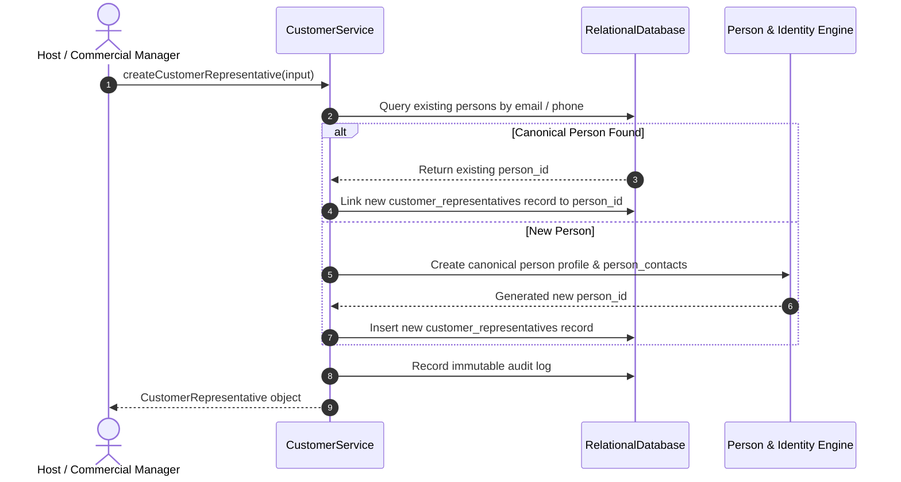

# Customer Representatives Directory & PII Privacy

## 1. Overview & Canonical Person Architecture

Customer representatives represent individuals employed by or acting on behalf of a customer organization (e.g., procurement managers, supplier quality assurance engineers, lead auditors, and executive sponsors).

To maintain absolute data integrity without duplicating profiles across visits or departments:
- Each representative is linked to a canonical `persons` entity.
- The `persons` table stores verified identity parameters (first name, last name, date of birth, photo ref).
- Phone and email deduplication matches incoming contact data against existing `person_contacts` entries within the tenant boundary.

---

## 2. Least-Privilege PII Masking Engine

Customer contact details (personal phone numbers, mobile numbers, and personal email addresses) constitute sensitive commercial and personal data. Access is governed by role-based privacy filters:

| Role Category | Example Roles | Phone Exposure | Email Exposure | Government ID Exposure |
| :--- | :--- | :--- | :--- | :--- |
| **Frontline Security & Reception** | `SECURITY_GUARD`, `RECEPTIONIST`, `SITE_ADMIN` | Full (`+65-6888-9120`) | Full (`auditor@client.com`) | Masked except last 4 (`****-****-1234`) |
| **Operational & Commercial Hosts** | `SUPER_ADMIN`, `HOST`, `MANAGEMENT` | Full (`+65-6888-9120`) | Full (`auditor@client.com`) | Masked |
| **Compliance, Audit & ESG** | `AUDITOR`, `ESG_MANAGER`, `EHS_MANAGER` | Masked (`+65-***-9120`) | Masked (`au***@client.com`) | Fully Redacted |

---

## 3. Representative Verification Statuses

Each representative profile maintains an identity lifecycle state:
- `PENDING`: Contact information recorded; government photo ID scan not yet verified.
- `VERIFIED`: ID document authenticated, face biometric matched, or corporate credentials validated.
- `FAILED`: Document expired, fraudulent ID suspected, or sanctions list match.
- `EXPIRED`: Previously verified ID document has passed its legal expiry date.
