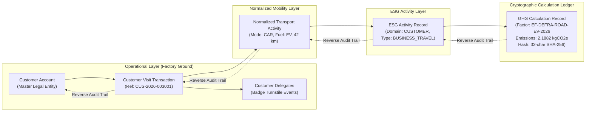

# Customer Source Provenance & Forensic Traceability

## 1. Overview & Section 61 Auditability Invariant

Regulatory reporting frameworks (CSRD, SEC Climate Disclosures, and IFRS S2) strictly prohibit synthetic, untraceable carbon claims. Every reported gram of $CO_2e$ must resolve through a complete, verifiable bidirectional provenance chain back to the original operational transaction.

---

## 2. Diagram 10: Bidirectional Provenance Traceability Chain

---

## 3. Bidirectional Provenance Traversal

The platform exposes `getCustomerActivityTraceability(tenantId, customerVisitId)` which compiles:
1. `customerVisit`: The parent appointment, host, scheduled times, and security state.
2. `customerAccount`: Master legal trade name, OEM tier, and registration number.
3. `participants`: Complete list of delegates, arrival timestamps, and presence statuses.
4. `transportActivities`: Array of all normalized vehicles in the convoy with distance provenance.
5. `esgActivities`: Generated ESG activity records detailing unit and quantity.
6. `ghgCalculations`: Complete cryptographic calculations including emission factor versions and hashes.
7. `gateEvents`: Immutable physical gate hardware events for entry and exit.
8. `auditLogs`: Administrative ledger tracking approvals, modifications, and signoffs.
