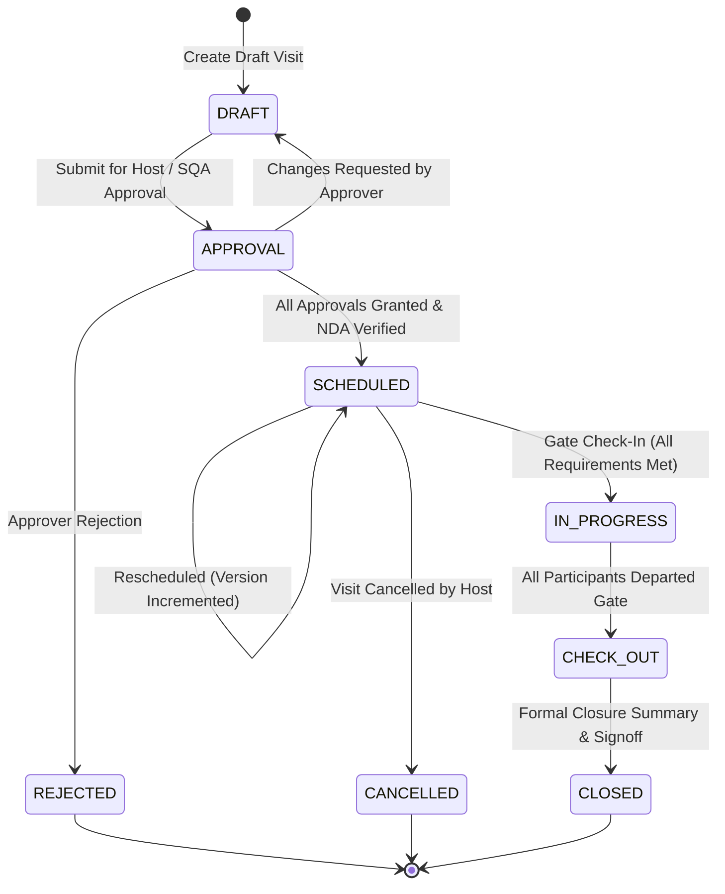
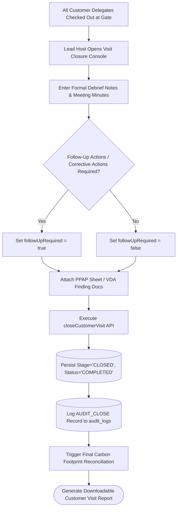

# Customer Visit Lifecycle & Stage State Machine

## 1. Overview & Transaction Envelope Invariants

In VMS Enterprise, all customer visits follow a strict dual-axis status architecture:
1. **Transaction Stage (`stage`):** High-level operational checkpoint along the factory entry lifecycle (`DRAFT` $\to$ `APPROVAL` $\to$ `SCHEDULED` $\to$ `CHECK_IN` / `IN_PROGRESS` $\to$ `CHECK_OUT` $\to$ `CLOSED`).
2. **Operational Status (`status`):** Real-time presence and authorization state (`PENDING`, `APPROVED`, `CONFIRMED`, `ON_PREMISES`, `CHECKED_OUT`, `COMPLETED`, `CANCELLED`, `REJECTED`).

---

## 2. Diagram 5: Customer Visit Lifecycle State Machine

---

## 3. Reschedule & Version Control Engine

Customer audits and executive benchmarking visits frequently experience flight delays, itinerary shifts, or technical re-sequencing. When `rescheduleCustomerVisit` is invoked:
- Prior schedule timestamps are archived into the immutable audit ledger.
- The transaction `version` field increments monotonically ($1 \to 2 \to 3$).
- The new start and end timestamps must maintain validity (`newEnd > newStart`).
- All linked QR passes automatically recompute expiration boundaries ($+4\text{ hours}$ grace period after new end).

---

## 4. Formal Closure Requirements & Diagram 10

A customer visit cannot transition to `CLOSED` until a formal closure input is submitted:
- Lead host or auditor user ID (`closedByUserId`).
- Formal debrief notes (`notes`).
- Audit finding / inspection follow-up flag (`followUpRequired: boolean`).
- Evidence document references (`evidenceDocumentRefs: string[]`, e.g. PPAP approval sheet, VDA score card).

