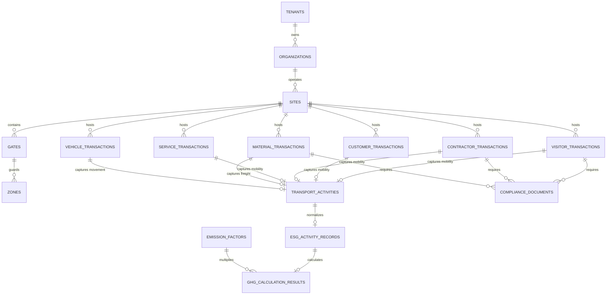

# VMS Enterprise: Database Architecture & Principles

## 1. Core Database Philosophy

VMS Enterprise utilizes **PostgreSQL 16+** as its operational data backbone, adhering to strict relational principles:

### Invariant Rules:
1. **Strict Normalization (3NF / BCNF):**
   Relational integrity is paramount. Data redundancy is eliminated through foreign keys, check constraints, and unique indexes.
2. **No Monolithic Tables:**
   The "Universal Visitor" antipattern is completely rejected. Visitor, Customer, Contractor, Service, Material, and Vehicle transactions reside in independent, strongly typed relational tables.
3. **No Duplicate Engines:**
   - Transport is normalized once in `transport_activities` and shared across all six domains.
   - Compliance documents are normalized once in `compliance_documents` and shared across all domains.
   - Approvals are handled once by `workflow_instances` and `workflow_steps`.
4. **JSONB Usage Constraint:**
   PostgreSQL `jsonb` columns are reserved **exclusively** for unstructured, rapidly evolving external metadata (e.g., custom form attributes, raw hardware sensor payloads). Core business attributes (stage, status, dates, IDs, quantities, distances, fuels) must be declared as explicit, indexed SQL columns.
5. **Database-Level Multi-Tenancy (Row-Level Security):**
   Every tenant-scoped table features a `tenant_id` foreign key with active PostgreSQL Row-Level Security (RLS) policies preventing cross-tenant leakage even if an application SQL query omits a WHERE filter.
6. **Optimistic Concurrency Control:**
   High-concurrency entities (gate passes, material challans) include an integer `version` column to prevent race conditions during concurrent turnstile scans or simultaneous gate operations.

---

## 2. Entity-Relationship Schema Architecture



---

## 3. PostgreSQL Database Schema Definition (DDL)

```sql
-- ============================================================================
-- VMS ENTERPRISE CORE RELATIONAL DDL (PostgreSQL 16+)
-- ============================================================================

CREATE EXTENSION IF NOT EXISTS "uuid-ossp";
CREATE EXTENSION IF NOT EXISTS "citext";

-- ----------------------------------------------------------------------------
-- 1. MULTI-TENANT TOPOLOGY
-- ----------------------------------------------------------------------------
CREATE TABLE tenants (
    tenant_id UUID PRIMARY KEY DEFAULT uuid_generate_v4(),
    code VARCHAR(32) NOT NULL UNIQUE,
    name VARCHAR(255) NOT NULL,
    status VARCHAR(32) NOT NULL DEFAULT 'ACTIVE',
    created_at TIMESTAMPTZ NOT NULL DEFAULT CURRENT_TIMESTAMP,
    updated_at TIMESTAMPTZ NOT NULL DEFAULT CURRENT_TIMESTAMP
);

CREATE TABLE organizations (
    organization_id UUID PRIMARY KEY DEFAULT uuid_generate_v4(),
    tenant_id UUID NOT NULL REFERENCES tenants(tenant_id) ON DELETE CASCADE,
    code VARCHAR(32) NOT NULL,
    name VARCHAR(255) NOT NULL,
    created_at TIMESTAMPTZ NOT NULL DEFAULT CURRENT_TIMESTAMP,
    CONSTRAINT uq_org_tenant_code UNIQUE (tenant_id, code)
);

CREATE TABLE sites (
    site_id UUID PRIMARY KEY DEFAULT uuid_generate_v4(),
    tenant_id UUID NOT NULL REFERENCES tenants(tenant_id) ON DELETE CASCADE,
    organization_id UUID NOT NULL REFERENCES organizations(organization_id) ON DELETE CASCADE,
    code VARCHAR(32) NOT NULL,
    name VARCHAR(255) NOT NULL,
    latitude NUMERIC(10, 7),
    longitude NUMERIC(10, 7),
    timezone VARCHAR(64) NOT NULL DEFAULT 'UTC',
    created_at TIMESTAMPTZ NOT NULL DEFAULT CURRENT_TIMESTAMP,
    CONSTRAINT uq_site_tenant_code UNIQUE (tenant_id, code)
);

CREATE TABLE gates (
    gate_id UUID PRIMARY KEY DEFAULT uuid_generate_v4(),
    tenant_id UUID NOT NULL REFERENCES tenants(tenant_id) ON DELETE CASCADE,
    site_id UUID NOT NULL REFERENCES sites(site_id) ON DELETE CASCADE,
    name VARCHAR(128) NOT NULL,
    gate_type VARCHAR(32) NOT NULL, -- PEDESTRIAN, COMMERCIAL_VEHICLE, EXECUTIVE, SERVICE
    is_active BOOLEAN NOT NULL DEFAULT TRUE,
    created_at TIMESTAMPTZ NOT NULL DEFAULT CURRENT_TIMESTAMP
);

CREATE TABLE zones (
    zone_id UUID PRIMARY KEY DEFAULT uuid_generate_v4(),
    tenant_id UUID NOT NULL REFERENCES tenants(tenant_id) ON DELETE CASCADE,
    site_id UUID NOT NULL REFERENCES sites(site_id) ON DELETE CASCADE,
    name VARCHAR(128) NOT NULL,
    security_level VARCHAR(32) NOT NULL DEFAULT 'STANDARD', -- STANDARD, HIGH_SECURITY, HAZARDOUS
    max_capacity INTEGER,
    created_at TIMESTAMPTZ NOT NULL DEFAULT CURRENT_TIMESTAMP
);

-- ----------------------------------------------------------------------------
-- 2. REUSABLE NORMALIZED TRANSPORT MODEL
-- ----------------------------------------------------------------------------
CREATE TABLE transport_activities (
    transport_id UUID PRIMARY KEY DEFAULT uuid_generate_v4(),
    tenant_id UUID NOT NULL REFERENCES tenants(tenant_id) ON DELETE CASCADE,
    source_domain VARCHAR(32) NOT NULL, -- VISITOR, CUSTOMER, CONTRACTOR, SERVICE, MATERIAL, VEHICLE
    source_transaction_id VARCHAR(64) NOT NULL,
    
    -- Independent normalized dimensions
    mode VARCHAR(32) NOT NULL,             -- CAR, BUS, TRAIN, FLIGHT, TWO_WHEELER, TRUCK, etc.
    ownership VARCHAR(32) NOT NULL,        -- PERSONAL, COMPANY, HIRED, PUBLIC, SUPPLIER, 3PL, etc.
    vehicle_class VARCHAR(32) NOT NULL,    -- SEDAN, SUV, TWO_WHEELER, MEDIUM_TRUCK, HEAVY_TRUCK, etc.
    fuel_type VARCHAR(32) NOT NULL,        -- PETROL, DIESEL, CNG, ELECTRIC, HYBRID, etc.
    usage_type VARCHAR(32) NOT NULL,       -- INDIVIDUAL, SHARED, CARPOOL, etc.
    occupancy INTEGER NOT NULL DEFAULT 1 CHECK (occupancy >= 1),
    
    -- Route & Metrics
    origin_location VARCHAR(255) NOT NULL,
    destination_location VARCHAR(255) NOT NULL,
    distance_km NUMERIC(10, 2) NOT NULL CHECK (distance_km >= 0),
    journey_type VARCHAR(32) NOT NULL DEFAULT 'ONE_WAY', -- ONE_WAY, ROUND_TRIP, MULTI_STOP
    trip_direction VARCHAR(32) NOT NULL DEFAULT 'INBOUND',
    fuel_consumed_litres NUMERIC(10, 2),
    payload_weight_tonnes NUMERIC(10, 3),
    
    -- Provenance & Measurement
    distance_provenance VARCHAR(32) NOT NULL DEFAULT 'USER_PROVIDED', -- MEASURED, USER_PROVIDED, SYSTEM_ESTIMATED
    measurement_method VARCHAR(32) NOT NULL DEFAULT 'GIS_ROUTING',   -- ODOMETER, TELEMATICS_GPS, GIS_ROUTING, WEIGHBRIDGE_SCALE
    data_source VARCHAR(64) NOT NULL DEFAULT 'WEB_FORM',
    created_at TIMESTAMPTZ NOT NULL DEFAULT CURRENT_TIMESTAMP,
    
    CONSTRAINT uq_transport_source UNIQUE (tenant_id, source_domain, source_transaction_id)
);

CREATE INDEX idx_transp_tenant_source ON transport_activities (tenant_id, source_domain, source_transaction_id);

-- ----------------------------------------------------------------------------
-- 3. SOURCE-LINKED ESG ACTIVITY & GHG FACTOR ENGINES
-- ----------------------------------------------------------------------------
CREATE TABLE esg_activity_records (
    esg_activity_id UUID PRIMARY KEY DEFAULT uuid_generate_v4(),
    tenant_id UUID NOT NULL REFERENCES tenants(tenant_id) ON DELETE CASCADE,
    site_id UUID NOT NULL REFERENCES sites(site_id) ON DELETE CASCADE,
    source_domain VARCHAR(32) NOT NULL,
    source_transaction_id VARCHAR(64) NOT NULL,
    transport_id UUID REFERENCES transport_activities(transport_id) ON DELETE SET NULL,
    
    activity_type VARCHAR(64) NOT NULL, -- COMMUTER_TRAVEL, BUSINESS_TRAVEL, UPSTREAM_LOGISTICS, FLEET_FUEL
    activity_quantity NUMERIC(14, 4) NOT NULL,
    activity_unit VARCHAR(32) NOT NULL, -- KM, LITRES, TONNE_KM, KWH
    data_provenance VARCHAR(32) NOT NULL, -- MEASURED, USER_PROVIDED, SYSTEM_ESTIMATED, SYSTEM_CALCULATED, IMPORTED
    
    created_at TIMESTAMPTZ NOT NULL DEFAULT CURRENT_TIMESTAMP,
    CONSTRAINT uq_esg_source UNIQUE (tenant_id, source_domain, source_transaction_id, activity_type)
);

-- Configurable Organizational Scope / Category Mapping
CREATE TABLE scope_mapping_rules (
    rule_id UUID PRIMARY KEY DEFAULT uuid_generate_v4(),
    tenant_id UUID REFERENCES tenants(tenant_id) ON DELETE CASCADE,
    source_domain VARCHAR(32) NOT NULL,
    ownership VARCHAR(32),
    trip_direction VARCHAR(32),
    activity_type VARCHAR(64),
    scope VARCHAR(16) NOT NULL,
    category VARCHAR(64) NOT NULL,
    subcategory VARCHAR(64) NOT NULL,
    methodology VARCHAR(64) NOT NULL,
    priority INTEGER NOT NULL DEFAULT 100,
    is_active BOOLEAN NOT NULL DEFAULT TRUE,
    created_at TIMESTAMPTZ NOT NULL DEFAULT CURRENT_TIMESTAMP
);

CREATE INDEX idx_scope_rules_domain ON scope_mapping_rules (source_domain, priority DESC);

CREATE TABLE emission_factors (
    factor_id VARCHAR(64) PRIMARY KEY,
    factor_code VARCHAR(64) NOT NULL,      -- e.g., ROAD-DIESEL-CAR
    version VARCHAR(32) NOT NULL,          -- e.g., 2026.1
    source VARCHAR(64) NOT NULL,           -- DEFRA, EPA, IEA, CEA
    factor_value NUMERIC(12, 6) NOT NULL,  -- e.g., 0.170820
    unit VARCHAR(32) NOT NULL,             -- kgCO2e/km, kgCO2e/litre, kgCO2e/tonne-km
    geography VARCHAR(16) NOT NULL,        -- ISO code or GLOBAL
    reporting_year INTEGER NOT NULL,
    methodology VARCHAR(32) NOT NULL DEFAULT 'GHG_PROTOCOL',
    valid_from TIMESTAMPTZ NOT NULL,
    valid_to TIMESTAMPTZ,
    gas_scope VARCHAR(16) NOT NULL DEFAULT 'CO2e',
    status VARCHAR(32) NOT NULL DEFAULT 'ACTIVE', -- ACTIVE, SUPERSEDED, DRAFT
    evidence_url TEXT,
    created_at TIMESTAMPTZ NOT NULL DEFAULT CURRENT_TIMESTAMP,
    CONSTRAINT uq_factor_version UNIQUE (factor_code, version, geography)
);

CREATE TABLE ghg_calculation_results (
    calculation_id UUID PRIMARY KEY DEFAULT uuid_generate_v4(),
    tenant_id UUID NOT NULL REFERENCES tenants(tenant_id) ON DELETE CASCADE,
    esg_activity_id UUID NOT NULL REFERENCES esg_activity_records(esg_activity_id) ON DELETE CASCADE,
    factor_id VARCHAR(64) NOT NULL REFERENCES emission_factors(factor_id),
    
    ghg_scope VARCHAR(16) NOT NULL,        -- SCOPE_1, SCOPE_2, SCOPE_3
    ghg_category VARCHAR(64) NOT NULL,     -- CAT_4_UPSTREAM_TRANSPORT, CAT_6_BUSINESS_TRAVEL, CAT_7_COMMUTE
    subcategory VARCHAR(64) NOT NULL DEFAULT 'GENERAL_ACTIVITY',
    methodology VARCHAR(64) NOT NULL DEFAULT 'GHG_PROTOCOL',
    factor_value_used NUMERIC(12, 6) NOT NULL,
    activity_quantity NUMERIC(14, 4) NOT NULL,
    calculated_emissions_kg_co2e NUMERIC(14, 4) NOT NULL,
    
    calculation_hash VARCHAR(64) NOT NULL, -- Cryptographic provenance audit hash
    calculated_at TIMESTAMPTZ NOT NULL DEFAULT CURRENT_TIMESTAMP,
    status VARCHAR(32) NOT NULL DEFAULT 'FINAL'
);

CREATE INDEX idx_ghg_tenant_scope ON ghg_calculation_results (tenant_id, ghg_scope, ghg_category);

-- ----------------------------------------------------------------------------
-- 4. INDEPENDENT BUSINESS DOMAIN PIPELINES
-- ----------------------------------------------------------------------------

-- VISITOR DOMAIN
CREATE TABLE visitor_transactions (
    transaction_id VARCHAR(64) PRIMARY KEY, -- e.g., VIS-2026-000123
    tenant_id UUID NOT NULL REFERENCES tenants(tenant_id) ON DELETE CASCADE,
    site_id UUID NOT NULL REFERENCES sites(site_id) ON DELETE CASCADE,
    stage VARCHAR(32) NOT NULL DEFAULT 'DRAFT',   -- DRAFT, APPROVAL, SCHEDULED, CHECK_IN, ACTIVE, CHECK_OUT, CLOSED
    status VARCHAR(32) NOT NULL DEFAULT 'PENDING', -- PENDING, APPROVED, REJECTED, ON_PREMISES, etc.
    
    visitor_category VARCHAR(32) NOT NULL, -- NEW_VISITOR, REPEATED_VISITOR, GROUP_VISITOR, VIP, AUDITOR, etc.
    purpose VARCHAR(64) NOT NULL,
    booking_mode VARCHAR(32) NOT NULL DEFAULT 'RESERVED',
    
    visitor_name VARCHAR(128) NOT NULL,
    visitor_email VARCHAR(255),
    visitor_phone VARCHAR(32),
    host_user_id VARCHAR(64) NOT NULL,
    scheduled_start TIMESTAMPTZ NOT NULL,
    scheduled_end TIMESTAMPTZ NOT NULL,
    actual_check_in TIMESTAMPTZ,
    actual_check_out TIMESTAMPTZ,
    
    version INTEGER NOT NULL DEFAULT 1,
    metadata JSONB,
    created_at TIMESTAMPTZ NOT NULL DEFAULT CURRENT_TIMESTAMP,
    updated_at TIMESTAMPTZ NOT NULL DEFAULT CURRENT_TIMESTAMP
);

-- CUSTOMER DOMAIN
CREATE TABLE customer_transactions (
    transaction_id VARCHAR(64) PRIMARY KEY, -- e.g., CUST-2026-00045
    tenant_id UUID NOT NULL REFERENCES tenants(tenant_id) ON DELETE CASCADE,
    site_id UUID NOT NULL REFERENCES sites(site_id) ON DELETE CASCADE,
    stage VARCHAR(32) NOT NULL DEFAULT 'DRAFT',
    status VARCHAR(32) NOT NULL DEFAULT 'PENDING',
    
    customer_account_name VARCHAR(255) NOT NULL,
    visit_type VARCHAR(64) NOT NULL, -- CUSTOMER_AUDIT, PLANT_VISIT, DELEGATION, MANAGEMENT_VISIT
    delegation_size INTEGER NOT NULL DEFAULT 1,
    executive_host_id VARCHAR(64) NOT NULL,
    nda_signed BOOLEAN NOT NULL DEFAULT FALSE,
    scheduled_start TIMESTAMPTZ NOT NULL,
    scheduled_end TIMESTAMPTZ NOT NULL,
    
    version INTEGER NOT NULL DEFAULT 1,
    metadata JSONB,
    created_at TIMESTAMPTZ NOT NULL DEFAULT CURRENT_TIMESTAMP,
    updated_at TIMESTAMPTZ NOT NULL DEFAULT CURRENT_TIMESTAMP
);

-- CONTRACTOR DOMAIN
CREATE TABLE contractor_transactions (
    transaction_id VARCHAR(64) PRIMARY KEY, -- e.g., CONT-2026-00089
    tenant_id UUID NOT NULL REFERENCES tenants(tenant_id) ON DELETE CASCADE,
    site_id UUID NOT NULL REFERENCES sites(site_id) ON DELETE CASCADE,
    stage VARCHAR(32) NOT NULL DEFAULT 'DRAFT',
    status VARCHAR(32) NOT NULL DEFAULT 'PENDING',
    
    contractor_company_name VARCHAR(255) NOT NULL,
    work_order_number VARCHAR(64) NOT NULL,
    authorized_worker_count INTEGER NOT NULL,
    safety_permit_required BOOLEAN NOT NULL DEFAULT FALSE,
    contract_start_date DATE NOT NULL,
    contract_end_date DATE NOT NULL,
    
    version INTEGER NOT NULL DEFAULT 1,
    metadata JSONB,
    created_at TIMESTAMPTZ NOT NULL DEFAULT CURRENT_TIMESTAMP,
    updated_at TIMESTAMPTZ NOT NULL DEFAULT CURRENT_TIMESTAMP
);

-- SERVICE / WORK DOMAIN
CREATE TABLE service_transactions (
    transaction_id VARCHAR(64) PRIMARY KEY, -- e.g., SERV-2026-00124
    tenant_id UUID NOT NULL REFERENCES tenants(tenant_id) ON DELETE CASCADE,
    site_id UUID NOT NULL REFERENCES sites(site_id) ON DELETE CASCADE,
    stage VARCHAR(32) NOT NULL DEFAULT 'DRAFT',
    status VARCHAR(32) NOT NULL DEFAULT 'PENDING',
    
    service_request_type VARCHAR(64) NOT NULL, -- OEM_BREAKDOWN, PREVENTIVE_MAINTENANCE, CALIBRATION
    equipment_tag VARCHAR(64) NOT NULL,
    target_zone_id UUID REFERENCES zones(zone_id),
    maintenance_lead_id VARCHAR(64) NOT NULL,
    inward_tools_declared BOOLEAN NOT NULL DEFAULT FALSE,
    
    version INTEGER NOT NULL DEFAULT 1,
    metadata JSONB,
    created_at TIMESTAMPTZ NOT NULL DEFAULT CURRENT_TIMESTAMP,
    updated_at TIMESTAMPTZ NOT NULL DEFAULT CURRENT_TIMESTAMP
);

-- MATERIAL DOMAIN
CREATE TABLE material_transactions (
    transaction_id VARCHAR(64) PRIMARY KEY, -- e.g., MAT-2026-019283
    tenant_id UUID NOT NULL REFERENCES tenants(tenant_id) ON DELETE CASCADE,
    site_id UUID NOT NULL REFERENCES sites(site_id) ON DELETE CASCADE,
    stage VARCHAR(32) NOT NULL DEFAULT 'DRAFT',
    status VARCHAR(32) NOT NULL DEFAULT 'PENDING',
    
    movement_type VARCHAR(32) NOT NULL, -- INWARD, OUTWARD
    classification VARCHAR(32) NOT NULL, -- RETURNABLE, NON_RETURNABLE, SCRAP, SAMPLE, SPARE
    delivery_challan_number VARCHAR(64) NOT NULL,
    po_reference VARCHAR(64),
    transporter_company VARCHAR(128) NOT NULL,
    vehicle_registration VARCHAR(32) NOT NULL,
    gross_weight_kg NUMERIC(10, 2),
    tare_weight_kg NUMERIC(10, 2),
    net_weight_kg NUMERIC(10, 2),
    
    version INTEGER NOT NULL DEFAULT 1,
    metadata JSONB,
    created_at TIMESTAMPTZ NOT NULL DEFAULT CURRENT_TIMESTAMP,
    updated_at TIMESTAMPTZ NOT NULL DEFAULT CURRENT_TIMESTAMP
);

-- VEHICLE DOMAIN
CREATE TABLE vehicle_transactions (
    transaction_id VARCHAR(64) PRIMARY KEY, -- e.g., VEH-2026-000512
    tenant_id UUID NOT NULL REFERENCES tenants(tenant_id) ON DELETE CASCADE,
    site_id UUID NOT NULL REFERENCES sites(site_id) ON DELETE CASCADE,
    stage VARCHAR(32) NOT NULL DEFAULT 'DRAFT',
    status VARCHAR(32) NOT NULL DEFAULT 'PENDING',
    
    registration_plate VARCHAR(32) NOT NULL,
    vehicle_type VARCHAR(32) NOT NULL,
    driver_name VARCHAR(128) NOT NULL,
    driver_license_number VARCHAR(64) NOT NULL,
    breathalyzer_passed BOOLEAN NOT NULL DEFAULT TRUE,
    entry_odometer_km NUMERIC(10, 1),
    exit_odometer_km NUMERIC(10, 1),
    
    version INTEGER NOT NULL DEFAULT 1,
    metadata JSONB,
    created_at TIMESTAMPTZ NOT NULL DEFAULT CURRENT_TIMESTAMP,
    updated_at TIMESTAMPTZ NOT NULL DEFAULT CURRENT_TIMESTAMP
);

-- ----------------------------------------------------------------------------
-- 5. REUSABLE COMPLIANCE DOCUMENT ENGINE
-- ----------------------------------------------------------------------------
CREATE TABLE compliance_documents (
    document_id UUID PRIMARY KEY DEFAULT uuid_generate_v4(),
    tenant_id UUID NOT NULL REFERENCES tenants(tenant_id) ON DELETE CASCADE,
    source_domain VARCHAR(32) NOT NULL,
    source_transaction_id VARCHAR(64) NOT NULL,
    document_type VARCHAR(64) NOT NULL, -- GOVT_ID, NDA, POLLUTION_CERT, INSURANCE, SAFETY_CERT, PTW
    file_storage_key VARCHAR(512) NOT NULL, -- S3 object key
    original_file_name VARCHAR(255) NOT NULL,
    file_mime_type VARCHAR(64) NOT NULL,
    file_size_bytes BIGINT NOT NULL,
    issued_date DATE,
    expiry_date DATE,
    verification_status VARCHAR(32) NOT NULL DEFAULT 'PENDING', -- PENDING, VERIFIED, REJECTED, EXPIRED
    verified_by VARCHAR(64),
    verified_at TIMESTAMPTZ,
    created_at TIMESTAMPTZ NOT NULL DEFAULT CURRENT_TIMESTAMP
);

CREATE INDEX idx_docs_source ON compliance_documents (tenant_id, source_domain, source_transaction_id);

-- ----------------------------------------------------------------------------
-- 6. AUDIT & OUTBOX LEDGER
-- ----------------------------------------------------------------------------
CREATE TABLE audit_events (
    audit_id UUID PRIMARY KEY DEFAULT uuid_generate_v4(),
    tenant_id UUID NOT NULL REFERENCES tenants(tenant_id) ON DELETE CASCADE,
    actor_id VARCHAR(64) NOT NULL,
    actor_role VARCHAR(64) NOT NULL,
    action VARCHAR(64) NOT NULL,
    entity_name VARCHAR(64) NOT NULL,
    entity_id VARCHAR(64) NOT NULL,
    previous_state JSONB,
    new_state JSONB,
    client_ip VARCHAR(45),
    user_agent TEXT,
    created_at TIMESTAMPTZ NOT NULL DEFAULT CURRENT_TIMESTAMP
);

CREATE TABLE outbox_events (
    event_id UUID PRIMARY KEY DEFAULT uuid_generate_v4(),
    tenant_id UUID NOT NULL REFERENCES tenants(tenant_id) ON DELETE CASCADE,
    event_type VARCHAR(64) NOT NULL,
    payload JSONB NOT NULL,
    published BOOLEAN NOT NULL DEFAULT FALSE,
    published_at TIMESTAMPTZ,
    created_at TIMESTAMPTZ NOT NULL DEFAULT CURRENT_TIMESTAMP
);

CREATE INDEX idx_outbox_unpublished ON outbox_events (published, created_at) WHERE published = FALSE;

-- ----------------------------------------------------------------------------
-- 7. ROW-LEVEL SECURITY POLICIES (RLS)
-- ----------------------------------------------------------------------------
ALTER TABLE visitor_transactions ENABLE ROW LEVEL SECURITY;
ALTER TABLE customer_transactions ENABLE ROW LEVEL SECURITY;
ALTER TABLE contractor_transactions ENABLE ROW LEVEL SECURITY;
ALTER TABLE service_transactions ENABLE ROW LEVEL SECURITY;
ALTER TABLE material_transactions ENABLE ROW LEVEL SECURITY;
ALTER TABLE vehicle_transactions ENABLE ROW LEVEL SECURITY;
ALTER TABLE transport_activities ENABLE ROW LEVEL SECURITY;
ALTER TABLE esg_activity_records ENABLE ROW LEVEL SECURITY;
ALTER TABLE ghg_calculation_results ENABLE ROW LEVEL SECURITY;
ALTER TABLE compliance_documents ENABLE ROW LEVEL SECURITY;

CREATE POLICY tenant_isolation_visitor ON visitor_transactions
    USING (tenant_id = NULLIF(current_setting('app.current_tenant_id', true), '')::UUID);

CREATE POLICY tenant_isolation_transport ON transport_activities
    USING (tenant_id = NULLIF(current_setting('app.current_tenant_id', true), '')::UUID);

CREATE POLICY tenant_isolation_esg ON esg_activity_records
    USING (tenant_id = NULLIF(current_setting('app.current_tenant_id', true), '')::UUID);

CREATE POLICY tenant_isolation_ghg ON ghg_calculation_results
    USING (tenant_id = NULLIF(current_setting('app.current_tenant_id', true), '')::UUID);
```
