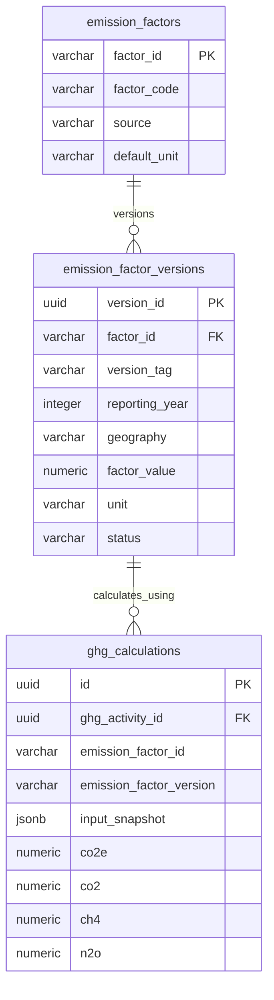

# VMS Enterprise: GHG & Carbon Accounting Data Model

This document outlines the data model for carbon accounting, emission factor versioning, historical calculation reproducibility, and greenhouse gas breakdown metrics.

---

> [!NOTE] **DEMO / TEMPORARY BENCHMARK EMISSION FACTORS NOTICE**
> All emission factors in migration `002_seed_data.sql` are **explicitly provided as demonstration / temporary benchmark factors** based on representative UK DEFRA/BEIS, US EPA, and CEA India publication baselines. In production enterprise deployments, emission factor datasets are managed via certified API feeds (e.g., Climatiq, Ecoinvent, Gabi, DEFRA official annual releases).

---

## 1. Emission Factor Versioning Schema

To guarantee that past sustainability reports remain 100% reproducible and verifiable during annual carbon audits, emission factors are split into two tables:

1. **`emission_factors` (Master Definition)**:
   - Holds stable identifiers (e.g. `EF-DEFRA-ROAD-PETROL-CAR`, `EF-DEFRA-ROAD-DIESEL-HDV`, `EF-ACTIVE-WALKING`).
   - Defines default unit, publisher, and high-level description.
2. **`emission_factor_versions` (Immutable Annual Releases)**:
   - Captures the exact numerical factor value for a specific `(factor_id, version_tag, geography)` tuple.
   - Example records:
     - `EF-DEFRA-ROAD-PETROL-CAR` | `2025.1` | `GLOBAL` | `0.165200 kgCO2e/km` (SUPERSEDED)
     - `EF-DEFRA-ROAD-PETROL-CAR` | `2026.1` | `GLOBAL` | `0.170800 kgCO2e/km` (ACTIVE)
     - `EF-DEFRA-ROAD-DIESEL-HDV` | `2026.1` | `GLOBAL` | `0.892400 kgCO2e/km` (ACTIVE)
     - `EF-ACTIVE-WALKING`        | `2026.1` | `GLOBAL` | `0.000000 kgCO2e/km` (ACTIVE)

---

## 2. Calculation Breakdown & Formulas

### 2.1 Passenger Mobility (Commuting & Business Travel)
For visitors, customer delegations, employee commutes, and contractor shifts:
$$\text{CO}_2\text{e} = \frac{\text{Distance (km)} \times \text{Factor Value}}{\max(1, \text{Occupancy})}$$

- **Occupancy Invariant**: When multiple passengers travel in a carpool (e.g. 2 visitors sharing a taxi), emissions are divided equally among occupants to prevent double-counting.
- **Active Mobility**: Walking and bicycling resolve factor `EF-ACTIVE-WALKING` ($0.000000\text{ kg CO}_2\text{e/km}$), correctly yielding exactly zero emissions.

### 2.2 Freight Logistics (Material Deliveries & Dispatch)
For commercial logistics and heavy trucks carrying raw materials or finished products:
$$\text{CO}_2\text{e} = \text{Distance (km)} \times \text{Payload Weight (tonnes)} \times \text{Factor Value}$$

- **Tonne-Km Invariant**: Freight calculations scale strictly with cargo weight and are never divided by cab occupant counts.

### 2.3 Greenhouse Gas Breakdown
Every calculation stores the aggregated carbon equivalent alongside specific Kyoto gas constituents:
- $\text{CO}_2$: Carbon dioxide (~95% of total combustion)
- $\text{CH}_4$: Methane (~3% of CO2e equivalent)
- $\text{N}_2\text{O}$: Nitrous oxide (~2% of CO2e equivalent)
- $\text{CO}_2\text{e}$: Total global warming potential (GWP-100)
