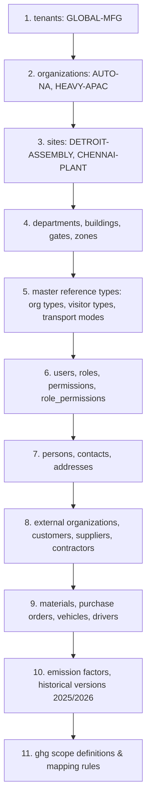

# VMS Enterprise: Deterministic Seed Data Strategy

This document details the deterministic seed data hierarchy, test isolation patterns, and master bootstrap datasets configured in VMS Enterprise.

---

## 1. Deterministic Bootstrap Hierarchy

Seed data insertion order in `002_seed_data.sql` and `MigrationRunner.applySeedsFromSql` strictly follows relational dependency constraints to prevent foreign key violations:

---

## 2. Master Bootstrap Entities Summary

The standard seed dataset establishes the following core environment:

1. **Global Tenant**:
   - `tenant_id`: `00000000-0000-0000-0000-000000000001`
   - `code`: `GLOBAL-MFG`
   - `name`: Global Manufacturing Conglomerate
2. **Two Operating Divisions & Sites**:
   - Division 1: North America Automotive (`AUTO-NA`)
     - Site 1: `DETROIT-ASSEMBLY` (`00000000-0000-0000-0000-0000000101`), Detroit, MI, USA. Timezone: `America/Detroit`.
     - Gates: `DET-GATE-1` (Pedestrian), `DET-GATE-2` (Commercial Logistics / Freight).
   - Division 2: Asia-Pacific Heavy Equipment (`HEAVY-APAC`)
     - Site 2: `CHENNAI-PLANT` (`00000000-0000-0000-0000-0000000102`), Chennai, Tamil Nadu, India. Timezone: `Asia/Kolkata`.
     - Gates: `CHE-GATE-1` (Pedestrian), `CHE-GATE-2` (Commercial Weighbridge).
3. **Master Emission Factors Across 2025 and 2026**:
   - `EF-DEFRA-ROAD-PETROL-CAR` (2025.1: 0.1652, 2026.1: 0.1708 kgCO2e/km)
   - `EF-DEFRA-ROAD-DIESEL-CAR` (2026.1: 0.1712 kgCO2e/km)
   - `EF-DEFRA-ROAD-DIESEL-HDV` (2026.1: 0.8924 kgCO2e/km)
   - `EF-CEA-ELECTRIC-CAR` (2026.1: 0.0521 kgCO2e/km, India Grid)
   - `EF-DEFRA-ROAD-TWO-WHEELER` (2026.1: 0.0815 kgCO2e/km)
   - `EF-DEFRA-COMMUTER-BUS` (2026.1: 0.0965 kgCO2e/km)
   - `EF-DEFRA-RAIL-TRAIN` (2026.1: 0.0354 kgCO2e/km)
   - `EF-DEFRA-AIR-FLIGHT` (2026.1: 0.2458 kgCO2e/km)
   - `EF-ACTIVE-WALKING` (2026.1: 0.0000 kgCO2e/km)

---

## 3. Test Data Isolation & Ephemeral Tenants

For automated test suites (`tests/tenant-isolation.test.ts`, `tests/traceability.test.ts`):
1. **Isolated Tenant IDs**: Tests instantiate isolated ephemeral tenants (e.g. `randomUUID()`) to prevent state pollution across parallel test runners.
2. **Database Reset**: The `runner.resetDatabase()` method wipes in-memory tables and re-seeds deterministic baselines within milliseconds.
3. **Immutability Testing**: Test suites explicitly assert that attempting to modify seed factors throws fatal immutability exceptions.
