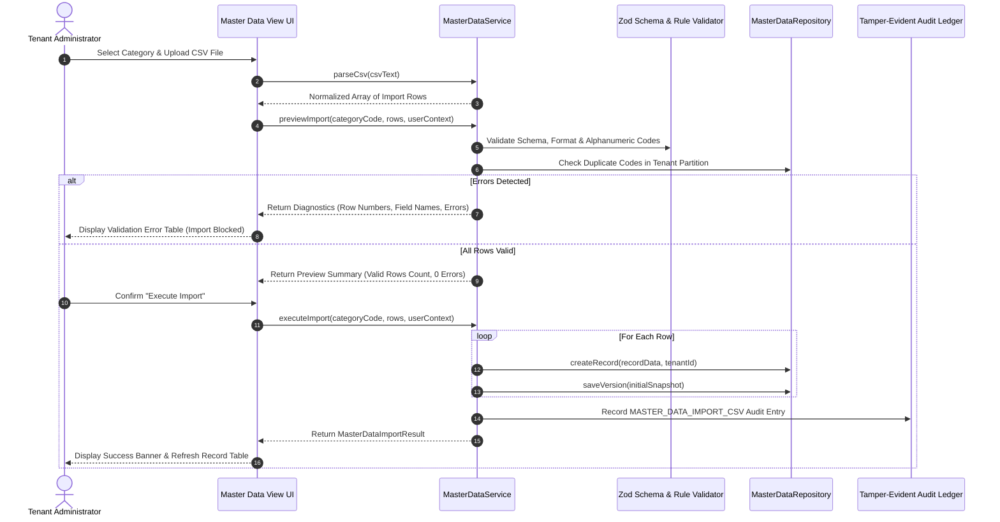

# Bulk CSV Import Framework & Ingestion Pipeline

## 1. Architectural Purpose

To facilitate enterprise onboarding and batch synchronization from external ERPs (SAP, Oracle, Workday) without custom integrations, VMS Enterprise provides a high-integrity CSV import framework. The import engine enforces strict row-level validation, multi-tenant isolation, format normalization, and atomic transactional ingestion with comprehensive error feedback.

---

## 2. CSV Ingestion Pipeline Sequence



---

## 3. CSV Formatting Specifications

### Standard Column Headers
The CSV header row must provide:
```csv
Code,Name,Description,SortOrder,EffectiveFrom,EffectiveUntil,SiteCode,ParentCode
```

### Strict Validation Invariants
1. **Header Normalization**: Headers are parsed case-insensitively and whitespace-trimmed. Columns `Code` and `Name` are strictly mandatory.
2. **Code Canonicalization**: Record codes are converted to uppercase. Only alphanumeric characters, dashes, dots, and underscores (`^[A-Z0-9_\-\.]+$`) are permitted.
3. **In-File Deduplication**: Multiple occurrences of the same code within the single CSV submission are flagged and rejected immediately.
4. **Database Deduplication**: Codes are compared against active and draft records within the tenant's partition. Existing codes trigger an explicit conflict diagnosis.
5. **Atomic Transactional Rollback**: If strict mode is enabled, any individual row failure prevents all rows from committing to the database.
6. **Auditability**: Every import generates a unique `importId` and an immutable tamper-evident audit record documenting the actor, row count, and snapshot.
