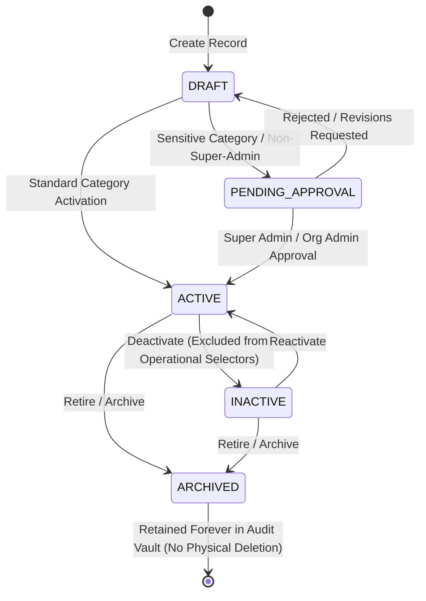

# Master Data Architecture & Governance Framework

## 1. Executive Overview

In VMS Enterprise, Master Data represents the controlled foundational configuration required by all transactional domain pipelines (Visitor, Customer, Contractor, Service, Material, Vehicle, Gate, Safety, and ESG). Rather than hardcoding business rules or options into application source code, the platform delegates all categorical dimensions to an administratively managed, version-controlled, multi-tenant master data ledger.

### Core Architectural Principles
1. **Administrative Self-Sufficiency**: Routine business rule modifications (such as introducing a new visitor category, requiring an additional PTW type, or establishing a new muster point) are achieved purely through configuration.
2. **Multi-Tenant Row-Level Security (RLS)**: Master records are partitioned strictly by `tenant_id`. Global baseline templates can be inherited, but tenant records cannot be viewed or altered across tenant boundaries.
3. **Immutability & Historical Integrity**: Master records referenced by past transactions are never physically deleted (`DELETE` prohibited). Deactivations are soft-status changes (`INACTIVE`), and removals are archived (`ARCHIVED`), preserving historical transaction fidelity.
4. **Graduated Activation Governance**: Sensitive operational categories (e.g., Hazardous Zones, High-Security Visitor Types, Hot Work PTWs) enforce dual-control review prior to activation.

---

## 2. Governance Lifecycle State Machine

Master Data records transition through a strictly governed lifecycle:



---

## 3. Master Record Data Schema

Each master record is encapsulated with an immutable audit envelope and version counter:

```typescript
export interface MasterRecord {
  id: string;                         // UUID PK
  tenantId: string;                   // Multi-tenant partition key
  organizationId?: string;           // Optional Org scope
  siteId?: string;                   // Optional Site scope
  category: string;                  // Canonical category code (e.g. VISITOR_TYPES)
  code: string;                      // Normalized alphanumeric code (e.g. VIP_EXECUTIVE)
  name: string;                      // Localized display name
  description?: string;              // Operational intent / guidance
  parentRecordId?: string;           // Hierarchical categorization
  status: 'DRAFT' | 'ACTIVE' | 'INACTIVE' | 'ARCHIVED';
  sortOrder: number;                 // UI presentation ordering
  effectiveFrom: Date;               // Validity start timestamp
  effectiveUntil?: Date;             // Optional sunset timestamp
  metadata?: Record<string, unknown>;// Domain-specific attributes
  version: number;                   // Monotonically increasing version counter
  isSensitive?: boolean;             // Flag indicating high-privilege record
  pendingApproval?: boolean;         // Flag indicating activation review in progress
  createdBy: string;
  createdAt: Date;
  updatedBy: string;
  updatedAt: Date;
}
```

---

## 4. Operational Invariants

| Invariant Code | Rule Description | Enforcement Layer |
|---|---|---|
| `INV-MD-01` | Record codes must be uppercase alphanumeric (`^[A-Z0-9_\-\.]+$`) and unique per tenant and category. | Service & Database unique index `(tenant_id, category, code)` |
| `INV-MD-02` | Sensitive categories require explicit dual-control approval before status transitions to `ACTIVE`. | `MasterDataService.activateRecord()` |
| `INV-MD-03` | Active forms only present records where `status = 'ACTIVE'` AND `effectiveFrom <= now` AND (`effectiveUntil IS NULL OR effectiveUntil >= now`). | `MasterDataService.listRecords({ activeOnly: true })` |
| `INV-MD-04` | Updates generate an immutable entry in `master_data_versions` containing the full before-and-after snapshot. | `MasterDataRepository.saveVersion()` |
| `INV-MD-05` | Master records referenced by historical transactions cannot be deleted physically. | Append-only ledger architecture |
