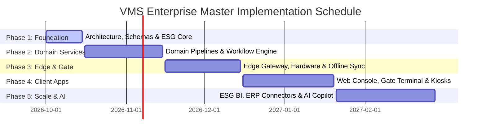

# VMS Enterprise: Multi-Phase Implementation Roadmap

## 1. Roadmap Strategy: Structured Enterprise Progression

To deliver a carrier-grade multi-site platform without premature distributed systems fragility or scope creep, VMS Enterprise is scheduled across five disciplined implementation phases.

---

## 2. Phase-by-Phase Execution Breakdown

### Phase 1: Enterprise Architectural Foundation (Current Scope)
- **Status:** **DELIVERING NOW**
- **Objective:** Establish the validated architectural blueprints, immutable schemas, domain type system, validation contracts, design tokens, and the core cross-cutting ESG/GHG activity capture & calculation kernel.
- **Key Deliverables:**
  1. Complete system, domain, shared services, and integration architecture specifications.
  2. PostgreSQL 16+ normalized relational schema DDL with multi-tenant Row-Level Security (RLS).
  3. Strongly typed domain models and Zod runtime validation schemas.
  4. Normalized Transport Service with independent dimensional vectors.
  5. Source-linked ESG activity capture and versioned emission factor calculation engine.
  6. Fine-grained RBAC/ABAC security and privacy permissions matrix.
  7. Industrial Enterprise UX design tokens.
  8. Automated test suite validating data integrity, derivation provenance, and calculation reproducibility.

### Phase 2: Domain Pipelines & Workflow Orchestration
- **Objective:** Implement the backend modular monolith business pipelines in NestJS.
- **Key Deliverables:**
  1. Independent business services for Visitor, Customer, Contractor, Service, Material, and Vehicle.
  2. Configurable DAG workflow engine with sequential/parallel approvals, SLA timers, and automatic escalations.
  3. Compliance Document Service with S3 envelope encryption and OCR verification adapters.
  4. Outbox pattern processor publishing transactional domain events to Redis Streams.
  5. EHS Permit To Work (PTW) and contractor safety induction modules.

### Phase 3: Physical Gate Execution & Hardware Edge Integration
- **Objective:** Build the local Site Edge Integration Gateway and hardware device adapters.
- **Key Deliverables:**
  1. Vendor-neutral Hardware Abstraction Layer (HAL) for ANPR, QR scanners, biometric face terminals, RFID, boom barriers, and weighbridges.
  2. Offline gate operation engine with encrypted local SQLite caching and 72-hour standalone survival.
  3. Bidirectional edge-to-cloud synchronization with anti-passback and conflict resolution.
  4. Physical Gate Policy Engine separating business eligibility from gate hardware actuation.

### Phase 4: High-Density User Interfaces & Kiosk Applications
- **Objective:** Deploy Next.js presentation clients tailored to specific operational personas.
- **Key Deliverables:**
  1. Enterprise Web Console for Administrative, Host, HR, EHS, and Compliance personnel.
  2. Industrial Split-Screen Gate Terminal App for security guards (keyboard-driven, ANPR stream, rapid gate triggers).
  3. Touch-optimized Self-Service Reception Kiosk with ID camera capture and digital NDA signature canvas.
  4. Host Mobile PWA for instant approval notifications and QR pass viewing.

### Phase 5: Enterprise Integrations, ESG Intelligence & AI Copilot
- **Objective:** Enterprise ERP/HRMS synchronization, automated statutory sustainability reporting, and natural language operational intelligence.
- **Key Deliverables:**
  1. Certified SAP S/4HANA connector for material gate pass and delivery challan reconciliation.
  2. Workday / Darwinbox HRMS automated employee and contractor roster sync.
  3. BRSR (India), SEC (US), and CSRD (EU) compliance export engine for Scope 1 and Scope 3 transport footprints.
  4. AI Operational Copilot for natural language site queries (*"Who is currently in Zone 4?"*, *"Which contractors have expired safety inductions?"*).

---

## 3. Quality Gates & Architectural Governance

Each implementation phase must pass mandatory exit criteria before subsequent phases commence:
- **Zero Schema Overlap:** Strict verification that no domain merges entities into a universal object.
- **Provenance Integrity:** 100% of ESG calculation values must trace back to a source operational transaction with verified provenance (`MEASURED`, `USER_PROVIDED`, or `SYSTEM_ESTIMATED`).
- **Zero Calculation in UI:** Continuous lint rules enforcing that emission multipliers are never invoked in client bundles.
- **Automated Test Coverage:** Minimum 90% unit test coverage for calculation logic, state machine transitions, and ABAC permission masks.
