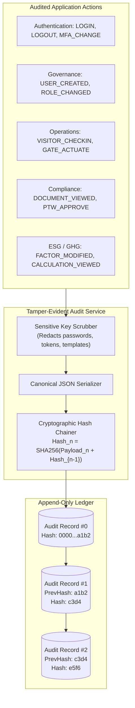
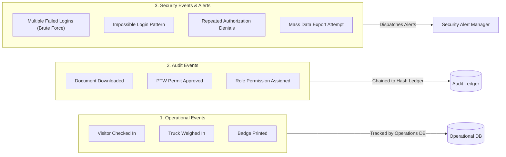

# VMS Enterprise: Tamper-Evident Forensic Audit Architecture

## 1. Audit Principles & Non-Negotiables

VMS Enterprise maintains a comprehensive, immutable, and tamper-evident audit ledger:
1. **Zero Secret Logging**: Passwords, hashes, JWT tokens, session cookies, private encryption keys, and raw facial biometric vectors are strictly scrubbed before persistence.
2. **Cryptographic Tamper-Evidence**: Records are linked in a cryptographic SHA-256 hash chain:
   $$\text{Hash}_n = \text{SHA-256}(\text{CanonicalPayload}_n \parallel \text{Hash}_{n-1})$$
   Any retroactive edit, deletion, or reordering breaks the chain pointer and is detected immediately by `verifyChainIntegrity()`.
3. **Immutability Invariant**: The underlying relational storage engine forbids all `UPDATE` and `DELETE` queries on the `audit_logs` table.

---

## 2. Audit Architecture Diagram (Section 64 - Diagram 8)



---

## 3. Security Event vs Audit Event vs Operational Event (Section 64 - Diagram 12)

VMS Enterprise categorizes system occurrences into three distinct event tiers:



---

## 4. Audit Record Data Schema

```typescript
export interface AuditRecord {
  auditId: string;
  tenantId: string;
  actorUserId: string;
  actorRoleContext: EnterpriseRole;
  action: string;
  entityType: string;
  entityId: string;
  timestamp: Date;
  requestId: string;
  correlationId: string;
  source: string;
  ipMetadata?: string;
  deviceMetadata?: string;
  beforeSnapshot?: Record<string, unknown>;
  afterSnapshot?: Record<string, unknown>;
  reason?: string;
  result: 'SUCCESS' | 'DENIED' | 'FAILED';
  hash: string;
  previousHash?: string;
}
```

---

## 5. Correlation ID Propagation

Every incoming request generates a standardized correlation and request identifier (e.g. `REQ-2026-001001`). This ID propagates across:
- Gateway Ingress → Domain Handlers → Database Transactions → Outbox CloudEvents → Notification Messages → Forensic Audit Records.
In incident investigations, a single correlation ID reconstructs the entire end-to-end execution path.
