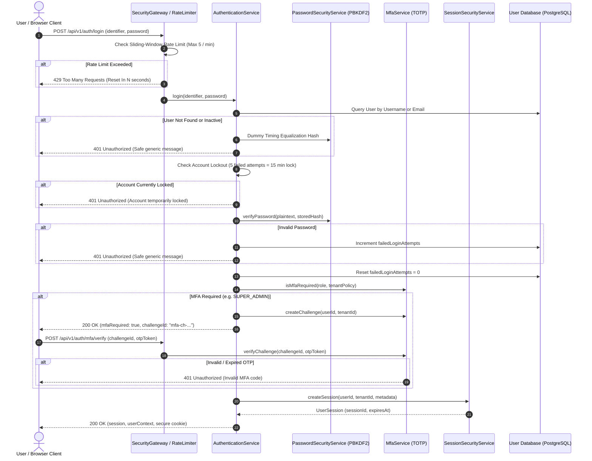

# VMS Enterprise: Authentication Architecture & Lifecycle

## 1. Authentication Architecture Overview

The VMS Enterprise authentication system provides an enterprise-ready, provider-agnostic identity foundation. It supports standard local email/password credentials, multi-factor authentication (MFA), server-side session tracking, brute-force lockout defenses, and is architected for seamless federation with enterprise Single Sign-On (OIDC, SAML 2.0, Microsoft Entra ID, Okta).

---

## 2. Authentication Flow Diagram (Section 64 - Diagram 1)



---

## 3. Password Security & Defense Guidelines

1. **Cryptographic Algorithm**: Passwords are hashed using **PBKDF2-HMAC-SHA512** with 100,000 iterations and a 16-byte cryptographically secure random salt generated via `node:crypto.randomBytes`. Plaintext passwords are never persisted.
2. **Timing-Safe Comparison**: All credential verifications execute via `crypto.timingSafeEqual` over fixed-length buffers. If an identifier does not exist in the database, a dummy calculation executes against a decoy hash to neutralize timing side-channel attacks used to enumerate usernames.
3. **Lockout Policy**:
   - Minimum length: 12 characters.
   - Character classes: Uppercase, lowercase, numeric digits, and special symbols required.
   - Maximum failed attempts: 5 consecutive failures triggers an automatic 15-minute temporary lockout.
4. **Safe Error Handling**: Authentication failure always returns:
   > *"Invalid credentials. Please verify your login details and try again."*
   The system never indicates whether the failure was due to a nonexistent username or an incorrect password.

---

## 4. Multi-Factor Authentication (MFA) Specification

- **Algorithm**: RFC 6238 Time-based One-Time Password (TOTP) utilizing HMAC-SHA1 with 30-second window intervals and a 6-digit numeric token.
- **Drift Tolerance**: ±1 time step (60-second drift tolerance) to support client clock offsets without degrading security.
- **Single-Use Recovery Codes**: Upon enrollment, users receive eight 8-character single-use emergency recovery codes. Each consumed code is immediately invalidated.
- **Role Policy Configuration**:
  - `SUPER_ADMIN`: MFA is mandatory. Login without MFA is blocked.
  - `SECURITY_GUARD` / `GATE_OPERATOR`: Configurable by plant operational security policy.
  - `ESG_MANAGER`: Configurable by corporate IT security baseline.

---

## 5. Enterprise SSO Federation Architecture

The authentication plane is abstracted behind the `IIdentityProvider` interface:

```typescript
export interface IIdentityProvider {
  providerName: string;
  authenticate(credentials: Record<string, unknown>): Promise<{
    authenticated: boolean;
    user?: AuthUserRecord;
    error?: string;
  }>;
}
```

This decoupled interface enables drop-in federation with:
- **OpenID Connect (OIDC)** via authorization code grant with PKCE.
- **SAML 2.0** for corporate Active Directory / ADFS integration.
- **OAuth 2.0 / SCIM** for automated user provisioning and lifecycle synchronization.
